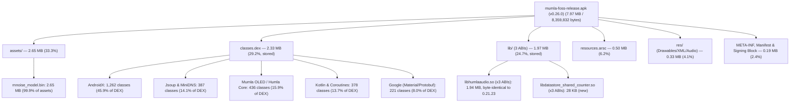
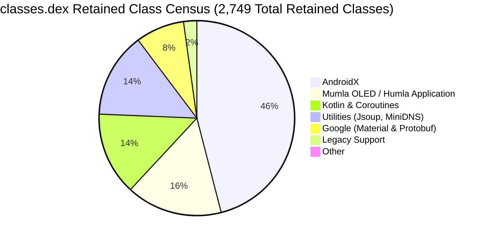
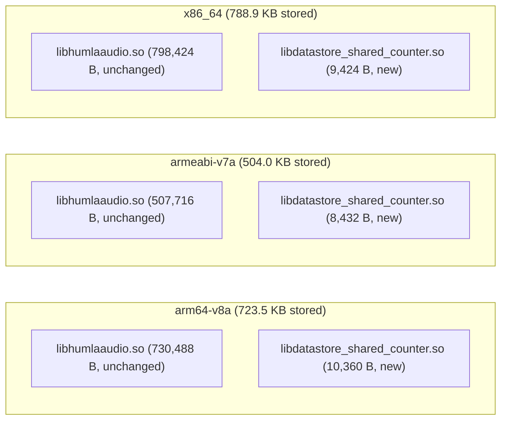

# Mumla OLED Release APK Size Analysis & Binary Footprint Report (0.26.0)

This report provides a comprehensive, quantitative analysis of the binary footprint, package composition, Dalvik bytecode structure, native shared libraries, asset payloads, and resource overhead in the production release APK of **Mumla OLED 0.26.0** ([`mumla-foss-release.apk`](../../app/build/outputs/apk/foss/release/mumla-foss-release.apk)). It is the successor to the [0.21.23 analysis](./README-0.21.23.md) and follows the same methodology so the reports can be compared section by section.

> [!NOTE]
> **Version skew**: the analyzed APK was built from tag `v0.26.0` (`versionCode 3070300`, `versionName 0.26.0` per [`output-metadata.json`](../../app/build/outputs/apk/foss/release/output-metadata.json)). `HEAD` sits two documentation-only commits ahead of the tag, so the binary is representative of the latest release version.

---

## 1. Executive Summary & Top-Level Metrics

The production release artifact is built under the `foss` flavor with ProGuard/R8 minification and resource shrinking enabled.



### Global Artifact Metrics

| Metric | Measured Value | Human Readable | Notes |
| :--- | :--- | :--- | :--- |
| **Analyzed Version** | `0.26.0` (`versionCode 3070300`) | — | Version analyzed in this report (`versionCode` unchanged since 0.21.23) |
| **Download / On-Disk Size (Compressed)** | `8,359,832 bytes` | **7.97 MiB** (~8.4 MB) | Exact byte count of the signed release APK |
| **ZIP Content Payload (Stored + Deflated)** | `8,200,040 bytes` | **7.82 MiB** | Sum of entry streams (DEX and `.so` are now stored, §4–§5) |
| **APK Signing Block, Alignment & ZIP Index Overhead** | `159,792 bytes` | **156.1 KiB** (1.91%) | v2/v3 signatures plus archive index and 4 KiB page-alignment padding |
| **Installed / Unpacked Size (Uncompressed)** | `9,352,967 bytes` | **8.92 MiB** (~9.4 MB) | Sum of all internal uncompressed payload streams |
| **Overall Stored/Compression Ratio** | `87.67%` | — | Ratio of entry streams to uncompressed contents (was 63.54%: DEX/`.so` no longer deflated) |
| **Total Files Inside Archive** | `903 files` | — | Includes classes, shared objects, resources, metadata |
| **Target Application ID** | `se.lublin.mumla.oled15` | — | Configured in [`app/build.gradle`](../../app/build.gradle) |
| **DEX Compilation Strategy** | Single DEX (`classes.dex`) | — | Single DEX **039** archive (was 035); no multidex split |
| **Target ABIs** | `arm64-v8a`, `armeabi-v7a`, `x86_64` | — | Multi-architecture universal FOSS APK |

### Delta vs 0.21.23

| Metric | 0.21.23 | 0.26.0 | Delta |
| :--- | :--- | :--- | :--- |
| **APK on-disk size** | `6,287,152 B` | `8,359,832 B` | **`+2,072,680 B` (+33.0%)** |
| **Unpacked size** | `9,700,152 B` | `9,352,967 B` | **`−347,185 B` (−3.6%)** |
| **File count** | 985 | 903 | −82 files |
| **`classes.dex`** | `1,144,365 B` (deflated) | `2,443,736 B` (**stored**) | **+113.5% on-disk; −2.5% uncompressed** |
| **`lib/` native** | `1,097,613 B` (3 files, deflated) | `2,064,844 B` (6 files, **stored**) | **+88.1% on-disk; +1.4% uncompressed** |
| **`assets/`** | `2,782,035 B` | `2,782,026 B` | −9 B (flat) |
| **`resources.arsc`** | `656,140 B` | `521,876 B` | **−20.5%** |
| **`res/`** | `386,074 B` | `343,147 B` | **−11.1%** |
| **Meta / signatures** | `97,423 B` (+ `123,502 B` overhead) | `44,411 B` (+ `159,792 B` overhead) | −54.4% (v1 JAR signatures dropped, §6) |

The headline paradox of this report: the APK grew by 2 MB on disk while its true payload *shrank* by 0.35 MB. Effectively all of the on-disk growth is a packaging change — `classes.dex` and all six `.so` files are now **stored uncompressed** (zip method 0) instead of deflated, a side effect of the AGP 8 → 9 and `minSdk 21 → 33` migration (which also moved DEX 035 → 039 and dropped v1 JAR signatures). Applying the 0.21.23 deflate ratios to today's uncompressed DEX/`.so` sizes yields a stored-packaging premium of ~2.3 MB, partly offset by ~0.23 MB of genuine shrinkage in `resources.arsc`, `res/`, and metadata. Details follow in §§4–6.

---

## 2. Global Archive Composition Breakdown

The archive contents break down across seven functional categories (percentages of the on-disk APK file):

| Category | Entry-Stream Size | % of Total APK | Uncompressed Size | % of Uncompressed | File Count |
| :--- | :--- | :--- | :--- | :--- | :--- |
| **Assets (`assets/`)** | `2,782,026 B` | **33.28%** | `3,546,556 B` | **37.92%** | 3 |
| **Bytecode (`classes.dex`)** | `2,443,736 B` | **29.23%** | `2,443,736 B` | **26.13%** | 1 |
| **Native Libraries (`lib/`)** | `2,064,844 B` | **24.70%** | `2,064,844 B` | **22.08%** | 6 |
| **Compiled Table (`resources.arsc`)** | `521,876 B` | **6.24%** | `521,876 B` | **5.58%** | 1 |
| **App Resources (`res/`)** | `343,147 B` | **4.10%** | `631,796 B` | **6.76%** | 800 |
| **Signatures, Manifest & Meta** | `44,411 B` | **0.53%** | `144,159 B` | **1.54%** | 92 |
| **Signing Block, Alignment & ZIP Index Overhead** | `159,792 B` | **1.91%** | — | — | — |
| **Total (on-disk APK)** | **`8,359,832 B`** | **100.00%** | **`9,352,967 B`** | **100.00%** | **903** |

*Shares are rounded to two decimals; the uncompressed column totals 100.01% before rounding.*

The structural story since 0.21.23: bytecode and native code now dominate purely through stored packaging (29.2% + 24.7% = 53.9% of the file, vs 35.7% deflated before), while the incompressible RNNoise model fell from 44.3% to 33.3% of the package **without changing by a single byte** (§3).

### Breakdown by File Extension

| Extension | Entry-Stream Size | % APK | Uncompressed Size | File Count | Primary Contents |
| :--- | :--- | :--- | :--- | :--- | :--- |
| `.bin` | `2,781,307 B` | 33.27% | `3,547,358 B` | 3 | RNNoise model weights, coroutine debug probes |
| `.dex` | `2,443,736 B` | 29.23% | `2,443,736 B` | 1 | Application and dependency Dalvik bytecode (**stored**, was deflated) |
| `.so` | `2,064,844 B` | 24.70% | `2,064,844 B` | 6 | Humla native audio engine + DataStore counter (**stored**, were deflated) |
| `.arsc` | `521,876 B` | 6.24% | `521,876 B` | 1 | Compiled resource string & ID lookup table |
| `.xml` | `197,530 B` | 2.36% | `494,960 B` | 548 | Binary Android layouts and vector drawables (+ manifest) |
| `.png` | `139,832 B` | 1.67% | `139,832 B` | 251 | Legacy channel/status icons and splash graphics (−19 files) |
| `.txt` | `25,681 B` | 0.31% | `72,659 B` | 8 | AndroidX LICENSE files (**new**, §6) |
| `.kotlin_builtins` | `12,425 B` | 0.15% | `54,007 B` | 8 | Kotlin runtime reflection metadata (+1 file) |
| `.ogg` | `8,588 B` | 0.10% | `8,588 B` | 2 | Push-to-talk on/off auditory cues (unchanged) |
| `.prof` / `.profm` | `2,236 B` | 0.03% | `2,236 B` | 2 | ART AOT baseline execution profile |
| Other (`.version`, `.properties`, `.textproto`, `LICENSE`, `NOTICE.md`, services) | `1,985 B` | 0.02% | `2,871 B` | 73 | AndroidX version markers, build metadata |

Notable absence versus 0.21.23: the entire `.SF` / `.MF` / `.RSA` row (81,122 B) is gone — v1 JAR signing is unnecessary with `minSdk 33` (raised from 21), so only v2/v3 signatures in the APK Signing Block remain. New arrival: eight `LICENSE.txt` files from Room/DataStore/Lifecycle artifacts (§6).

---

## 3. Deep Dive: Asset Storage & RNNoise Model Payload

The single largest entry inside the entire APK remains [`assets/rnnoise_model.bin`](../../libraries/humla/src/main/assets/rnnoise_model.bin), now accounting for **33.3%** of the entire APK file size — down in share purely because stored DEX/`.so` ballooned around it.

```math
\text{Asset Footprint Ratio} = \frac{\text{Compressed Size of } \texttt{assets/rnnoise\_model.bin}}{\text{Total Compressed APK Size}} = \frac{2,779,790}{8,359,832} \approx 33.25\%
```

### Detailed Asset File Census

| Path | Entry-Stream Size | Uncompressed Size | Compression % | Purpose |
| :--- | :--- | :--- | :--- | :--- |
| `assets/rnnoise_model.bin` | `2,779,790 B` (2.65 MiB) | `3,544,320 B` (3.38 MiB) | 78.43% | Quantized neural network weights for RNNoise |
| `assets/dexopt/baseline.prof` | `1,963 B` (1.92 KiB) | `1,963 B` (1.92 KiB) | 100.00% | ART AOT baseline execution profile (−22 B) |
| `assets/dexopt/baseline.profm` | `273 B` (0.27 KiB) | `273 B` (0.27 KiB) | 100.00% | ART baseline profile metadata (+13 B) |

The model blob is **byte-identical in size** to 0.21.23 (2,779,790 / 3,544,320) — no regeneration this cycle. The `DNNw` container format, 42-tensor inventory, and GRU/convolution/index-table breakdown documented in the 0.18.4 report are unchanged.

### Architectural Synergy with Native Shared Libraries

- **The Multi-ABI Duplication Problem (still solved)**:
  The `-DUSE_WEIGHTS_FILE` build flag in [`libraries/humla/src/main/jni/Android.mk`](../../libraries/humla/src/main/jni/Android.mk) continues to strip static weights from the compiled `.so` binaries. Had the weights been statically linked, they would be triplicated inside the single `libhumlaaudio.so` across all 3 ABIs:

```math
\text{Static Multi-ABI Weight Bloat} = 3 \times 3,544,320\text{ bytes} \approx 10,632,960\text{ bytes} \quad (\approx 10.14\text{ MiB uncompressed})
```

- **Runtime Loading**:
  [`NativeAudioInputEngine.loadRnnoiseModel()`](../../libraries/humla/src/main/java/se/lublin/humla/audio/NativeAudioInputEngine.kt) (now Kotlin, converted in the migration) still reads `rnnoise_model.bin` from Android assets once into a cached byte buffer, passing it across JNI during `AudioInputEngine` initialization. This remains the single most significant size optimization in the project, saving over **7 MB** of compressed APK overhead.

---

## 4. Deep Dive: Dalvik Executable Bytecode (`classes.dex`)

[`classes.dex`](../../app/build/intermediates/dex/fossRelease/minifyFossReleaseWithR8/classes.dex) is now the second largest component at **2.33 MiB stored** (29.23%) — up 1.3 MB on disk from 0.21.23 while its uncompressed payload actually *shrank* 2.5% (2,507,436 → 2,443,736 B). The DEX version moved **035 → 039** with the `minSdk 21 → 33` migration, and the entry is stored uncompressed (zip method 0) rather than deflated.



### Low-Level DEX Header Metrics

Extracted directly from the binary DEX 039 header:

| DEX Header Field | Measured Value | 0.21.23 Value | Android 64K Limit | Margin Remaining |
| :--- | :--- | :--- | :--- | :--- |
| **Class Definitions (`class_defs_size`)** | `2,427` | `2,238` | Unlimited | — |
| **Method References (`method_ids_size`)** | `20,525` | `21,413` | 65,536 | **45,011 methods (68.7% headroom)** |
| **Field References (`field_ids_size`)** | `8,482` | `8,477` | 65,536 | **57,054 fields (87.1% headroom)** |
| **Type IDs (`type_ids_size`)** | `3,439` | `3,290` | 65,536 | 62,097 types |
| **String IDs (`string_ids_size`)** | `14,337` | `14,142` | 65,536 | 51,199 strings |
| **Prototype IDs (`proto_ids_size`)** | `4,744` | `5,029` | 65,536 | 60,792 prototypes |

Method-reference headroom grew from 67.3% to 68.7% despite 189 new class definitions. The application still comfortably fits within a single primary DEX.

### Class Retention Census by Dependency Package

R8 minification and tree shaking (`minifyEnabled = true`) reduced the codebase to **2,749 mapped classes** (2,427 class definitions in the final DEX header) and **170,027 method mappings** — up from 2,423 classes and 152,936 methods. Method mappings are counted as indented `mapping.txt` entries carrying a `->` arrow, excluding 2,851 R8 `#` diagnostic comment lines (fewer than the 7,124 emitted by the older R8 in the 0.21.23 build):

| Package Prefix | Retained Classes | % of Retained Classes | Mapped Methods | % of Mapped Methods | Dominant Role / Purpose |
| :--- | :--- | :--- | :--- | :--- | :--- |
| **`androidx.*`** | **1,262** | **45.91%** | **84,148** | **49.49%** | AppCompat widgets, core shims, fragments, recycler, lifecycle, Room, DataStore |
| **`se.lublin.humla.*`** | **233** | **8.48%** | **14,615** | **8.60%** | Core Mumble protocol engine, audio bridge, crypto (+34 classes, Kotlin conversion) |
| `kotlinx.*` | 208 | 7.57% | 8,625 | 5.07% | Kotlin coroutines runtime (**new**, slice-4 service core) |
| **`se.lublin.mumla.*`** | **203** | **7.38%** | **18,023** | **10.60%** | Android activities, fragments, overlay, preferences, Room DB (+65 classes) |
| `org.minidns.*` | 202 | 7.35% | 3,607 | 2.12% | DNS SRV record lookup for Mumble server discovery (flat) |
| `org.jsoup.*` | 185 | 6.73% | 11,263 | 6.62% | HTML sanitization and message rendering (flat) |
| `kotlin.*` | 170 | 6.18% | 4,864 | 2.86% | Kotlin standard library runtime helpers (+72 classes) |
| `com.google.android.*` | 137 | 4.98% | 13,572 | 7.98% | Material design components, layout widgets (−107 classes, tighter R8) |
| `com.google.protobuf.*` | 84 | 3.06% | 8,911 | 5.24% | Mumble protocol protobuf runtime serialization (4.35.1 → 4.36.2) |
| `android.support.v4.*` | 60 | 2.18% | 1,723 | 1.01% | Legacy support interfaces |
| Other (`_COROUTINE`, `dagger`, `android`) | 5 | 0.18% | 676 | 0.40% | Coroutine debug metadata, Hilt remnants |
| **Total** | **2,749** | **100.00%** | **170,027** | **100.00%** | |

Sub-package detail: `androidx.appcompat` (226, of which `widget` 125), `androidx.core` (222, of which `view` 81), `kotlinx.coroutines` (208, **new**), `androidx.datastore` (168, **new**), `org.jsoup.parser` (114), `androidx.fragment.app` (71), `androidx.recyclerview.widget` (70), `androidx.room` (66, **new**), `androidx.lifecycle` (74), `androidx.emoji2.text` (42). The pre-existing AndroidX internals all shrank (`appcompat.widget` 153 → 125, `core.view` 125 → 81) under the newer R8 while the slice-2/4 dependencies (DataStore, Room, coroutines, lifecycle-service) added ~516 classes.

### What Changed: The Kotlin Migration, Absorbed

Between 0.21.23 and 0.26.0 the entire `:app` and `:libraries:humla` Java codebase was converted to Kotlin and the service layer moved to coroutines with a Room + DataStore settings stack (migration slices 1–5). The DEX census shows this landing at remarkably low cost:

- `se.lublin.mumla.*` +65 classes / +8,598 methods (Kotlin activities/fragments/service, Room `@Database`, DataStore settings, Hilt modules).
- `se.lublin.humla.*` +34 classes / +5,379 methods (Kotlin protocol/audio/crypto, `ConnectionScope` + UDP channel coroutine machinery).
- `kotlinx.*` +206 and `kotlin.*` +72 (coroutines + stdlib for the converted code).
- Offsetting it: `com.google.android.*` −107 classes / −8,532 methods (same `material:1.13.0` pin — the AGP 9 / R8 upgrade shakes unused Material widgets harder, which also prunes their layouts from `res/`, §6), `com.google.protobuf.*` −12 classes, and Hilt shaken down to a single retained class (the runtime is on the classpath but no generated components survive R8 yet).

Note the divergence: mapped method *entries* rose 11% while DEX method *references* fell 4% — Kotlin/coroutine synthetics inflate the mapping while D8/DEX-039 reference dedup keeps the binary count down. Net DEX uncompressed: **−64 KB**.

### The Standing Over-Retention Candidate: MiniDNS

The wildcard in [`app/proguard-rules.pro`](../../app/proguard-rules.pro) is untouched:

```pro
# MiniDNS
-keep class org.minidns.** { *; }
```

All 202 MiniDNS classes are retained (203 in 0.21.23 — flat) — including DNSSEC validation (33 classes), the iterative resolver (13), and DANE (7) that a stub-resolver client almost certainly never touches. Same reflection-driven over-retention pattern BouncyCastle once exhibited. See optimization #3 in §7.

---

## 5. Deep Dive: Native Shared Libraries (`lib/`)

Native binaries represent **1.97 MiB stored** (24.70%) and **1.97 MiB uncompressed** (22.08%) — the entries are stored uncompressed (zip method 0, 4 KiB page-aligned for direct mmap) rather than deflated. The single-library layout from 0.21.23 is unchanged: there is still no `libjniopus.so`, and the per-ABI `libhumlaaudio.so` sizes are **byte-identical to the 0.21.23 uncompressed sizes**, proving the Opus 1.6.1 + RNNoise + OCB2 native code did not change. The only new native arrival is DataStore's shared-counter helper (~28 KB stored across 3 ABIs).



### Detailed Native Library Metrics

| Architecture (ABI) | Library Name | Stored Size | 0.21.23 Deflated Size | Key Functionality |
| :--- | :--- | :--- | :--- | :--- |
| **`arm64-v8a`** | `libhumlaaudio.so` | `730,488 B` (713.4 KB) | `381,914 B` comp | Opus 1.6.1 + RNNoise + OCB2 + engines (ARM64, unchanged) |
| | `libdatastore_shared_counter.so` | `10,360 B` (10.1 KB) | — (**new**) | DataStore multithreaded file-lock counter |
| **`armeabi-v7a`** | `libhumlaaudio.so` | `507,716 B` (495.8 KB) | `322,601 B` comp | Opus 1.6.1 + RNNoise + OCB2 + engines (ARMv7, unchanged) |
| | `libdatastore_shared_counter.so` | `8,432 B` (8.2 KB) | — (**new**) | DataStore multithreaded file-lock counter |
| **`x86_64`** | `libhumlaaudio.so` | `798,424 B` (779.7 KB) | `393,098 B` comp | Opus 1.6.1 + RNNoise + OCB2 + engines (x86-64, unchanged) |
| | `libdatastore_shared_counter.so` | `9,424 B` (9.2 KB) | — (**new**) | DataStore multithreaded file-lock counter |
| **Subtotal (`libhumlaaudio.so`)** | 3 ABIs | **`2,036,628 B` (1.94 MB, identical)** | **`1,097,613 B`** | |
| **Subtotal (`libdatastore*`)** | 3 ABIs | **`28,216 B` (27.6 KB, new)** | — | |
| **Total Native (`lib/`)** | **6 files** | **`2,064,844 B` (1.97 MB)** | **`1,097,613 B`** | |

### Component Analysis

1. **`libhumlaaudio.so` (unchanged)**:
   Opus 1.6.1 statically linked, RNNoise runtime with externalized weights (§3), the C++ audio pipeline (`AudioInputEngine`, `OpusVoiceEncoder`, `RnnoiseProcessor`, `PreSpeechRingBuffer`, `HysteresisVad`, `SoftLimiter`, `AdaptiveLeveler`), the Speex-derived adaptive jitter buffer, the native output mix engine, and native OCB2 crypto — still built with `-ffunction-sections -fdata-sections -fvisibility=hidden -fstack-protector-strong -D_FORTIFY_SOURCE=2`, 16 KiB page alignment (`-Wl,-z,max-page-size=16384`), and whole-archive linking with `--gc-sections` / `--exclude-libs=ALL` per [`libraries/humla/src/main/jni/Android.mk`](../../libraries/humla/src/main/jni/Android.mk). x86_64 remains the largest ABI as in both prior reports.
2. **`libdatastore_shared_counter.so` (new)**:
   Ships inside the `androidx.datastore:datastore-preferences` dependency (migration slice 2) to implement inter-process file-lock counters. At ~28 KB stored it is the only genuine native growth this cycle (+1.4% uncompressed).

---

## 6. Deep Dive: Resources, Assets & Packaging Overhead

### Compiled Resource Table (`resources.arsc`)

- **Size**: `521,876 bytes` (509.64 KiB), stored uncompressed ($6.24\%$ of total APK) — **down 134,264 B (−20.5%)** from 0.21.23.
- **Language Pruning Effect (unchanged)**:
  [`app/build.gradle`](../../app/build.gradle) still defines:
  ```groovy
  resourceConfigurations += ["en", "fr", "zh-rCN"]
  ```
  Restricting compiled localization strings to English, French, and Simplified Chinese continues to save an estimated **450–600 KB** against the unpruned dependency string pool. The additional −134 KB this cycle comes from fewer resources surviving shrinking (below), not from locale changes.

### Application Resource Files (`res/`)

- **Total Payload**: `343,147 bytes` entry-stream (4.10% of APK), `631,796 bytes` uncompressed across **800 files** (−108 files vs 0.21.23).

| Resource Sub-Type | File Count | Entry-Stream Size | Uncompressed Size | Characteristics |
| :--- | :--- | :--- | :--- | :--- |
| **Compiled XML (`.xml`)** | 547 | `~190 KB` | `~472 KB` | Binary XML layouts, vector drawables, state lists, res-only (excl. manifest) (−89 vs 0.21.23) |
| **Bitmaps (`.png`)** | 251 | `139,832 B` (136.6 KB) | `139,832 B` (136.6 KB) | Legacy notification icons, channel emblems (−19 files, −5.7 KB) |
| **Audio cues (`.ogg`)** | 2 | `8,588 B` (8.4 KB) | `8,588 B` (8.4 KB) | PTT on/off earcons, stored uncompressed (unchanged) |

Two drivers explain the shrinkage: the removal of the broken channel-search feature (deleting `ChannelSearchProvider`, both `searchable.xml` files, the search menu item, `SearchView` wiring, `search_suggest_authority`, search strings in all three locales, and `ic_action_search` drawables) and tighter AGP 9 resource shrinking pruning the layouts of the 107 Material classes R8 now discards (§4). The 251 surviving PNGs remain vector-drawable migration candidates (row 6).

### Classpath Baggage & Signature Modernization

The metadata bucket (`44,411 B` entry-stream, `144,159 B` uncompressed, 92 files) was reshaped by two opposing forces:

1. **v1 JAR signatures — GONE** (`−81,122 B` entry-stream, `−182,757 B` uncompressed). No more `.MF` / `.SF` / `.RSA`: with `minSdk 33` (raised from 21), every installed device verifies v2/v3 signatures from the APK Signing Block, so AGP no longer emits JAR-signed manifests. Pure win, zero action required.
2. **AndroidX LICENSE files — NEW** (`+25,681 B` entry-stream, `+72,659 B` uncompressed). Eight `LICENSE.txt` files (7 × ~10 KB Apache-2.0 texts + 1 × 1.4 KB) arrived with the Room/DataStore/Lifecycle artifacts (annotation, collection×2, datastore×3, lifecycle-common, room-common), plus a `META-INF/NOTICE.md` (512 B). Same leak pattern as the old BouncyCastle/JavaCPP baggage, now in license form — see optimization #5.
3. **Surviving / new trivia** (all individually < 4 KB):
   - `DebugProbesKt.bin`: `774 B` entry (`1,728 B` uncomp) — Kotlin coroutine debugger probe dictionary (−8 B).
   - `core/java_features_proto-descriptor-set.proto.bin`: `743 B` entry (`1,310 B` uncomp) — Protobuf descriptor binary (unchanged).
   - `META-INF/jsoup/LICENSE`: `661 B` — still present; the micro-exclusion proposed in 0.21.23 was never applied.
   - 66 AndroidX/coroutines/Hilt/Room/SQLite `.version` markers: `605 B` (+14 files tracking the new dependencies).
   - `META-INF/services/i4.a` / `i4.b`: R8-processed 5-byte service markers (**new**, negligible).
   - `META-INF/version-control-info.textproto`: `118 B` — AGP build provenance stamp (unchanged).
   - `kotlin_builtins` ×8: `12,425 B` entry (`54,007 B` uncomp) — new `atomics.kotlin_builtins` arrived with the Kotlin 2.4 stdlib (+2.3 KB entry).

---

## 7. Actionable Size Optimization Matrix

Updated from the 0.21.23 report: per-ABI splitting is now a much larger lever (stored layout), dependency-baggage removal has *regressed* (new LICENSE leak), and a new packaging item captures the stored-vs-deflated trade-off behind this cycle's on-disk growth.

| Optimization Strategy | Target Component | Estimated Savings (On-Disk) | Status since 0.21.23 | Complexity | Technical Risk & Trade-offs |
| :--- | :--- | :--- | :--- | :--- | :--- |
| **1. Per-ABI APK Splitting** | `lib/` | **~1.32 MB** (~15.8%, arm64 slice) | Open (**lever doubled** under stored layout) | Low | Low risk. Requires publishing multiple APK artifacts (or AAB) rather than a single universal FOSS APK. Largest remaining lever. |
| **2. Stored-vs-Deflated Packaging Evaluation** | `classes.dex` + `lib/` | **~2.3 MB** on-disk (est. via 0.21.23 deflate ratios) | **New** (source of this cycle's +2.07 MB) | Low–Medium | Moderate. Stored + page-aligned entries enable mmap/no-extract install and are AGP 9 defaults at `minSdk 33`; recompressing trades download size against install time. Prefer #1/AAB over recompression. |
| **3. MiniDNS Class Stripping** | `classes.dex` | **~30–60 KB** (~0.4–0.7%) | Open (still `-keep class org.minidns.**`; dnssec 33 + iterative 13 + dane 7 retained) | Medium | Moderate risk. Audit dynamic DNS-record lookups to replace the wildcard with granular rules for SRV resolution. |
| **4. BouncyCastle Removal** | `classes.dex` | **~1,060 KB realized** | ✅ **Done** (unchanged) | — | Realized via in-tree X.509 DER encoder + platform PKCS#12. |
| **5. License-Baggage Exclusion** | `META-INF/` | **~26 KB** (~0.3%) + ~74 KB installed | **New leak** (8 `LICENSE.txt` + `NOTICE.md` arrived with Room/DataStore/Lifecycle) | Trivial | Zero risk. Add `META-INF/**/LICENSE.txt`, `META-INF/NOTICE.md`, and the long-open `META-INF/jsoup/LICENSE` to `packaging.resources.excludes`. |
| **6. Vector Drawable Migration** | `res/` | **~60–85 KB** (~0.7–1.0%) | Open (PNG count 270 → 251) | Medium | Low risk. Convert the 251 legacy PNG icons and drawables to Android vector XML drawables. |
| **7. Model Weight FP16 / Pruning** | `assets/` | **~300–600 KB** (~3.6–7.2%) | Open (model byte-identical; share fell 44.2% → 33.3% on packaging growth) | High | High risk. Requires re-training or fine-tuning the RNNoise GRU layers to verify denoising PESQ/POLQA voice quality does not regress. |

---

## 8. Summary Conclusion

The Mumla OLED 0.26.0 release package at **8.0 MB on disk** is 2 MB larger than 0.21.23 (6.0 MB) — yet its true installed payload is 0.35 MB *smaller* (9.35 vs 9.70 MB). The binary footprint is still dominated by the same specialized components, now joined at the top by stored-packaging overhead rather than new code:

```math
\text{Dominant Payloads} = \underbrace{33.3\%}_{\text{RNNoise Weights}} + \underbrace{29.2\%}_{\text{Dalvik Bytecode (stored)}} + \underbrace{24.7\%}_{\text{Native, stored (3 ABIs)}} = 87.2\% \text{ of Total APK}
```

The defining events between the two reports are infrastructural, not functional: the **AGP 9 + `minSdk 33` migration** moved DEX 035 → 039, switched DEX and `.so` entries to stored/page-aligned packaging (+~2.3 MB on-disk at zero payload cost), and retired v1 JAR signatures (−81 KB) — while the **Kotlin migration with Room + DataStore + coroutines** (+516 retained classes on paper) was fully absorbed by tighter R8 shrinking, leaving DEX *smaller* uncompressed (−64 KB) with fewer method references (−888). Native code and model weights are byte-identical to 0.21.23. With the payload leaner than ever, the optimization frontier is packaging geometry: per-ABI splitting or AAB publishing (~1.3 MB, the largest lever), the stored-vs-deflated trade-off (~2.3 MB, weighed against install performance), a trivial LICENSE exclusion (~26 KB), and the standing MiniDNS keep-rule refinement — the last surviving wildcard-retention hotspot in an otherwise tightly-shaken DEX.
