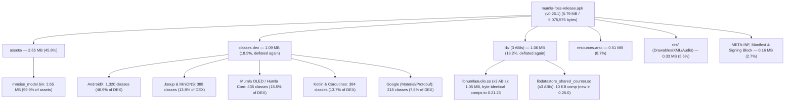
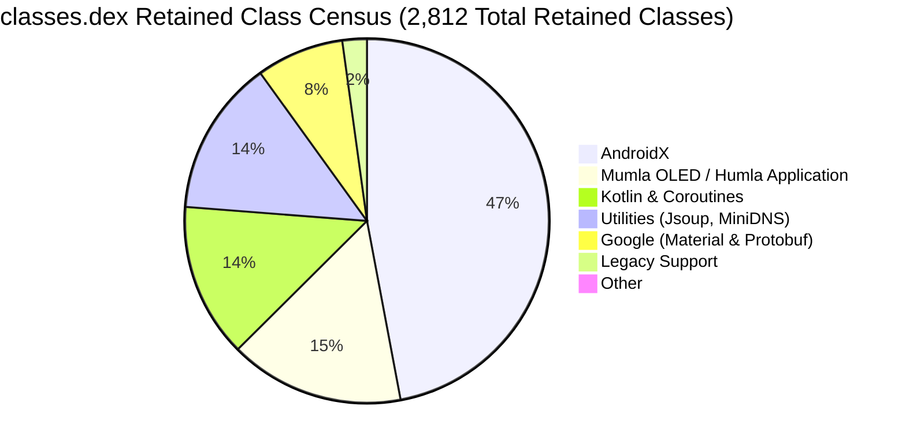
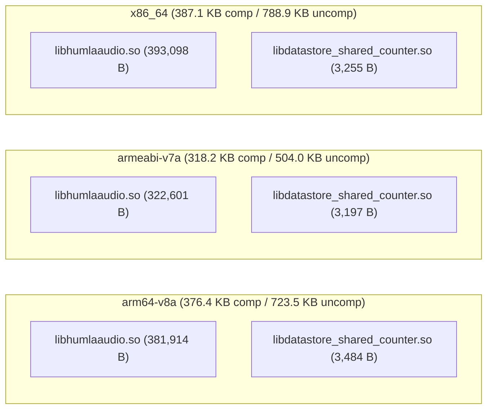

# Mumla OLED Release APK Size Analysis & Binary Footprint Report (0.26.1)

This report provides a comprehensive, quantitative analysis of the binary footprint, package composition, Dalvik bytecode structure, native shared libraries, asset payloads, and resource overhead in the production release APK of **Mumla OLED 0.26.1** ([`mumla-foss-release.apk`](../../app/build/outputs/apk/foss/release/mumla-foss-release.apk)). It is the successor to the [0.26.0 analysis](./README-0.26.0.md) and follows the same methodology so the reports can be compared section by section.

> [!NOTE]
> **No version skew**: the analyzed APK was built from tag `v0.26.1` itself (`versionCode 3070300`, `versionName 0.26.1` per [`output-metadata.json`](../../app/build/outputs/apk/foss/release/output-metadata.json)) — `HEAD` is exactly the tag.

---

## 1. Executive Summary & Top-Level Metrics

The production release artifact is built under the `foss` flavor with ProGuard/R8 minification and resource shrinking enabled.



### Global Artifact Metrics

| Metric | Measured Value | Human Readable | Notes |
| :--- | :--- | :--- | :--- |
| **Analyzed Version** | `0.26.1` (`versionCode 3070300`) | — | Version analyzed in this report (`versionCode` unchanged since 0.21.23) |
| **Download / On-Disk Size (Compressed)** | `6,075,576 bytes` | **5.79 MiB** (~6.1 MB) | Exact byte count of the signed release APK |
| **ZIP Content Payload (Compressed)** | `5,954,446 bytes` | **5.68 MiB** | Sum of compressed entry streams (DEX/`.so` deflated again) |
| **APK Signing Block & ZIP Central Directory** | `121,130 bytes` | **118.3 KiB** (1.99%) | v2/v3 signatures plus archive index overhead |
| **Installed / Unpacked Size (Uncompressed)** | `9,442,926 bytes` | **9.01 MiB** (~9.4 MB) | Sum of all internal uncompressed payload streams |
| **Overall Compression Ratio** | `63.06%` | — | Ratio of compressed content to uncompressed contents (was 87.67%) |
| **Total Files Inside Archive** | `903 files` | — | Unchanged count vs 0.26.0 |
| **Target Application ID** | `se.lublin.mumla.oled15` | — | Configured in [`app/build.gradle`](../../app/build.gradle) |
| **DEX Compilation Strategy** | Single DEX (`classes.dex`) | — | Single DEX **039** archive (retained despite minSdk 30); no multidex split |
| **Target ABIs** | `arm64-v8a`, `armeabi-v7a`, `x86_64` | — | Multi-architecture universal FOSS APK |
| **Minimum SDK** | `30` (lowered from 33) | Android 11+ | Restores Android 11–12 users; legacy SCO + compat shims reintroduced |

### Delta vs 0.26.0

| Metric | 0.26.0 | 0.26.1 | Delta |
| :--- | :--- | :--- | :--- |
| **APK on-disk size** | `8,359,832 B` | `6,075,576 B` | **`−2,284,256 B` (−27.3%)** |
| **Unpacked size** | `9,352,967 B` | `9,442,926 B` | `+89,959 B` (+1.0%, minSdk-30 compat) |
| **File count** | 903 | 903 | Unchanged |
| **`classes.dex`** | `2,443,736 B` (stored) | `1,146,246 B` (deflated) | **−53.1% on-disk; +3.3% uncompressed** |
| **`lib/` native** | `2,064,844 B` (stored) | `1,107,549 B` (deflated) | **−46.4% on-disk; flat uncompressed** |
| **`assets/`** | `2,782,026 B` | `2,782,061 B` | +35 B (profile noise) |
| **`resources.arsc`** | `521,876 B` | `531,032 B` | +1.8% (legacy strings re-added) |
| **`res/`** | `343,147 B` | `343,147 B` | Byte-identical |
| **Meta / signatures** | `44,411 B` (+ `159,792 B` overhead) | `44,411 B` (+ `121,130 B` overhead) | Identical payload; overhead −24.2% |

Two changes explain everything: `packaging.dex.useLegacyPackaging` + `packaging.jniLibs.useLegacyPackaging` (commit `81c3ab90`, citing the 0.26.0 report's §7 #2) restore deflated DEX/`.so` entries, and the minSdk 33 → 30 floor adds ~90 KB of compat payload. The realized −2.28 MB closes the 0.26.0 report's ~2.3 MB stored-packaging estimate to within 9 KB.

### Reconciliation vs 0.21.23

The packaging round-trip makes 0.21.23 the meaningful baseline again:

| Metric | 0.21.23 | 0.26.1 | Delta |
| :--- | :--- | :--- | :--- |
| **APK on-disk size** | `6,287,152 B` | `6,075,576 B` | **`−211,576 B` (−3.4%)** |
| **Unpacked size** | `9,700,152 B` | `9,442,926 B` | **`−257,226 B` (−2.7%)** |
| **`classes.dex`** | `1,144,365 B` / `2,507,436 B` uncomp | `1,146,246 B` / `2,524,504 B` uncomp | +0.2% on-disk / +0.7% uncompressed |
| **`lib/` native** | `1,097,613 B` / `2,036,628 B` uncomp | `1,107,549 B` / `2,064,844 B` uncomp | +0.9% / +1.4% (DataStore counter) |
| **`resources.arsc`** | `656,140 B` | `531,032 B` | **−19.1%** |
| **`res/`** | `386,074 B` | `343,147 B` | **−11.1%** |
| **Meta / signatures** | `97,423 B` | `44,411 B` | **−54.4%** (v1 JAR signatures gone) |

The 0.26.1 package is now *smaller than 0.21.23 on every axis* — on disk (−3.4%) and installed (−2.7%) — while carrying the entire Kotlin migration, Room + DataStore + coroutines, the native OCB2/output-engine work, PTT audio cues, and the new API-30 compatibility shims. DEX is within 2 KB of its 0.21.23 on-disk size.

---

## 2. Global Archive Composition Breakdown

The archive contents break down across seven functional categories (percentages of the on-disk APK file):

| Category | Compressed Size | % of Total APK | Uncompressed Size | % of Uncompressed | File Count |
| :--- | :--- | :--- | :--- | :--- | :--- |
| **Assets (`assets/`)** | `2,782,061 B` | **45.79%** | `3,546,591 B` | **37.56%** | 3 |
| **Bytecode (`classes.dex`)** | `1,146,246 B` | **18.87%** | `2,524,504 B` | **26.73%** | 1 |
| **Native Libraries (`lib/`)** | `1,107,549 B` | **18.23%** | `2,064,844 B` | **21.87%** | 6 |
| **Compiled Table (`resources.arsc`)** | `531,032 B` | **8.74%** | `531,032 B` | **5.62%** | 1 |
| **App Resources (`res/`)** | `343,147 B` | **5.65%** | `631,796 B` | **6.69%** | 800 |
| **Signatures, Manifest & Meta** | `44,411 B` | **0.73%** | `144,159 B` | **1.53%** | 92 |
| **Signing Block & ZIP Index Overhead** | `121,130 B` | **1.99%** | — | — | — |
| **Total (on-disk APK)** | **`6,075,576 B`** | **100.00%** | **`9,442,926 B`** | **100.00%** | **903** |

*Shares are rounded to two decimals; the uncompressed column totals exactly 100.00%.*

Composition is back to the 0.21.23 shape: the incompressible RNNoise model dominates again (45.8%, vs 33.3% under stored packaging), with deflated bytecode and native code back to a combined 37.1%.

### Breakdown by File Extension

| Extension | Compressed Size | % APK | Uncompressed Size | File Count | Primary Contents |
| :--- | :--- | :--- | :--- | :--- | :--- |
| `.bin` | `2,781,307 B` | 45.78% | `3,547,358 B` | 3 | RNNoise model weights, coroutine debug probes |
| `.dex` | `1,146,246 B` | 18.87% | `2,524,504 B` | 1 | Application and dependency Dalvik bytecode (deflated again) |
| `.so` | `1,107,549 B` | 18.23% | `2,064,844 B` | 6 | Humla native audio engine + DataStore counter (deflated again) |
| `.arsc` | `531,032 B` | 8.74% | `531,032 B` | 1 | Compiled resource string & ID lookup table |
| `.xml` | `197,530 B` | 3.25% | `494,960 B` | 548 | Binary Android layouts and vector drawables (+ manifest) |
| `.png` | `139,832 B` | 2.30% | `139,832 B` | 251 | Legacy channel/status icons and splash graphics |
| `.txt` | `25,681 B` | 0.42% | `72,659 B` | 8 | AndroidX LICENSE files (exclusion still unapplied, §6) |
| `.kotlin_builtins` | `12,425 B` | 0.20% | `54,007 B` | 8 | Kotlin runtime reflection metadata |
| `.ogg` | `8,588 B` | 0.14% | `8,588 B` | 2 | Push-to-talk on/off auditory cues (unchanged) |
| `.prof` / `.profm` | `2,271 B` | 0.04% | `2,271 B` | 2 | ART AOT baseline execution profile |
| Other (`.version`, `.properties`, `.textproto`, `LICENSE`, `NOTICE.md`, services) | `1,985 B` | 0.03% | `2,871 B` | 73 | AndroidX version markers, build metadata |

No `.SF` / `.MF` / `.RSA` again — minSdk 30 is still well above the API-24 threshold where v2/v3 signatures suffice, so v1 JAR signing stays off.

---

## 3. Deep Dive: Asset Storage & RNNoise Model Payload

[`assets/rnnoise_model.bin`](../../libraries/humla/src/main/assets/rnnoise_model.bin) is back to being nearly half the package at **45.8%**, up in share purely because deflated DEX/`.so` shrank around it.

```math
\text{Asset Footprint Ratio} = \frac{\text{Compressed Size of } \texttt{assets/rnnoise\_model.bin}}{\text{Total Compressed APK Size}} = \frac{2,779,790}{6,075,576} \approx 45.76\%
```

### Detailed Asset File Census

| Path | Compressed Size | Uncompressed Size | Compression % | Purpose |
| :--- | :--- | :--- | :--- | :--- |
| `assets/rnnoise_model.bin` | `2,779,790 B` (2.65 MiB) | `3,544,320 B` (3.38 MiB) | 78.43% | Quantized neural network weights for RNNoise (byte-identical, third cycle running) |
| `assets/dexopt/baseline.prof` | `2,005 B` (1.96 KiB) | `2,005 B` (1.96 KiB) | 100.00% | ART AOT baseline execution profile (+42 B build noise) |
| `assets/dexopt/baseline.profm` | `266 B` (0.26 KiB) | `266 B` (0.26 KiB) | 100.00% | ART baseline profile metadata (−7 B build noise) |

The model blob is unchanged for the third consecutive report. The `DNNw` container format, 42-tensor inventory, and GRU/convolution/index-table breakdown documented in the 0.18.4 report stand.

### Architectural Synergy with Native Shared Libraries

- **The Multi-ABI Duplication Problem (still solved)**:
  The `-DUSE_WEIGHTS_FILE` build flag in [`libraries/humla/src/main/jni/Android.mk`](../../libraries/humla/src/main/jni/Android.mk) continues to strip static weights from the compiled `.so` binaries:

```math
\text{Static Multi-ABI Weight Bloat} = 3 \times 3,544,320\text{ bytes} \approx 10,632,960\text{ bytes} \quad (\approx 10.14\text{ MiB uncompressed})
```

- **Runtime Loading**:
  [`NativeAudioInputEngine.loadRnnoiseModel()`](../../libraries/humla/src/main/java/se/lublin/humla/audio/NativeAudioInputEngine.kt) still reads `rnnoise_model.bin` from Android assets once into a cached byte buffer, passing it across JNI during `AudioInputEngine` initialization — still saving over **7 MB** of compressed APK overhead.

---

## 4. Deep Dive: Dalvik Executable Bytecode (`classes.dex`)

[`classes.dex`](../../app/build/intermediates/dex/fossRelease/minifyFossReleaseWithR8/classes.dex) is back to **1.09 MiB compressed** (18.87%) and **2.41 MiB uncompressed** (26.73%) — within 2 KB of its 0.21.23 on-disk size. DEX 039 is retained despite the minSdk 30 floor, and the entry is deflated again (zip method 8).



### Low-Level DEX Header Metrics

Extracted directly from the binary DEX 039 header:

| DEX Header Field | Measured Value | 0.26.0 Value | Android 64K Limit | Margin Remaining |
| :--- | :--- | :--- | :--- | :--- |
| **Class Definitions (`class_defs_size`)** | `2,476` | `2,427` | Unlimited | — |
| **Method References (`method_ids_size`)** | `21,334` | `20,525` | 65,536 | **44,202 methods (67.5% headroom)** |
| **Field References (`field_ids_size`)** | `8,598` | `8,482` | 65,536 | **56,938 fields (86.9% headroom)** |
| **Type IDs (`type_ids_size`)** | `3,498` | `3,439` | 65,536 | 62,038 types |
| **String IDs (`string_ids_size`)** | `14,563` | `14,337` | 65,536 | 50,973 strings |
| **Prototype IDs (`proto_ids_size`)** | `5,159` | `4,744` | 65,536 | 60,377 prototypes |

Headroom is essentially unchanged (67.5% vs 68.7%). The application still comfortably fits within a single primary DEX.

### Class Retention Census by Dependency Package

R8 minification and tree shaking (`minifyEnabled = true`) reduced the codebase to **2,812 mapped classes** (2,476 class definitions in the final DEX header) and **163,081 method mappings** (indented `->` entries, excluding 2,919 R8 `#` diagnostic lines):

| Package Prefix | Retained Classes | Δ vs 0.26.0 | Mapped Methods | Δ vs 0.26.0 | Dominant Role / Purpose |
| :--- | :--- | :--- | :--- | :--- | :--- |
| **`androidx.*`** | **1,320** | +58 | **84,442** | +294 | AppCompat, core shims, Room, DataStore, lifecycle (compat cost lands here) |
| **`se.lublin.humla.*`** | **233** | 0 | **13,096** | −1,519 | Core protocol engine, audio bridge, crypto (class count flat) |
| `kotlinx.*` | 211 | +3 | 8,421 | −204 | Kotlin coroutines runtime |
| `org.minidns.*` | 203 | +1 | 3,621 | +14 | DNS SRV lookup (flat; wildcard keep unchanged) |
| **`se.lublin.mumla.*`** | **202** | −1 | **14,895** | −3,128 | Activities, fragments, overlay, preferences, Room DB |
| `org.jsoup.*` | 185 | 0 | 10,007 | −1,256 | HTML sanitization (flat classes) |
| `kotlin.*` | 173 | +3 | 4,160 | −704 | Kotlin stdlib runtime |
| `com.google.android.*` | 135 | −2 | 12,665 | −907 | Material components (same 1.13.0 pin) |
| `com.google.protobuf.*` | 83 | −1 | 8,717 | −194 | Protobuf runtime (4.36.2) |
| `android.support.v4.*` | 61 | +1 | 1,942 | +219 | Legacy support interfaces |
| Other (`_COROUTINE`, `android`) | 6 | +1 | 1,115 | +439 | Coroutine metadata, platform-bridging helpers (Hilt fully shaken out) |
| **Total** | **2,812** | **+63** | **163,081** | **−6,946** | |

Sub-package detail (movers vs 0.26.0): `androidx.core` 240 (+18), `androidx.room` 93 (+27), `androidx.appcompat` 230 (+4), `androidx.sqlite` 29 (+4), `androidx.datastore` 169 (+1), `androidx.lifecycle` 74 (flat), `androidx.fragment` 73 (+1), `androidx.recyclerview` 69 (−2). App code is essentially untouched (humla ±0, mumla −1); the +63 classes concentrate in `androidx.core` desugaring/compat shims and Room's multi-API implementation retention for the lowered floor.

Note the divergence running opposite to last cycle: mapped method *entries* fell 4% while DEX method *references* rose 4% — the floor-lowering shims land platform-bridging refs in DEX outside mapped-method accounting, consistent with D8 desugaring for API 30. Net DEX uncompressed: **+81 KB**, the measured price of restoring Android 11–12 users.

### The Standing Over-Retention Candidate: MiniDNS

The wildcard in [`app/proguard-rules.pro`](../../app/proguard-rules.pro) survives its third report:

```pro
# MiniDNS
-keep class org.minidns.** { *; }
```

All 203 MiniDNS classes retained (202 → 203, noise) — DNSSEC, iterative-resolver, and DANE machinery included. See optimization #3 in §7.

---

## 5. Deep Dive: Native Shared Libraries (`lib/`)

Native binaries are back to **1.06 MiB compressed** (18.23%) and **1.97 MiB uncompressed** (21.87%) — deflated (zip method 8) with the same per-ABI profile as 0.21.23. The headline verification: every `libhumlaaudio.so` **compressed size is byte-identical to 0.21.23** (381,914 / 322,601 / 393,098), confirming the native codec/DSP/crypto code did not change across either 0.26.x release — only packaging moved.



### Detailed Native Library Metrics

| Architecture (ABI) | Library Name | Compressed Size | Uncompressed Size | Deflate Savings | Key Functionality |
| :--- | :--- | :--- | :--- | :--- | :--- |
| **`arm64-v8a`** | `libhumlaaudio.so` | `381,914 B` (373.0 KB) | `730,488 B` (713.4 KB) | 47.7% | Opus 1.6.1 + RNNoise + OCB2 + engines (unchanged) |
| | `libdatastore_shared_counter.so` | `3,484 B` (3.4 KB) | `10,360 B` (10.1 KB) | 66.4% | DataStore file-lock counter |
| **`armeabi-v7a`** | `libhumlaaudio.so` | `322,601 B` (315.0 KB) | `507,716 B` (495.8 KB) | 36.5% | Opus 1.6.1 + RNNoise + OCB2 + engines (unchanged) |
| | `libdatastore_shared_counter.so` | `3,197 B` (3.1 KB) | `8,432 B` (8.2 KB) | 62.1% | DataStore file-lock counter |
| **`x86_64`** | `libhumlaaudio.so` | `393,098 B` (383.9 KB) | `798,424 B` (779.7 KB) | 50.8% | Opus 1.6.1 + RNNoise + OCB2 + engines (unchanged) |
| | `libdatastore_shared_counter.so` | `3,255 B` (3.2 KB) | `9,424 B` (9.2 KB) | 65.5% | DataStore file-lock counter |
| **Subtotal (`libhumlaaudio.so`)** | 3 ABIs | **`1,097,613 B` (1.05 MB, identical to 0.21.23)** | **`2,036,628 B`** | 46.1% | |
| **Subtotal (`libdatastore*`)** | 3 ABIs | **`9,936 B` (9.7 KB)** | **`28,216 B`** | 64.8% | |
| **Total Native (`lib/`)** | **6 files** | **`1,107,549 B` (1.06 MB)** | **`2,064,844 B` (1.97 MB)** | **46.4%** | |

### Component Analysis

1. **`libhumlaaudio.so` (unchanged, third cycle)**:
   Opus 1.6.1 statically linked, RNNoise runtime with externalized weights (§3), the C++ audio pipeline, jitter buffer, output mix engine, and native OCB2 crypto — same flags (`-ffunction-sections -fdata-sections -fvisibility=hidden -fstack-protector-strong -D_FORTIFY_SOURCE=2`, 16 KiB page alignment, `--gc-sections` / `--exclude-libs=ALL`).
2. **Packaging flip (`81c3ab90`)**:
   `packaging.dex.useLegacyPackaging` + `packaging.jniLibs.useLegacyPackaging` in `:app` opt back into deflated entries; the manifest merger flips `extractNativeLibs` false → true automatically while `resources.arsc` stays stored as required. Accepted trade-off: download −2.28 MB against install-time extraction and a larger installed footprint instead of page-aligned mmap — the right call for a universally-downloaded FOSS APK with no store to split per-ABI.

---

## 6. Deep Dive: Resources, Assets & Packaging Overhead

### Compiled Resource Table (`resources.arsc`)

- **Size**: `531,032 bytes` (518.59 KiB), stored uncompressed ($8.74\%$ of total APK) — **+9,156 B (+1.8%)** vs 0.26.0, the legacy strings re-added for API 30–32 (permission flows, SCO fallback copy).
- **Language Pruning Effect (unchanged)**:
  [`app/build.gradle`](../../app/build.gradle) still defines:
  ```groovy
  resourceConfigurations += ["en", "fr", "zh-rCN"]
  ```
  The estimated **450–600 KB** saving against the unpruned dependency string pool stands.

### Application Resource Files (`res/`)

- **Total Payload**: `343,147 bytes` compressed (5.65% of APK), `631,796 bytes` uncompressed across **800 files** — **byte-identical aggregates to 0.26.0** (same counts, same sizes per sub-type).

| Resource Sub-Type | File Count | Compressed Size | Uncompressed Size | Characteristics |
| :--- | :--- | :--- | :--- | :--- |
| **Compiled XML (`.xml`)** | 547 | `~190 KB` | `~472 KB` | Binary XML layouts, vector drawables, state lists, res-only (excl. manifest) |
| **Bitmaps (`.png`)** | 251 | `139,832 B` (136.6 KB) | `139,832 B` (136.6 KB) | Legacy notification icons, channel emblems |
| **Audio cues (`.ogg`)** | 2 | `8,588 B` (8.4 KB) | `8,588 B` (8.4 KB) | PTT on/off earcons, stored uncompressed (unchanged) |

The 251 PNGs remain vector-drawable migration candidates (row 6).

### Classpath Baggage & Packaging (Unchanged)

The metadata bucket is identical in compressed payload to 0.26.0 (`44,411 B` / `144,159 B` / 92 files): v1 JAR signatures still absent (minSdk 30 ≥ API 24, so v2/v3 suffice), and the eight AndroidX `LICENSE.txt` files (`25,681 B` / `72,659 B`) plus `META-INF/jsoup/LICENSE` still await the `packaging.resources.excludes` entry proposed two reports ago — see optimization #5. `DebugProbesKt.bin` (774 B), the protobuf descriptor (743 B), 66 `.version` markers, and the AGP provenance stamp are all unchanged.

---

## 7. Actionable Size Optimization Matrix

Updated from the 0.26.0 report: item #2 is now **done** (realized −2.28 MB, estimate closed within 9 KB), per-ABI splitting reverts to its deflated-layout value, and MiniDNS + LICENSE + PNG + model rows carry over.

| Optimization Strategy | Target Component | Estimated Savings (Compressed) | Status since 0.26.0 | Complexity | Technical Risk & Trade-offs |
| :--- | :--- | :--- | :--- | :--- | :--- |
| **1. Per-ABI APK Splitting** | `lib/` | **~722 KB** (~11.9%, arm64 slice) | Open (lever back to deflated value) | Low | Low risk. Requires publishing multiple APK artifacts (or AAB) rather than a single universal FOSS APK. Weaker case than at 0.26.0: direct-download users benefit more from one small universal file. |
| **2. Stored-vs-Deflated Packaging** | `classes.dex` + `lib/` | **~2,280 KB realized** | ✅ **Done** (`81c3ab90`) | — | Realized via `useLegacyPackaging` for dex + jniLibs; install-time extraction accepted. 0.26.0 estimate (~2.3 MB) closed within 9 KB. |
| **3. MiniDNS Class Stripping** | `classes.dex` | **~30–60 KB** (~0.5–1.0%) | Open (still `-keep class org.minidns.**`, 203 classes) | Medium | Moderate risk. Audit dynamic DNS-record lookups to replace the wildcard with granular rules for SRV resolution. |
| **4. BouncyCastle Removal** | `classes.dex` | **~1,060 KB realized** | ✅ **Done** (unchanged) | — | Realized via in-tree X.509 DER encoder + platform PKCS#12. |
| **5. License-Baggage Exclusion** | `META-INF/` | **~26 KB** (~0.4%) + ~74 KB installed | Open (**unapplied two cycles running**) | Trivial | Zero risk. Add `META-INF/**/LICENSE.txt`, `META-INF/NOTICE.md`, and `META-INF/jsoup/LICENSE` to `packaging.resources.excludes`. |
| **6. Vector Drawable Migration** | `res/` | **~60–85 KB** (~1.0–1.4%) | Open (PNG count still 251) | Medium | Low risk. Convert the 251 legacy PNG icons and drawables to Android vector XML drawables. |
| **7. Model Weight FP16 / Pruning** | `assets/` | **~300–600 KB** (~4.9–9.9%) | Open (model byte-identical; share back to 45.8%) | High | High risk. Requires re-training or fine-tuning the RNNoise GRU layers to verify denoising PESQ/POLQA voice quality does not regress. |

---

## 8. Summary Conclusion

The Mumla OLED 0.26.1 release package at **5.8 MB** closes the 0.26.0 packaging detour in full: −27.3% on disk, back within 2 KB of the 0.21.23 DEX size, and now smaller than 0.21.23 on *every* axis (−3.4% on-disk, −2.7% installed) while carrying the Kotlin migration, Room + DataStore + coroutines, native OCB2/output-engine work, PTT cues, and new API-30 compatibility shims:

```math
\text{Dominant Payloads} = \underbrace{45.8\%}_{\text{RNNoise Weights}} + \underbrace{18.9\%}_{\text{Dalvik Bytecode}} + \underbrace{18.2\%}_{\text{Native (3 ABIs)}} = 82.9\% \text{ of Total APK}
```

The two-cycle arc vindicates the report series' purpose: the 0.26.0 analysis quantified a ~2.3 MB stored-packaging premium, and the 0.26.1 fix realized −2.28 MB against it (estimate closed within 9 KB). With packaging geometry settled, the frontier returns to payload: MiniDNS keep-rule refinement (the last wildcard hotspot), the trivial LICENSE exclusion (unapplied twice), PNG vector migration, and model quantization — while the ~90 KB minSdk-30 compat cost stands as the measured price of restoring Android 11–12 users.
