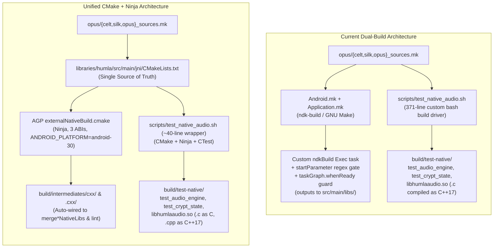

# Native Build Rewrite to CMake: Investigation & Blueprint

Snapshot: commit `b9b46452`, 2026-11-07 (`master`).

Subjects:
- [`libraries/humla/src/main/jni/Android.mk`](../../libraries/humla/src/main/jni/Android.mk)
- [`libraries/humla/src/main/jni/Application.mk`](../../libraries/humla/src/main/jni/Application.mk)
- [`libraries/humla/build.gradle`](../../libraries/humla/build.gradle)
- [`scripts/test_native_audio.sh`](../../scripts/test_native_audio.sh)
- [`flake.nix`](../../flake.nix)

---

## Executive Verdict

Rewriting the Mumla OLED native build from `ndk-build` (`Android.mk` + `Application.mk`) and the custom bash build driver (`scripts/test_native_audio.sh`) to **CMake + Ninja** is **strongly recommended and low-risk**, provided six specific NDK, AGP, and Nix toolchain subtleties documented in this report are handled explicitly.

Today, Mumla OLED maintains **two disjoint native build systems** for the same C/C++ codebase:
1. **Android NDK build (`ndk-build`)**: [`Android.mk`](../../libraries/humla/src/main/jni/Android.mk) and [`Application.mk`](../../libraries/humla/src/main/jni/Application.mk) (140 lines total), invoked by a 2014-era custom `Exec` task (`ndkBuild`) in [`libraries/humla/build.gradle`](../../libraries/humla/build.gradle) that writes `.so` outputs into `src/main/libs/` inside the source tree and relies on a `gradle.startParameter.taskNames` regex gate plus a `gradle.taskGraph.whenReady` fail-closed guard.
2. **Host C++ test & host JNI build**: [`scripts/test_native_audio.sh`](../../scripts/test_native_audio.sh) (371 lines of custom bash implementing mtime/epoch dependency tracking, directory-wide header-set checksumming, toolchain fingerprinting, `sed` `.mk` parsing, and manual background job batching).

A single [`libraries/humla/src/main/jni/CMakeLists.txt`](04-migration-blueprint-and-pitfalls.md#1-complete-librarieshumlasrcmainjnicmakeliststxt) (~145 lines) can serve as the single source of truth for **both**:
- **Android NDK packaging** via AGP 9.0.1's first-class `externalNativeBuild.cmake` across `arm64-v8a`, `armeabi-v7a`, and `x86_64`.
- **Host C++ unit/interop/fuzz testing and host JNI compilation** (`test_audio_engine`, `test_crypt_state`, and host `libhumlaaudio.so`/`.dylib`) via CMake + Ninja + CTest.

Crucially, **the existing Nix Android SDK composition in [`flake.nix`](../../flake.nix) already ships CMake `4.1.2`, Ninja `1.12.1`, and CTest `4.1.2`** under `$ANDROID_HOME/cmake/4.1.2/bin/` by default—requiring **zero `flake.lock` changes or new Nix store downloads**.

---

## Summary Comparison Matrix

| Dimension | Current (`ndk-build` + Custom Bash) | Rewritten to CMake (`CMakeLists.txt` + Ninja) |
| :--- | :--- | :--- |
| **Build definitions** | Split across `Android.mk`, `Application.mk`, and 371-line `test_native_audio.sh` | Single `libraries/humla/src/main/jni/CMakeLists.txt` |
| **AGP task wiring** | Manual `Exec` task + `startParameter` regex + `whenReady` guard | First-class `externalNativeBuild.cmake` (zero custom guards) |
| **`./gradlew lintFossDebug`** | **Broken on `master`** (trips `whenReady` guard at line 278) | **Fixed** (AGP wires `buildCMakeDebug` to lint AAR automatically) |
| **Direct packaging subtasks** | **Broken on `master`** (`mergeDebugJniLibFolders` trips guard) | **Fixed** (task-output `DirectoryProperty` edges) |
| **Source tree hygiene** | Writes `.so` and `.o` into `src/main/libs/` and `src/main/obj/` | All outputs under `build/` and `.cxx/` |
| **Host `.c` compilation** | Compiles `.c` files (`opus/`, `jitter.c`) as C++17 (`g++ -std=c++17`) | Compiles `.c` files as C (`gcc`) and `.cpp` as C++17 (`g++`) |
| **Host header dep tracking** | Coarse directory-wide mtime/checksum (1 header edit rebuilds ~155 TUs) | Exact per-TU `-MD -MF` depfiles in `.ninja_deps` (rebuilds 2–4 TUs) |
| **Warm `ccache` worktree rebuild** | ~3–18 s (81.67% historical miss rate without `CCACHE_BASEDIR`) | **`0.33 s`** (with `CCACHE_BASEDIR` + `CMAKE_<LANG>_COMPILER_LAUNCHER`) |
| **No-op incremental host check** | ~150–250 ms (`find` + `stat` + `cksum` in bash) | **`5 ms`** (`ninja: no work to do`) |
| **Stripped `.so` size (`arm64-v8a`)** | `730,632 B` (`android-21`) | `730,632 B` (`android-21`, `0 B` $\Delta$) / `730,088 B` (`android-30`, `−544 B`) |
| **Stripped `.so` size (`armeabi-v7a`)** | `507,812 B` (`android-21`) | `507,228 B` (`android-21`, `−584 B`) / `506,592 B` (`android-30`, `−1,220 B`) |
| **Stripped `.so` size (`x86_64`)** | `798,568 B` (`android-21`) | `798,568 B` (`android-21`, `0 B` $\Delta$) / `798,016 B` (`android-30`, `−552 B`) |
| **Nix `flake.lock` impact** | N/A | **None** (`$ANDROID_HOME/cmake/4.1.2/bin` is already in the dev shell) |

---

## Report Structure

This investigation is organized into four companion documents:

| Document | Focus |
| :--- | :--- |
| [01-current-architecture-and-pain-points.md](01-current-architecture-and-pain-points.md) | Root-cause audit of the current dual-build architecture: the 2014 `ndkBuild` Exec task, the `lintFossDebug` guard failure on `master`, C-as-C++ drift and coarse header invalidation in `test_native_audio.sh`, and the 81.67% cross-worktree `ccache` miss rate. |
| [02-submodules-and-toolchain-parity.md](02-submodules-and-toolchain-parity.md) | Third-party submodule integration (`opus` v1.6.1 and `rnnoise`), why `add_subdirectory(opus)` is a trap, flag and internal header isolation (`arch.h`, `pitch.h`, `kiss_fft.h`, `-DUSE_WEIGHTS_FILE`), and the complete flag parity matrix between `ndk-build` and NDK 27's `android.toolchain.cmake`. |
| [03-empirical-benchmarks-and-verification.md](03-empirical-benchmarks-and-verification.md) | Quantitative measurements from the prototype CMake + Ninja build: byte-exact `.so` size comparisons at `android-21` and `android-30`, ELF segment and `.dynsym` inspections, AGP 9.0.1 `--dry-run` task-graph verification, host build/test timings, and cross-worktree `ccache` hit-rate proofs. |
| [04-migration-blueprint-and-pitfalls.md](04-migration-blueprint-and-pitfalls.md) | The six migration pitfalls and their mitigations, complete ready-to-land files (`CMakeLists.txt`, `libraries/humla/build.gradle`, `scripts/test_native_audio.sh`, `flake.nix`, `.gitignore`), and the pre-completion verification checklist. |
