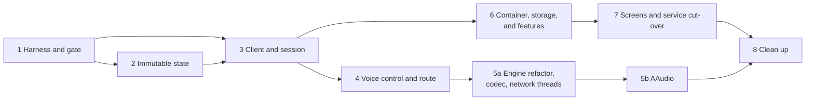

# Migration

Part of the [target architecture](README.md). Sets the step order, the
rules every step follows, the kill criteria, and the decisions this work
reverses. Each step's commits and done-when list live in its own file
under [`steps/`](steps/); progress is tracked in
[`PROGRESS.md`](PROGRESS.md).

## Steps

| Step | Status |
|---|---|
| [1 Harness and gate](steps/1-harness-and-gate.md) | done |
| [2 Immutable state](steps/2-immutable-state.md) | done |
| [3 Client and session](steps/3-client-and-session.md) | done |
| [4 Voice control and route](steps/4-voice-control-and-route.md) | done |
| [5a Engine refactor, codec, network threads](steps/5a-engine-refactor-codec-network-threads.md) | done |
| [5b AAudio](steps/5b-aaudio.md) | done |
| [6 Container, storage, and features](steps/6-container-storage-and-features.md) | done |
| [7 Screens and service cut-over](steps/7-screens-and-service-cut-over.md) | done |
| [8 Clean up](steps/8-clean-up.md) | done |

The step files of finished steps are records of the plan as it was
executed. They are not updated to track later code; the living specs
(`state.md`, `voice.md`, `app.md`, and the rest) hold the current design.

## Ground rules

- Each step runs in its own worktree (`./scripts/worktree.py add …`) and
  lands as atomic commits, each passing `./scripts/check.sh`.
- A step is **done** when its done-when list holds, the allowlist has
  shrunk as stated, and its row in `PROGRESS.md` is updated. On-device
  testing is at the developer's discretion (see
  [testing](testing.md#on-device-testing)). Merging is a separate,
  user-requested action, as always.
- **Done-when is executable and never deferred.** Every done-when
  includes at least one check that executes what the step makes live
  (not only unit tests of its parts). If a done-when item or kill
  criterion fails, the step stops: either fix it, or change the spec in
  a separate commit on `master` first. A rationale in `PROGRESS.md` is
  not a substitute for a result.
- **Invariants name their detector.** A step that states an invariant in a
  header comment or a spec section (nothing allocates on the capture
  thread; one owner of the socket; no lock across the render path) names
  that invariant in its done-when together with the object that fails
  when it stops holding: a check in `scripts/check_architecture.py`, an
  entry in `scripts/architecture-allowlist.txt`, or a test whose scope is
  the same as the sentence. A test that passes without covering the
  statement is not coverage: in 5a.1 the allocation rule was true of
  `processFrame` and false of `reset` for the whole step, and the golden
  fixtures could not see the difference. Where no such object can be
  built, narrow the invariant as it is written. The rule's evidence is
  that `SINGLE_THREADED_ENGINE`, the only invariant given a named object,
  needed no review-round correction.
- **A step branch does not edit the design it implements.** Changes to
  a step's own spec (its step file, and the threads, invariants, and
  realtime rules it relies on in the living specs) land on `master` as
  standalone docs commits, reviewed as design changes, before code
  depends on them. A reviewer who finds the code diverging from the spec
  reports a broken rule; the fix restores the rule, or the spec change
  goes to `master` first.
- **Review rounds are capped.** If a third review round still returns
  branch-killing findings (production path dead, gate not exercising the
  code, a fix regressing an earlier fix), stop and re-slice the step
  instead of running a fourth.
- Every step leaves a working app. Step 7 needs step 6; step 8 needs
  steps 5b and 7.
- **Main-thread assertion.** Every method that may block (stream start
  and stop, platform route calls, thread joins) starts with
  `checkNotMainThread()`, a small helper that throws in debug builds and
  logs in release builds.
- Spikes run in throwaway worktrees before the step that depends on them,
  and their findings are written into the relevant spec file before the
  step starts.

## Kill criteria

Each step file states its own kill criterion, if it has one. For every
step:

- If a file cannot leave the allowlist without new coordination
  machinery, treat it as a design problem and revisit the spec, not the
  code.

## Decisions this reverses

Updated in the branch of the step that reverses them:

| Decision (where recorded) | Replaced by | Step |
|---|---|---|
| Native fence: "C++ frozen, no behavior touch" ([migration README](../migration/README.md)) | The engine stays free of I/O; it may be refactored, pinned by golden outputs | 5a, 7 (done; the old README stays as written) |
| "No Oboe/AAudio" in the audio pipeline description ([`AGENTS.md`](../../AGENTS.md)) | AAudio, callback mode, for capture and playback | 5b (recorded) |
| Frozen binder surface `IMumlaService`/`IHumlaService`/`IHumlaSession` ([migration README](../migration/README.md)) | Removed; screens and features collect flows | 7 (done) |
| Hilt as the DI framework ([migration slices](../migration/slices.md)) | Hand-written `AppContainer` | 6 |
