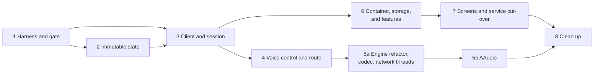

# Migration

Part of the [target architecture](README.md). Specifies the step order,
the commits inside each step, what "done" means, the spikes that gate
steps, the kill criteria, and the decisions this work reverses.

## Ground rules

- Each step runs in its own worktree (`./scripts/worktree.py add …`) and
  lands as atomic commits, each passing `./scripts/check.sh`.
- A step is **done** when its done-when list holds, the allowlist has
  shrunk as stated, and its row in `PROGRESS.md` is updated. On-device
  testing is at the developer's discretion (see
  [testing](testing.md#on-device-testing)). Merging is a separate,
  user-requested action, as always.
- **Done-when is executable and never deferred.** Every done-when
  includes at least one check that executes what the step makes live
  (not only unit tests of its parts). If a done-when item or kill
  criterion fails, the step stops: either fix it, or change the spec in
  a separate commit on `master` first. A rationale in `PROGRESS.md` is
  not a substitute for a result.
- **Invariants name their detector.** A step that states an invariant in a
  header comment or a spec section (nothing allocates on the capture
  thread; one owner of the socket; no lock across the render path) names
  that invariant in its done-when together with the object that fails
  when it stops holding: a check in `scripts/check_architecture.py`, an
  entry in `scripts/architecture-allowlist.txt`, or a test whose scope is
  the same as the sentence. A test that passes without covering the
  statement is not coverage: in 5a.1 the allocation rule was true of
  `processFrame` and false of `reset` for the whole step, and the golden
  fixtures could not see the difference. Where no such object can be
  built, narrow the invariant as it is written. The rule's evidence is
  that `SINGLE_THREADED_ENGINE`, the only invariant given a named object,
  needed no review-round correction.
- **A step branch does not edit the design it implements.** Changes to
  a step's own spec sections (threads, invariants, realtime rules,
  done-when) land on `master` as standalone docs commits, reviewed as
  design changes, before code depends on them. A reviewer who finds the
  code diverging from the spec reports a broken rule; the fix restores
  the rule, or the spec change goes to `master` first.
- **Review rounds are capped.** If a third review round still returns
  branch-killing findings (production path dead, gate not exercising the
  code, a fix regressing an earlier fix), stop and re-slice the step
  instead of running a fourth.
- Every step leaves a working app. Steps 2–5 are each worth landing
  alone. Step 6 needs step 3; step 7 needs step 6. Step 5b is independent
  of steps 6 and 7. Step 8 needs it: step 8's done-when allows only
  boundary files on the allowlist, and `AudioInput` and `AudioOutput` are
  not boundary files.
- Until step 7, today's `ConfigDelta` path keeps applying settings live:
  `HumlaService.apply` stays as a bridge that forwards each delta to the
  new components as they appear (the client in step 3; voice, route, and
  `VoiceSettings` in step 4). Step 6 takes the voice, route, and local-fact
  fields out of it (the container derives them from settings, and the
  session persists local facts), leaving only the connect-target half,
  which step 7 deletes.
- **Interim owners.** Until step 6 creates `AppContainer`, `HumlaService`
  constructs the new application-scoped objects itself (`HumlaClient`,
  `LocalFactsStore`, `NetworkMonitor`, `TransportFactory`, and from step 4
  `RouteControl` and the voice control) and closes them in `onDestroy`.
  Step 6 moves their construction into `AppContainer` and hands the same
  instances to `HumlaService` through `HumlaRuntime`, so there is only ever
  one of each. From then on they live as long as the process, and the
  service never closes them (see the
  [step 6 lifetime rule](#step-6--container-storage-and-features)).
- **Interim observer bridge.** Until step 7, `HumlaClient` and `Session`
  take `IHumlaObserver`, a main-thread poster, and the deny formatter so
  today's screens keep working. From step 6 `HumlaRuntime` owns all three
  (the observer is its `HumlaCallbacks`), because the client outlives
  every service instance. Step 7 removes them along with
  `IHumlaObserver`.
- **Other recorded interims** (found by the
  [steps 1–4 audit](issues/README.md)):
  - Until step 6, the self-mute/deafen half of the interim
    `LocalFactsStore` in `HumlaService` is a stub (loads unset, drops
    writes); `MumlaService` restores self-mute after sync and persists it,
    as before the migration. Step 6 (commit 5) moves both into the session
    and `LocalFactsStore` in one change, so there is never zero or two
    owners.
  - Until step 5a, `IHumlaService.getCurrentBandwidth` reads the current
    `AudioHandler`, not `SessionStats.currentBandwidth`.
  - Until step 5a.4, `AudioHandler.updateMuteState` and
    `HumlaService.setTalkingState` also write the native mute/PTT gates,
    alongside the per-frame `VoicePolicy` path described in
    [voice](voice.md#interim-mute-step-4-before-5a); the two writers can
    disagree until the policy next changes.
- **Main-thread assertion.** From step 3 on, every method that may block
  (stream start and stop, platform route calls, thread joins) starts with
  `checkNotMainThread()`, a small helper that throws in debug builds and
  logs in release builds.
- Spikes run in throwaway worktrees before the step that depends on them,
  and their findings are written into the relevant spec file before the
  step starts.

## Step 1 — Harness and gate

1. `scripts/check_architecture.py` with its tests: concurrency tripwire,
   native tripwire, Android-free package check (packages that do not exist
   yet pass trivially). `scripts/architecture-allowlist.txt` seeded with
   today's files and counts. Wired into `check.sh`.
2. Dev shell: `pkgs.murmur`. Test resources: the loopback test certificate
   and key. `:libraries:humla` test dependencies: Robolectric (version
   from the catalog). The `murmurInteropTest` Gradle task and
   `scripts/test_interop.sh` (not wired into `check.sh`).
3. Interop scenarios against today's `HumlaConnection` (see
   [testing](testing.md#murmur-interop)).
4. `StateImmutabilityTest` scaffold (walks nothing until step 2) and
   `PROGRESS.md`.

**Done when:** the harness reproduces the stale-callback race fixed in
`2e2a067d` with that fix reverted in a throwaway worktree, failing on 10 of
10 runs, and passes on 10 of 10 runs on `master`.

## Step 2 — Immutable state

**Spike first:** live handles (see [state](state.md#compatibility-handles-migration-only))
behind `ChannelListAdapter`. A Robolectric test drives the adapter over
handles through a scripted sequence (users join, move, mute, deafen,
start and stop talking, start and stop listening, and leave; channels are
renamed, re-ordered, linked, expanded, collapsed, and removed) and asserts
the rendered rows after each message. The spike passes when every assertion holds without changes
to the adapter.

1. `kotlinx-collections-immutable` in the version catalog. The state types,
   `ChannelTree`, and their tests.
2. Transitions ported from `ModelHandler`, one message family per commit
   (`ChannelState`/`ChannelRemove`/links; `UserState`; `UserRemove`;
   `PermissionQuery`; `ServerSync`, `ServerConfig`, `Version`,
   `CodecVersion`), each with its existing tests ported.
3. `SessionEvent` emission. A temporary adapter in `:libraries:humla`
   turns events into today's `HumlaLogger` strings, so the chat log keeps
   working; it moves to the app in step 6.
4. One commit switches the model over, since the halves cannot work
   apart: `HumlaService` holds a `MutableStateFlow<SessionState>` and
   applies the transitions; live handles replace `User` and `Channel`
   behind `IUser` and `IChannel`, whose navigation types narrow to the
   interfaces and whose setters are removed (each writer becomes a session
   intent); `IHumlaObserver` callbacks pass handles; `ModelHandler`,
   `User`, and `Channel` are deleted.
5. `AudioHandler`'s reads of self and local-mute state come from the state
   flow.

**Done when:** `Channel`, `User`, and `ModelHandler` are off the
allowlist (deleted); `StateImmutabilityTest` walks `SessionState`.

## Step 3 — Client and session

1. `Transport` extracted from `HumlaConnection` and `HumlaTCP`: framing,
   reader thread, writer coroutine, TLS, keepalive, UDP health. Until step
   5a it talks to voice through an interim `LegacyVoiceLink`, a
   `VoiceLink` implementation over today's Kotlin `HumlaUDP` and
   `CryptState` (keys, IVs, UDP pings, tunnelled packets, resync
   requests); step 5a replaces it with the `VoiceEngine`.
2. `Session`: scope, message coroutine, intents, statistics.
   `HumlaService` delegates `IHumlaSession` to the current session.
3. `HumlaClient`, `ClientState`, `ReconnectPolicy` (with
   `ReconnectBackoffTest` ported), `NetworkMonitor`. `HumlaService`
   delegates `IHumlaService` to the client.
4. Delete `connectionGeneration` and the connect, reconnect, and whisper
   locks. `ConnectionParams` is replaced by `ConnectTarget`; the
   `ConfigDelta` bridge (see the ground rules) keeps live settings working.

**Done when:** `HumlaConnection` is off the allowlist (deleted), and the
interop harness drives `HumlaClient` directly.

## Step 4 — Voice control and route

1. `RouteControl` (`route/RouteControl.kt`): the controller moves to the
   route `HandlerThread`, publishes `RouteState` and events, and gains its
   private route-session counter in the same commit that removes `Host`,
   so `shouldDropStaleEvent` keeps working throughout (see
   [route](route.md#thread)). `ScoLink` callbacks use the route executor.
2. `VoiceControl` (`voice/VoiceControl.kt`), an interim class that owns
   the voice control thread and today's `AudioHandler` lifecycle (create,
   destroy, recreate), following `RouteState` (see
   [route](route.md#migration-notes)). Step 5a replaces it with the
   `VoiceEngine`.
3. The `VoiceSettings` mapper and the policy collector, which publishes
   `StateFlow<VoicePolicy>`. Interim consumer: the Kotlin capture thread
   reads it each frame and calls the engine's `setMuted`/`setPttTalking`
   (and bitrate and frames per packet) on change (see
   [voice](voice.md#interim-mute-step-4-before-5a)).
4. Delete `mMuteLock` and the documented `AudioHandler` monitor order.

**Done when:** no `Thread.join` or other blocking wait is reachable from
the main thread (by review, and `checkNotMainThread()` guards every
blocking method in `VoiceControl` and `RouteControl`); `AudioHandler`,
`AudioRouteController`, and `BluetoothScoManager` are off the allowlist.

## Step 5a — Engine refactor, codec, network threads

Four sub-steps, the third in two halves (5a.3a and 5a.3b). Each one
leaves voice working on a live path, ships, and is used daily before the
next begins. Old and new paths coexist through interim seams (as
`LegacyVoiceLink` and `VoiceControl` did in steps 3 and 4); the Kotlin
receive path is deleted in 5a.3b and the Kotlin send path in 5a.4. 5a
introduces **no intentional behavior changes**, with one accepted
exception: a
push-to-talk press and release inside a single 10 ms frame no longer opens
and closes a burst (see [voice](voice.md#input-engine)). Upstream-parity
differences found along the way are recorded in [open
items](open-items.md) and land after 5a.4 as their own commits. Why the
step is split: see the
[step 5a retrospective](history/step5a-retrospective/README.md).

**Native loading** (from 5a.1 on): one `HumlaNative.ensureLoaded()`
owns `System.loadLibrary("humlaaudio")`, and every class with `external`
methods goes through it. JVM tests inject a fake native layer instead of
catching `UnsatisfiedLinkError`; on Android a load failure throws in
debug builds and reports `VoiceEvent.PipelineError` in release builds.

### 5a.1 — Engines

1. **Golden fixtures**, recorded from today's engines, committed before
   any engine change.
2. Engine refactor, one concern per commit, each reproducing the golden
   fixtures: input engine (per-frame config, result struct, no locks);
   output engine (voice pool, lookup array, result struct, no locks);
   `jitter.c` slot pool; allocation-count test.
3. The existing JNI bridges adapt to the new engine API; today's Kotlin
   audio path stays the live consumer.

**Done when:** golden, allocation, and jitter-pool stress tests pass (the
pool test fixes the slot count); `SINGLE_THREADED_ENGINE` is on for
`audio_engine/`; the snapshot is in daily use without regressions the
developer notices.

### 5a.2 — Packet codec

1. The nanopb submodule and `pkgs.nanopb` in the dev shell;
   `scripts/gen_nanopb.sh` with the options file; the generated
   `MumbleUDP.pb.{c,h}` (generated code only).
2. The codec, with fixtures generated by a JVM test from the Java
   protobuf classes and `PacketBuffer`, byte-equal to today's framing.
3. Live consumer: today's Kotlin framing (`AudioHandler` encode,
   `AudioOutput` legacy parse, `LegacyVoiceLink` protobuf decode and ping
   framing) calls the native codec through a thin interim JNI, `voice_codec/
   NativeVoiceCodecJni.cpp`. It is the one `<jni.h>` allowlist exception in
   that directory, and both leave in 5a.4 with the Kotlin framing they
   serve. Both inbound formats go through the codec here, so the protobuf
   branch stops using the generated Java classes and hands the same parsed
   frames to `AudioOutput` as the legacy branch, which keeps applying
   today's locally-muted and unknown-sender drops to both; no Kotlin
   parser stays behind, and the live path is what the daily-use check exercises.
4. Device-free encode entry point: `AudioHandler` stops acquiring the
   native input engine, `AudioRecord`, and `AudioTrack` in its
   constructor and does it in `initialize()`/`startRecording()`, carrying
   the existing construction-failure teardown with it — the lazy pattern
   `AudioOutput` already uses (`AudioOutput.startPlaying`;
   `AudioOutput(listener)` is device-free today). A production change on
   its own merits, not a test seam, and it outlives 5a.3, so it leaves no
   deletion debt. Without it, constructing `AudioHandler` in a JVM test
   means grabbing the mic.

**Done when:** codec golden tests pass; `SINGLE_THREADED_ENGINE` covers
`voice_codec/`; the encode framing entry point is driven from a JVM test
and produces bytes byte-equal to the Java-generated classes and
`PacketBuffer`, failing when the native codec is absent or wrong; inbound
framing is pinned by the codec goldens in this sub-step and by 5a.3's voice
scenarios, which bring the native receive path — a device-free parse entry
point invented here would only be deleted there; interop
UDP ping framing built by the native codec completes a round trip against
murmur (the reply proves the server parsed it), and text messages keep
working end to end;
daily use without regressions. Voice between two clients over the tunnel
is **not** part of this sub-step: it moves to 5a.3a, where it plays
through the native render entry point instead of through a test-only seam
in Kotlin (see [testing](testing.md#murmur-interop) and
[open items](open-items.md#resolved)).

### 5a.3 — Native receive

Two halves, each shipped and used daily before the next begins.
Re-planned (2026-11-14) after 5a.2 went into daily use. 5a.2's inbound
codec JNI hands parsed frames back to Kotlin, which filters senders and
passes each frame to the output engine through a mutex-guarded bridge
shared by three threads (the UDP receive coroutine, the session message
coroutine, and the render thread), and the render thread calls into
Kotlin for talk state. 5a.3a removes both without touching the network;
5a.3b moves the socket.

**Prerequisites:** issue
[01](issues/01-sco-manager-two-thread-mutation.md) before 5a.3a (resolved); issue
[34](issues/34-published-policy-not-an-invariant.md) before 5a.3b; issues
[04](issues/04-session-transport-virtual-time-gaps.md),
[05](issues/05-client-edge-invariants-weak.md),
[16](issues/16-voice-link-owns-udp-route.md), and
[17](issues/17-udp-format-per-packet.md), also before 5a.3b, are resolved (see
[open items](open-items.md)). The render idle and wake design is settled
(see [voice](voice.md#render-idle-and-wake)).

#### 5a.3a — Native render

1. `voice_io` arrives with the inbound and tunnel rings, the render entry
   point, and the notifier thread, as in
   [voice](voice.md#voice-io-layer). The render entry point drains both
   rings into `queuePacket`, renders at most 60 ms per engine call, and
   publishes the talk snapshot (levels plus drop counts, see
   [queues](voice.md#queues)); today's
   Kotlin `AudioTrack` thread calls it. `voice_io` creates, drives, and
   destroys the output engine, so exactly one thread drives it.
2. Engine calls that reach it from other threads today move with it:
   `removeUser` reaches the render thread as a control item on the
   tunnel ring (see [queues](voice.md#queues)),
   `hasActiveVoices` stops being a separate engine call (the render entry
   point reports in its result whether any voices are active, which the
   Kotlin idle wait reads, and the interim enqueue keeps calling
   `signalData`), and the jitter margin is the I/O layer's constant. The
   idle wait itself does not change in this half; 5a.3b moves it native
   (see [render idle](voice.md#render-idle-and-wake)). `NativeAudioOutputEngineJni.cpp`,
   the Kotlin `NativeAudioOutputEngine`, and the bridge's `<mutex>` are
   deleted.
3. The notifier thread attaches to the JVM once and every 20 ms delivers
   the latest talk snapshot to Kotlin in one call. It publishes `talkActivity`
   through a production class that the `VoiceEngine` facade takes over in
   5a.3b, not a partial facade:
   - **Owner.** The publisher lives as long as the service: `HumlaService`
     builds it in `onCreate`, next to `VoiceControl` and `HumlaClient`. It
     is passed to `HumlaClient`, so `Session` builds handles with it, and
     to `VoiceControl`, so each `AudioHandler` build feeds it. A
     per-pipeline publisher would be replaced on every rebuild and leave
     subscribers on a dead flow.
   - **Remote users** come from the notifier. The publisher clears them
     whenever the output engine is destroyed (see
     [outputs](voice.md#outputs)).
   - **Self** comes from `AudioHandler`'s existing Kotlin talking callback,
     which sets `selfTalking` instead of stamping a fresh handle
     (`HumlaService`'s encode listener today). `AudioHandler.shutdown`
     reports not talking, but today resets `mTalking` before joining the
     capture thread; 5a.3a moves the reset and report after
     `mInput.shutdown()` so a last frame cannot leave `selfTalking` stuck. 5a.4 only moves the source to the
     capture thread's self-talking flag.
   - **Writes** to `talkActivity` use `update {}`, because the notifier
     and the talking callback can write at the same moment (see
     [outputs](voice.md#outputs)). 5a.4 makes the notifier the only
     writer.
   - **Drop counts** from the snapshot are logged until `VoiceStatus`
     arrives in 5a.3b.
   - **Handles and hints.** Handles read `talkState` from `talkActivity`
     for every user and stop carrying a writable `talkState`; the
     `onTalkStateChanged` callback is deleted. Repaint hints follow the
     [bridge rule](state.md#compatibility-handles-migration-only).
4. Interim enqueue: Kotlin keeps parsing with 5a.2's codec and keeps the
   sender filter, and pushes the surviving frames into the rings through
   two interim calls, one per ring and producer: UDP frames from the
   `HumlaUDP` receive coroutine, tunnelled frames from the session message
   coroutine. `AudioHandler.messageUserRemove`, which already runs on that
   coroutine, pushes removals through the tunnel call. Every interim push
   and the teardown in `AudioOutput.stopPlaying` run under `AudioOutput`'s
   existing monitor, which `queueDecodedVoiceFrames` and `removeUser`
   already enter. That keeps a push from reaching a destroyed `voice_io`
   (the deleted `NativeAudioOutputEngine` and native mutex did this
   before), and serializes the old and new UDP coroutines that briefly
   overlap when UDP restarts (`HumlaUDP.disconnect` does not wait for its
   coroutine), so each ring keeps one producer at a time. The render thread
   never takes this monitor, and no new lock lines are added. Nothing
   native reads policy or settings yet, so no sequence
   locks arrive in this half; half duplex stays in Kotlin's `AudioOutput`
   until capture moves in 5a.4.

**Done when:** the output engine bridge is deleted and its `<mutex>`
entry is gone from the allowlist, and `NativeAudioOutputEngine.kt` with
it; `voice_io/` stays outside the native tripwire's scope by design (it
is the I/O layer) and holds no locks, per enforcement.md;
`audio_engine/` and `voice_codec/` stay under `SINGLE_THREADED_ENGINE`;
ring tests pin the full-ring drop counters; a notifier test pins one
Kotlin call per delivery; a snapshot test pins that a talk state change
reaches Kotlin after a stalled notifier resumes; a test pins that a push
after `stopPlaying` is dropped without touching native memory; the render
core compiles with no JNI dependency (the render entry never attaches)
and owns the output engine privately as the only path while render runs,
with lifecycle calls asserting render is stopped in debug builds; a test rebuilds the pipeline while a remote
voice is talking and ends with empty `talkActivity` users; interop voice from a peer over the tunnel
plays non-silent PCM through the real render entry point — the scenario
deferred from 5a.2, with the peer sending voice through the device-free
Kotlin `AudioHandler` encode path (production code, not a test seam);
daily use without regressions, including remote talk indicators and a
user leaving mid-talk.

#### 5a.3b — Native receive and transport

One sub-step, built in this order, each item a checkpoint that keeps
voice working:

1. Native render wake, as in
   [voice](voice.md#render-idle-and-wake): `voice_io` gains the render
   semaphore and `awaitWork(timeoutMs)`, its push functions post when
   render is idle, and the Kotlin render thread waits through it with
   today's timeouts. `signalData`, `hasIncomingAudio`, the idle
   `inactiveLock` waits, and `stopPlaying`'s thread interrupt are deleted;
   the pacing poll becomes a plain sleep. Lands first, on the interim
   pushes, so the receive thread arrives with its wake path in place.
2. The Kotlin `VoiceEngine` facade (lifecycle, keys, pings, tunnelled
   packets) replaces `LegacyVoiceLink` and implements `VoiceLink` and
   `VoiceLifecycle`. `VoiceCommand.Start` carries the keys, the UDP
   format, and the legacy server version, decided once by the transport
   (issue [17](issues/17-udp-format-per-packet.md)). It takes over the
   `talkActivity` publisher from 5a.3a.
3. `voice_io` receive half: the UDP socket and receive thread
   (`recvfrom`, OCB2 decrypt through `CryptStateOCB2` directly,
   `parseDatagram`); the [sender filter](voice.md#sender-filter) reads
   the locally-muted list and the known sessions through the policy
   sequence lock; voice goes to the inbound ring. The interim UDP enqueue
   is deleted.
4. Native `queueTunnelled`: parse and filter on the session message
   coroutine, push to the tunnel ring. The Kotlin tunnel parse and the
   interim tunnel enqueue are deleted.
5. Interim send seam: Kotlin capture, encode, and framing stay; framed
   packets go to native through a temporary `nativeSendDatagram`
   (encrypt and `sendto` on the shared socket), or to the tunnel sink
   when the transport routes voice over TCP.
6. Pings, resync, and counters: ping replies reach Kotlin as
   `VoiceEvent.UdpPing`; a decrypt failure raises `CryptResyncRequested`
   at today's rate; `VoiceStatus.localCrypt` comes from `CryptStateOCB2`.
   The 20 s fallback and the switch back to UDP stay in `TransportImpl`,
   unchanged — native code reports, the transport decides.
7. `HumlaNative` takes up its remaining duties: a load failure reports
   `VoiceEvent.PipelineError` on release builds, and JVM tests inject a
   fake native layer instead of catching `UnsatisfiedLinkError`.
8. Delete `HumlaUDP`, `LegacyVoiceLink`, the Kotlin `CryptState`, and
   `NativeCryptStateJni.cpp`, which have no callers once the socket and
   encryption are native; the interim codec bridge loses its parse and
   ping calls and keeps only the voice framing Kotlin encode uses until
   5a.4.

**Done when:**
- **Crypt counts match today's.** Before the Kotlin path is deleted, the
  good, late, lost, and resync counts it reports for a scripted sequence
  of in-order, late, lost, and replayed packets are recorded as a
  fixture, and the native path reproduces them. Wrong counts make the
  transport's health check fall back to the tunnel, or fail to, without
  an audible symptom.
- **Resync recovers.** A forced decrypt failure produces exactly one
  rate-limited resync request, and voice resumes after the new IV.
- **Render wake.** Host tests pin that a push to either ring wakes an
  idle render wait, that stop wakes it, that the 20 ms timeout fires, and
  that a producer-versus-waiter stress run loses no wakeup.
- **Stop leaves nothing behind.** A test pins that after `Stop` the
  socket is closed and the receive and notifier threads have exited;
  interop restart → `Reconnecting` → `Connected` carries voice
  afterward.
- **Sender filter.** A locally muted user is silent over UDP and over the
  tunnel; an unknown session produces no audio and holds no voice slot;
  known-sessions overflow fails open.
- No per-packet UDP format decision remains.
- Native loopback, queue, and sequence-lock tests pass; `audio_engine/`
  and `voice_codec/` stay under `SINGLE_THREADED_ENGINE` while
  `voice_io/`'s allowlist section holds only the socket and thread
  includes and the sequence locks the spec names, with a test pinning
  that the locks guard receive-visible settings and nothing else.
- `HumlaUDP`, `CryptState`, `LegacyVoiceLink`, and
  `NativeCryptStateJni.cpp` are deleted and absent from the allowlist.
- Interop voice from a peer over UDP plays non-silent PCM; the existing
  UDP ping and both UDP-blocked → tunnel fallback scenarios pass.
- Daily use without regressions.

### 5a.4 — Native send and cleanup

1. `voice_io` send half: capture entry point (any block size, carried
   into exact 10 ms frames), input engine, framing, outbound queue with
   drop-oldest, send thread. `VoicePolicy` and `VoiceSettings` pushed to
   native.
2. Self talk state: `selfTalking` moves from `AudioHandler`'s Kotlin talking
   callback (5a.3a) to the capture thread's self-talking flag, and the
   notifier becomes the only writer of `talkActivity`.
3. Delete the Kotlin framing in `AudioHandler`, `VoiceControl`, the
   interim seams from 5a.2 (the codec bridge) and 5a.3b
   (`nativeSendDatagram`), and the input engine bridge;
   `NativeCrashTestJni.cpp` moves to `jni/diagnostics/`.

**Done when:** interop voice in both directions over UDP and over the
tunnel; mute, deafen, and push-to-talk gate transmission in interop;
outbound queue is allocation-free and drops oldest under a full-queue
test that pins the drop count; `VoiceControl` is deleted and absent from
the allowlist; the input engine bridge's interim `<mutex>` entry from
5a.1 is gone with the file; daily use without regressions.

## Step 5b — AAudio

AAudio directly (not Oboe), in callback mode, for both streams (decided
2026-11-23; see [open items](open-items.md#resolved)). No spikes gate the
step: the choices are made, and on a single device the on-device check and
daily use below are the evidence that counts. Android 11–12 is not tested.

Three items, each a checkpoint that keeps voice working. Item 1 adds AAudio
code that nothing uses yet and leaves the live 5a path untouched, item 2
switches voice over to it in one commit, and item 3 deletes the old path
and points the JNI render and capture entry points at the new code for
tests.

**Files.** A new header, `voice_io/VoiceStreamContext.h`, defines the state
the callbacks share with the rest of `voice_io`. The callback bodies go in
a new host-compiled file, `voice_io/VoiceStreamCallbacks.cpp`, added to the
explicit source lists of the Android `humlaaudio` target, the host
`humlaaudio` target, and `test_voice_io`. Everything that calls AAudio,
including the stream JNI functions, goes in an Android-only file,
`voice_io/AAudioStreams.cpp`, and only the Android target links `aaudio`.
The host library never sees AAudio, so it still links; host tests never
open streams. `nativeDestroy` also stops and closes any streams
defensively before deleting the context, so a missed Kotlin teardown
cannot leave callback user data dangling.

1. **Native stream layer in `voice_io`, not yet used.**
   - **Shared state.** `VoiceStreamContext` holds pointers to the `VoiceIo`
     and `VoiceSend` instances, the `renderActive` and `captureActive`
     flags with `RenderGuard` and `CaptureGuard`, the status counters
     (`lastDroppedInbound`, `lastDroppedTunnel`, `lastDroppedJitter`,
     `lastDroppedOutbound`, `lastHasActiveVoices`), the render carry
     buffer, the stream generation counter, and the disconnect atomic.
     These move out of the JNI-private `VoiceEngineContext`, which now owns
     one `VoiceStreamContext`, created with it in `nativeCreate`. The
     header declares `streamContextFromHandle(jlong)`, defined in
     `NativeVoiceEngineJni.cpp`, so `AAudioStreams.cpp` can reach it. The
     existing JNI entry points and lifecycle asserts read and write the
     same fields, so 5a behavior is unchanged.
   - **Stream calls.** `openStreams`, `startStreams`, `stopStreams`, and
     `closeStreams` for both streams, as JNI functions in
     `AAudioStreams.cpp` and methods on `EngineNative`. Open takes the
     route's [stream parameters](route.md#stream-parameters), clears the
     carry buffer and disconnect slot, bumps the generation before building
     the streams (it starts at 0, so the first open returns 1) and never
     rolls it back: a failed attempt consumes its generation, so a late
     disconnect can never match a later stream pair. It returns a
     `LongArray` of the input stream's session ID
     (allocated with `AAUDIO_SESSION_ID_ALLOCATE`) and the new generation,
     or `null` on failure. Start returns `false` if either stream fails to
     start. Start and stop are separate from open and close so Kotlin can
     attach the capture effects before the streams start and release them
     before they close. Stop also reads each stream's
     `AAudioStream_getXRunCount` and logs it on the control thread; nothing
     logs from a callback.
   - **Stop and the engine handoff.** Stop requests stop on both streams
     and waits, with a 500 ms timeout, for `AAUDIO_STREAM_STATE_STOPPED`,
     treating `AAUDIO_STREAM_STATE_DISCONNECTED` as final too, since a
     disconnected stream may never report stopped. Close calls
     `AAudioStream_close`, after which no callback runs; the control thread
     touches an engine only after close (see [engine
     lifecycle](voice.md#start-stop-reconfigure)).
   - **Render callback body.** Each render call must cover whole 10 ms
     frames, and FEC needs at least two per call: the output engine's gate
     timeout counts `samples / FRAME_SIZE`, so sub-frame requests would
     never time the gate out, and a missing frame is recovered from its
     successor's in-band FEC only when both fall in the same render call
     (an unrecovered slot is concealed at the end of the call). The render
     body therefore calls `VoiceIo::render` only in 960-sample (20 ms)
     chunks, 5a's render quantum, into a two-frame carry buffer, and copies
     out exactly the frames requested, keeping the remainder for the next
     call. A loss in a chunk's first frame is recovered from FEC and a loss
     in its second is concealed, as in 5a; one-frame chunks would conceal
     every loss. This adds up to 20 ms of output latency. It reports
     whether everything it wrote was silence and stores the status
     counters. The AAudio callback ignores the silence report and always
     returns the full buffer.
   - **Capture callback body.** Calls `VoiceSend::captureFrame` with
     whatever burst arrives; `VoiceSend` already carries the remainder in
     10 ms frames. It stores `lastDroppedOutbound`.
   - **Both callbacks** are C++ functions, never JNI (callbacks never touch
     the JVM), and set `renderActive` or `captureActive` through their
     guard for the whole call.
   - **Disconnects.** The error callback stores its stream's generation in
     the disconnect atomic and its `aaudio_result_t` in a second atomic
     (both initially 0; open and `nativeReset` clear them); AAudio's
     documentation says not to stop, close, or reopen a stream from that
     callback, and it does not log. The control thread logs the stored
     error when it tears the streams down.
     `VoiceNotifier` gains two constructor parameters, a pointer to the
     atomic and a second sink, both defaulting to `nullptr`/empty so the
     existing three-argument constructions in `test_voice_io.cpp` still
     compile. On every tick, before the talk-cell read that can return
     early, the notifier compares the atomic with the last value delivered
     and, when it changed, calls the sink, which calls a new listener
     method, `NativeVoiceEngine.Listener.onStreamDisconnect(generation:
     Long)`, separate from `onTalkSnapshot`. `nativeCreate` looks the
     method up as `(J)V` and fails creation if it is missing, as for the
     other listener methods. A disconnect during silence is therefore still
     delivered.
   - **Kotlin stubs.** So item 1 compiles and the interop tests that create
     a real `NativeVoiceEngine` still pass, `VoiceEngine` gets an empty
     `onStreamDisconnect` and `VoiceEngineTest`'s `FakeEngineNative` gets
     stub stream methods; item 2 fills them in.
   - **Host tests** go in `test_voice_send.cpp`, which already installs the
     counting allocator (`--wrap` link options and `-fno-builtin` on that
     file), and drive the callback bodies directly: render with burst sizes
     such as 96, 192, 441, and 960 frames writes exactly that many frames
     and allocates nothing; under 96-frame bursts a trickling voice's
     startup gate still times out, a loss in a chunk's first frame is
     recovered from FEC (the decoder sees an FEC decode), and a loss in a
     chunk's second frame is concealed; `notifyNow` delivers a disconnect
     with no talk change.

2. **Switch voice to AAudio.** In one commit, `VoiceEngine` opens the
   AAudio streams through `EngineNative` wherever it builds `AudioInput`
   and `AudioOutput` today (the pipeline rebuild on start, route change,
   and handset-stream preference change). The `inputFactory` and
   `outputFactory` seams go. `VoiceEngineTest` fakes the stream calls in
   its existing `FakeEngineNative`; `VoiceEnginePipelineTest`, which uses a
   zero-handle `NativeVoiceEngine` today, gets a fake `EngineNative` that
   records opens, starts, stops, and closes. `VoiceEngine` calls
   `setSpeakerphone` before `openStreams`, so the route is final when the
   streams open and the speakerphone change cannot disconnect them. It
   attaches `AcousticEchoCanceler`, `NoiseSuppressor`, and
   `AutomaticGainControl` to the returned session ID before the streams
   start (skipping them if the ID is `AAUDIO_SESSION_ID_NONE`), and
   releases them after the streams stop and before they close, as
   `AudioInput` does today, on every route (the session ID is allocated
   either way). `BuiltPipeline` drops its `InputPipeline` and
   `OutputPipeline` fields and records the route, profile, input preset and
   usage, the attached effects, and the generation the last open returned;
   `pipelineForTests()` returns that record.

   - **On `onStreamDisconnect(generation)`** it posts one reopen of both
     streams to the voice control thread. The control thread skips it if
     voice is not running, no streams are open, or the generation does not
     exactly equal the live pair's generation. Only a disconnect of the
     exact generation built by the last reopen counts as a failed reopen
     within 5 s; route and preference rebuilds clear that history.
   - **A failed open, start, or reopen** stops and closes whatever streams
     are open, releases the capture effects, and leaves voice without
     streams. It follows the [voice failure table](voice.md#failures):
     `PipelineError`, and the stored pipeline record is cleared so the next
     route or route-preference change rebuilds (today's `tryEnsurePipeline`
     returns early when nothing changed).
   - A facade JVM test pins the skips and the failure paths. From this
     commit `AudioInput` and `AudioOutput` are unused at runtime;
     `VoiceEngine` still implements `AudioInput.AudioInputListener` and
     `RenderDriver` until item 3.

3. **Delete the old path.**
   - Kotlin: `AudioInput.kt` and `AudioOutput.kt` (with their allowlist
     entries), the `Pacer` and `AudioOutputPacerTest`, `Pipeline.kt`,
     `RenderDriver.kt`, and `VoiceEngine`'s `AudioInput.AudioInputListener`
     and `RenderDriver` supertypes: `onAudioInputReceived` goes, and
     `render` stays without `override` for the tests. In `VoiceEngine`,
     `NativeVoiceEngine`, and `VoiceEngineTest`'s fake, the members only
     the old path used go: `awaitWork`, `wakeForStop`, and
     `lastHasActiveVoices`.
   - Native: `nativeAwaitWork`, `nativeWakeForStop`, `lastHasActiveVoices`
     and the `hasActiveVoices` field, and the [render
     wake](voice.md#render-idle-and-wake) (semaphore, `idle` flag,
     `awaitWork`, the producer posts). Tests: delete the render-wake tests
     in `test_voice_io.cpp`, and edit out the `hasActiveVoices` assertions
     in its ordinary render tests and the one use in `test_voice_send.cpp`.
   - Test entry points: `nativeRender` and `nativeCaptureFrame` stay,
     rewired to call the callback bodies, so the host tests that drive
     voice through `VoiceEngine.render` and `captureFrame`
     (`VoiceEngineTest`, `MurmurVoiceGateInteropTest`, `MurmurConnectTest`)
     exercise the same code AAudio runs. `nativeRender` keeps today's
     return value, 0 when the render body reports silence. `RenderGuard` is
     now used only in the callback bodies, so `check_architecture.py`'s
     voice lifecycle check splits in the same commit: the `RenderGuard`-use
     rule targets `VoiceStreamCallbacks.cpp`, the `renderActive` and
     `captureActive` assert rules keep targeting
     `NativeVoiceEngineJni.cpp`, and the fixtures in
     `scripts/test_check_architecture.py` follow.
   - Docs: update the audio pipeline description in `AGENTS.md` and the
     [decisions table](#decisions-this-reverses).

AAudio xrun counts (read at stop, see item 1) and stream errors are logged
on the control thread, for diagnosis only; they gate nothing. Allocating a
session ID can give the input stream a higher-latency path (AAudio's
documentation warns of this), so the input may never get very short
callbacks; if capture xruns show up anyway, the input stream may drop to
`AAUDIO_PERFORMANCE_MODE_NONE`.

**Done when:** `AudioInput` and `AudioOutput` are deleted; the host tests
above pass; on-device debug and release pass (connect, voice both ways,
mute, deafen, push-to-talk, Bluetooth SCO and A2DP, handset with both
handset-stream settings, speakerphone echo); and the AAudio path is in
daily use without regressions the developer notices against 5a.

## Step 6 — Container, storage, and features

`MumlaService` stays the bound service in this step, and `HumlaService`
stays its base class. The step moves construction into `AppContainer` and
the library's `HumlaRuntime`, gives storage a non-blocking current-value
API, and moves each `MumlaService` responsibility into a feature.
`MumlaService` delegates the matching `IMumlaService` calls to the feature
until step 7 deletes it. Binder calls stay synchronous: reads return the
feature's current `StateFlow` value (for example `getMessageLog` returns
the chat log's `value`), and writes launch into the feature's scope.

**Lifetime rule.** Everything the container builds lives as long as the
process and is never closed (see [app](app.md#appcontainer)). Today
`HumlaService.onDestroy` closes `RouteControl`, `VoiceEngine`, and
`PolicyCollector` and unregisters the network callback. From commit 4 on
it does none of that. The service is destroyed and re-created within one
process (disconnect, leave the app, come back), and a second instance
handed closed objects has no voice. This is the same class of failure that
ended the first step-5a attempt. `onDestroy` keeps `client.disconnect()`,
which ends a connection exactly as today, releases the service's own wake
lock and Wi-Fi lock, and unregisters every observer that was registered
through its binder, so a dead service's screens never stay in the
container's `HumlaCallbacks`.

Commits, in order:

1. **Remove Hilt.** Nothing uses the Hilt graph: there is no
   `@AndroidEntryPoint`, and the only `@Inject` is `SettingsRepository`'s
   constructor. Delete `@HiltAndroidApp`, that `@Inject`, `DatabaseModule`,
   `SettingsModule`, the Hilt plugin in both modules and in the root
   `build.gradle`, the Hilt and `androidx.hilt` dependencies and their
   `gradle/libs.versions.toml` entries, and kapt in `:libraries:humla`,
   where Hilt is its only processor. `:app` keeps kapt for the Room
   compiler until the KSP TODO in `gradle/libs.versions.toml` lands. Doing
   this first means the container never shares construction with a second
   provider.
2. **`AppContainer` and storage.** `MumlaApplication.onCreate` builds the
   container through an overridable `createContainer()` (the test seam) and
   exposes it as `container`. The container constructs the settings
   `DataStore`, `SettingsRepository`, and `MumlaRoomDatabase` once. The
   `AppDataStore.get` and `MumlaRoomDatabase.getInstance` singletons and
   the `Settings.getInstance` factory are deleted, and every call site
   reads the container.
   - Settings get the current-value API from [app](app.md#settings): one
     in-memory `Preferences` with its typed `PrefSnapshot`, seeded by the
     one blocking startup read, changed by a non-blocking `update`, and
     written back whole by one writer coroutine. The `Settings` facade's
     getters read the snapshot and its setters call `update`.
     `DataStorePreferenceDataStore` reads the raw `Preferences` with the
     widget's default and writes through `update`. After startup, no
     settings read or write blocks.
   - `MumlaApplication` collects theme and language from the flow instead
     of registering a listener. The listener bridge stays, with its
     baseline taken from the in-memory value, for the screens that still
     register (`BaseActivity`, `ChannelFragment`, `ChannelListFragment`)
     until step 7.
   - Tests that wrote the store after building a repository write through
     `update` instead; writing the store first and then building the
     repository still works, because the startup read loads it.
   - The database keeps its synchronous `runBlocking` bridge for screens
     until step 7 and gains `suspend` methods, which the service, the
     features, and `LocalFactsStore` use from here on. Comments that name
     `runBlocking` without calling it are reworded, so the tripwire counts
     only real calls.
3. **Local facts.** `LocalFactsStore` gets its real implementation in
   `:app`, over the database (mute and ignore lists per server ID) and
   settings (self-mute and self-deafen). It skips writes, and loads empty
   lists, for a server that is not saved (negative ID), as the adapter's
   `isSaved()` guard does today. Until commit 4, `HumlaService` gets it
   from a `localFactsStore()` hook that `MumlaService` implements from the
   container. The same commit removes the other writers, so there is never
   zero or two: `ChannelListAdapter` stops writing local mute to the
   database (and its writer `Thread` goes with it); `MumlaService` stops
   writing self-mute and deafen to settings on each self `UserState` and
   stops restoring them after sync (the session does both, see
   [state](state.md#self-mute-and-deafen)); and
   `ConfigDelta.localMuteHistory`, `ConfigDelta.localIgnoreHistory`, and
   `HumlaService`'s pending-snapshot store are deleted.
4. **`HumlaRuntime`.** `RouteControl`, `AudioPlatform`, `VoiceEngine`'s
   collaborators, and the policy collector are `internal` to
   `:libraries:humla`, and they stay that way. A public
   `HumlaRuntime.create` in the library builds them, in the order and with
   the inputs [app](app.md#humlaruntime) gives, plus the interim pieces
   they reference: `HumlaCallbacks`, the main-thread poster, the
   session-state mirror, and the observer-bridge collectors that forward
   route, SCO, and talk hints into `HumlaCallbacks`. The container calls
   it once and hands the result to `HumlaService` through an abstract
   `runtime()` that `MumlaService` implements. `HumlaService` constructs
   and closes none of it (lifetime rule), and the commit-3 hook folds into
   the runtime's inputs. The same commit:
   - derives `VoiceSettings` and `RoutePreferences` in the container from
     the settings snapshot, so `HumlaService.apply` loses its voice and
     route branches (including the `setTargetBitrate` and
     `setTargetFramesPerPacket` calls) and `ConfigDelta` loses those
     fields. Until step 7, `apply` keeps only the connect-target half. A
     snapshot the mapper rejects (any field `validateAudioDelta` rejects
     today) keeps the previous `VoiceSettings` and logs a warning, as
     `apply` keeps the running configuration today. `RoutePreferences`
     carries Bluetooth SCO only when the setting is on **and** the
     `BLUETOOTH_CONNECT` grant is held, so a value the permission guard is
     about to revert never reaches `RouteControl`;
   - makes `SessionState.local.pttPressed` the only record of whether the
     user is talking. `isTalking` reads it, `setTalkingState` calls
     `session.setPtt`, and a new `session.togglePtt()` intent flips it
     inside `update {}` for toggle mode. `InputModes` and the
     `audio/inputmode` package are deleted: their transmit mode was never
     fed (nothing calls `applyAudioDelta`), so `getTransmitMode` has
     returned voice activity on `master` whatever the setting, which has
     silenced PTT sounds and made the talk broadcast receiver reject every
     request. `getTransmitMode` now reads the runtime's `VoiceSettings`
     until the features that called it read the setting directly.
5. **Client-level events.** `HumlaClient.events` replaces `Session.events`
   (see [state](state.md#events)): one application-lifetime
   `SharedFlow<SessionEventRecord>`, where each record pairs the event with
   the emitting session's state right after the transition that produced
   it. Features subscribe once, when the container starts them, so a new
   session cannot emit before its collectors exist, and filters read the
   state the event came from instead of a mirror that may lag. The interim
   chat-log adapter switches to it.
6. **Features, one per commit** (see [app](app.md#features)), chat log
   first.
   - **Chat-log goldens.** Before the chat-log commit deletes
     `StateEventLogger`, it records golden strings from it in `:app`
     (Robolectric, where the merged resources load) for every
     `SessionEvent` case: self, other, and actor variants, and both sides
     of the move and recording filters. The feature must reproduce them.
     The `chat_notify_*`, `deny_reason_*`, and `audio_max_bandwidth`
     strings (with their translations) move from `:libraries:humla` to
     `:app` in that commit, and the deny formatter that the client's
     interim observer bridge uses moves with them.
   - **Chat log interim edges.** Until step 7 the chat log keeps two
     inputs from today's paths: received text arrives through the
     observer bridge's `onMessageLogged` (the container registers the
     feature as an observer for that callback only), and sent text through
     `MumlaService`'s send delegations. Every info, warning, and error line
     it appends is also forwarded to `HumlaCallbacks.onLogInfo`,
     `onLogWarning`, or `onLogError`, so an open `ChannelChatFragment`
     keeps updating live as it does today.
   - **Tests move with their code.** `MumlaServiceChatLogTest`,
     `MumlaServiceTalkKeyTest`, and the `MumlaConnectionNotification`
     tests become tests of the features that take that code over, in the
     same commits. `HumlaService` tests that reach into its fields build a
     test runtime instead.
   - The connection notification feature exposes its notification, and
     `HumlaService` posts it with `startForeground` until step 7 hands that
     to `ConnectionService`. The other features follow in any order.

What step 6 leaves in `MumlaService` for step 7: `onCreate`, `onDestroy`,
`onBind`, `onStartCommand`, the `IMumlaService` delegations, the connect
half of `ConfigDelta` (`buildConnectDelta`, read at connect time), and the
error-shown flag (`isErrorShown`, `markErrorShown`, reset when `client.state`
becomes `Connecting`), which step 7 moves into `MainViewModel`.

**Done when:**

- **Executable:** `AppContainerLifecycleTest` (Robolectric, `:app`) builds
  the real container through `createContainer()` with fakes only at the
  runtime's edges (the native engine factory and the transport factory,
  see [testing](testing.md#app-layer-tests)). It drives `MumlaService`
  through create, destroy, create, and destroy, and asserts that:
  - the second instance holds the same `HumlaClient` and `HumlaRuntime`
    as the first;
  - after the first destroy, the route still answers `SessionStarted` and
    `SessionEnded` with state changes;
  - an observer registered through the first instance is gone from
    `HumlaCallbacks` after its destroy, and one registered through the
    second instance receives a callback;
  - a connect through the second instance reaches `Connected` on the fake
    transport, and the features see its events.
- **Executable:** the chat-log goldens recorded from `StateEventLogger`
  pass against the chat log feature.
- Every row of the [feature table](app.md#features) has a feature class
  in `se.lublin.mumla.feature`, and `MumlaService` holds only the residue
  listed above: no field of type `TextToSpeech`, `SoundPool`,
  `MumlaOverlay`, `MumlaHotCorner`, `MumlaConnectionNotification`,
  `MumlaMessageNotification`, `TalkBroadcastReceiver`, or `WakeLock`, and
  no chat log.
- Invariants and their detectors:
  - **One instance of each application-scoped object:** the identity
    assertions above, and the concurrency tripwire, which fails if a
    `synchronized` or `@Volatile` singleton returns to the storage files
    after they leave the allowlist.
  - **One writer for local facts:** a `LocalFactsStore` test (one database
    write per mute or ignore toggle, none for an unsaved server, one
    settings write per self-mute intent), and the
    [local-facts writer check](enforcement.md#local-facts-writer).
  - **One owner of talk state:** a `Session` test that `togglePtt`
    flips `pttPressed` inside `update {}`, and `InputModes` gone.
  - **Features do not call each other:** the
    [feature isolation check](enforcement.md#feature-isolation).
  - **Event collectors never stall the session:** for each feature that
    collects `client.events`, a test emits more events than the buffer
    holds (300) while the feature's slow dependency (TTS engine,
    notification manager, database) is blocked, and asserts that the
    emitter never suspends.
- **Allowlist:** these leave the list: `AppDataStore.kt` (2),
  `DataStorePreferenceDataStore.kt` (3), `MumlaService.kt` (12),
  `MumlaConnectionNotification.kt` (1), `MumlaMessageNotification.kt` (1),
  `HumlaService.kt` (1), `ChannelListAdapter.kt` (1), `InputModes.kt` (2),
  and `ToggleInputMode.kt` (1). `SettingsRepository.kt` drops from 8 to 3
  (the listener bridge) and `MumlaRoomDatabase.kt` from 5 to 2 (the `io`
  bridge and its import). `AppContainer.kt` joins as a boundary file with 1
  (the startup read). That takes the list from 23 / 74 to 15 / 43.

## Step 7 — Screens and service cut-over

1. Screens on ViewModels, one per commit, in this order (each depends only
   on features from step 6): `ServerInfoFragment`, `AccessTokenFragment`,
   comment fragments, `ChannelChatFragment`, `ChannelFragment`,
   `ChannelListFragment` (with the menus), `MumlaActivity`. Each commit
   removes that screen's `IHumlaObserver` and `HumlaServiceFragment` use
   (see [app](app.md#screens)). The `MumlaActivity` commit moves the
   permission-denied dialog and the error-shown flag into `MainViewModel`.
   The `ChannelChatFragment` commit also removes the chat log's interim
   edges: the log builds text entries from `TextMessageReceived` and
   `TextMessageSent` records, resolving names from each record's state;
   it stops observing `onMessageLogged`, stops forwarding lines to
   `HumlaCallbacks`, and `MumlaService`'s send delegations no longer
   append. Its entries hold values, not live handles, so step 8 can delete
   the handles.
2. Storage off the main thread. Screens without a ViewModel that use the
   database (`FavouriteServerListFragment`, `ServerEditFragment`, the
   certificate activities, `MumlaCertificateGenerateTask`) call its
   `suspend` methods from `lifecycleScope`. `BaseActivity`,
   `ChannelFragment`, and `ChannelListFragment` collect the settings flow.
   Then the database's `runBlocking` bridge and the settings listener
   bridge are deleted.
3. `ConnectionService` with the foreground rules; the UI starts it before
   connecting. It posts the connection notification feature's
   notification, as `HumlaService` does in step 6.
4. Delete `MumlaService`, `IMumlaService`, `HumlaService`,
   `HumlaServiceProvider`, `HumlaServiceFragment`, `ConfigDelta` and its
   bridge, and the service-binding code. `HumlaRuntime` stays as the
   library's public assembly point; it loses its interim members (the
   main-thread poster, the deny formatter, and the observer-bridge
   collectors) along with the client's `IHumlaObserver` parameter.
   `HumlaCallbacks` itself goes in step 8.
5. Update the migration README's native fence and binder-surface decisions
   (see [below](#decisions-this-reverses)).

**Done when:**

- **Executable:** `AppContainerLifecycleTest` is rewritten for
  `ConnectionService`: a connect started from the UI path starts the
  service in the foreground, a fake-transport session reaches `Connected`
  with no bound service, and the service stops itself on `Idle` and on
  `Failed`.
- No screen implements an observer or extends `HumlaServiceFragment`, and
  nothing binds a service.
- The allowlist no longer lists `HumlaService`, `MumlaService`,
  `MumlaActivity`, `SettingsRepository.kt`, or `MumlaRoomDatabase.kt`.

## Step 8 — Clean up

Delete `IHumlaObserver`, `HumlaCallbacks`, the live handles, `IUser`,
`IChannel`, and any remaining compatibility shims.

**Done when:** the allowlist holds only the boundary files listed in
[enforcement](enforcement.md#concurrency-tripwire).

## Kill criteria

- **Step 1** cannot reproduce a known past race. The harness cannot vouch
  for later steps; fall back to the satisficing
  [whales list](history/whales-list.md).
- **Step 2's live-handle spike** shows screen behavior changes the tests
  did not catch. Fix the harness before continuing.
- **Step 4's route sequence** misbehaves with the Bluetooth headset in
  daily use and cannot be fixed within the readiness model. Rethink the
  sequence before step 5.
- **Step 5a**, any sub-step: if its executable done-when check cannot
  pass without coordination machinery the [voice](voice.md) spec does not
  name (locks on realtime threads, extra threads, cross-thread engine
  access), stop and revise `voice.md` on `master` before continuing.
- **Step 5b** regresses latency, glitches, echo cancellation, routing, or
  connection survival in daily use and cannot be fixed. Revert the 5b
  commits with `git revert` and stay on 5a's `AudioRecord` and
  `AudioTrack`, which still leaves all transmit state on the native side.
- **Step 6:** if a feature cannot be built without calling another feature,
  holding a lock, or blocking an event collector, the feature table is
  wrong. Revise [app](app.md#features) on `master` before continuing.
- **Any step:** if a file cannot leave the allowlist without new
  coordination machinery, treat it as a design problem and revisit the
  spec, not the code.

## Decisions this reverses

Updated in the branch of the step that reverses them:

| Decision (where recorded) | Replaced by | Step |
|---|---|---|
| Native fence: "C++ frozen, no behavior touch" ([migration README](../migration/README.md)) | The engine stays free of I/O; it may be refactored, pinned by golden outputs | 5a (recorded), 7 (README updated) |
| "No Oboe/AAudio" in the audio pipeline description ([`AGENTS.md`](../../AGENTS.md)) | AAudio, callback mode, for capture and playback | 5b (recorded) |
| Frozen binder surface `IMumlaService`/`IHumlaService`/`IHumlaSession` ([migration README](../migration/README.md)) | Removed; screens and features collect flows | 7 |
| Hilt as the DI framework ([migration slices](../migration/slices.md)) | Hand-written `AppContainer` | 6 |
