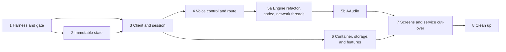

# Migration

Part of the [target architecture](README.md). Specifies the step order,
the commits inside each step, what "done" means, the spikes that gate
steps, the kill criteria, and the decisions this work reverses.

## Ground rules

- Each step runs in its own worktree (`./scripts/worktree.py add …`) and
  lands as atomic commits, each passing `./scripts/check.sh`.
- A step is **done** when its done-when list holds, the allowlist has
  shrunk as stated, and its row in `PROGRESS.md` is updated. On-device
  testing is at the developer's discretion (see
  [testing](testing.md#on-device-testing)). Merging is a separate,
  user-requested action, as always.
- **Done-when is executable and never deferred.** Every done-when
  includes at least one check that executes what the step makes live
  (not only unit tests of its parts). If a done-when item or kill
  criterion fails, the step stops: either fix it, or change the spec in
  a separate commit on `master` first. A rationale in `PROGRESS.md` is
  not a substitute for a result.
- **Invariants name their detector.** A step that states an invariant in a
  header comment or a spec section (nothing allocates on the capture
  thread; one owner of the socket; no lock across the render path) names
  that invariant in its done-when together with the object that fails
  when it stops holding: a check in `scripts/check_architecture.py`, an
  entry in `scripts/architecture-allowlist.txt`, or a test whose scope is
  the same as the sentence. A test that passes without covering the
  statement is not coverage: in 5a.1 the allocation rule was true of
  `processFrame` and false of `reset` for the whole step, and the golden
  fixtures could not see the difference. Where no such object can be
  built, narrow the invariant as it is written. The rule's evidence is
  that `SINGLE_THREADED_ENGINE`, the only invariant given a named object,
  needed no review-round correction.
- **A step branch does not edit the design it implements.** Changes to
  a step's own spec sections (threads, invariants, realtime rules,
  done-when) land on `master` as standalone docs commits, reviewed as
  design changes, before code depends on them. A reviewer who finds the
  code diverging from the spec reports a broken rule; the fix restores
  the rule, or the spec change goes to `master` first.
- **Review rounds are capped.** If a third review round still returns
  branch-killing findings (production path dead, gate not exercising the
  code, a fix regressing an earlier fix), stop and re-slice the step
  instead of running a fourth.
- Every step leaves a working app. Steps 2–5 are each worth landing
  alone. Step 6 needs step 3; step 7 needs steps 5b and 6.
- Until step 7, today's `ConfigDelta` path keeps applying settings live:
  `HumlaService.apply` stays as a bridge that forwards each delta to the
  new components as they appear (the client in step 3; voice, route, and
  `VoiceSettings` in step 4). It is deleted in step 7.
- **Interim owners.** Until step 6 creates `AppContainer`, `HumlaService`
  constructs the new application-scoped objects itself (`HumlaClient`,
  `LocalFactsStore`, `NetworkMonitor`, `TransportFactory`, and from step 4
  `RouteControl` and the voice control). Step 6 moves their construction
  into `AppContainer` and hands the same instances to `HumlaService`, so
  there is only ever one of each.
- **Interim observer bridge.** Until step 7, `HumlaClient` and `Session`
  take `IHumlaObserver`, a main-thread poster, and the deny formatter so
  today's screens keep working. Step 7 removes them along with
  `IHumlaObserver`.
- **Other recorded interims** (found by the
  [steps 1–4 audit](issues/README.md)):
  - Until step 6, the self-mute/deafen half of the interim
    `LocalFactsStore` in `HumlaService` is a stub (loads unset, drops
    writes); `MumlaService` restores self-mute after sync and persists it,
    as before the migration. Step 6 moves both into the session and
    `LocalFactsStore` in one change, so there is never zero or two owners.
  - Until step 5a, `IHumlaService.getCurrentBandwidth` reads the current
    `AudioHandler`, not `SessionStats.currentBandwidth`.
  - Until step 5a.4, `AudioHandler.updateMuteState` and
    `HumlaService.setTalkingState` also write the native mute/PTT gates,
    alongside the per-frame `VoicePolicy` path described in
    [voice](voice.md#interim-mute-step-4-before-5a); the two writers can
    disagree until the policy next changes.
- **Main-thread assertion.** From step 3 on, every method that may block
  (stream start and stop, platform route calls, thread joins) starts with
  `checkNotMainThread()`, a small helper that throws in debug builds and
  logs in release builds.
- Spikes run in throwaway worktrees before the step that depends on them,
  and their findings are written into the relevant spec file before the
  step starts.

## Step 1 — Harness and gate

1. `scripts/check_architecture.py` with its tests: concurrency tripwire,
   native tripwire, Android-free package check (packages that do not exist
   yet pass trivially). `scripts/architecture-allowlist.txt` seeded with
   today's files and counts. Wired into `check.sh`.
2. Dev shell: `pkgs.murmur`. Test resources: the loopback test certificate
   and key. `:libraries:humla` test dependencies: Robolectric (version
   from the catalog). The `murmurInteropTest` Gradle task and
   `scripts/test_interop.sh` (not wired into `check.sh`).
3. Interop scenarios against today's `HumlaConnection` (see
   [testing](testing.md#murmur-interop)).
4. `StateImmutabilityTest` scaffold (walks nothing until step 2) and
   `PROGRESS.md`.

**Done when:** the harness reproduces the stale-callback race fixed in
`2e2a067d` with that fix reverted in a throwaway worktree, failing on 10 of
10 runs, and passes on 10 of 10 runs on `master`.

## Step 2 — Immutable state

**Spike first:** live handles (see [state](state.md#compatibility-handles-migration-only))
behind `ChannelListAdapter`. A Robolectric test drives the adapter over
handles through a scripted sequence (users join, move, mute, deafen,
start and stop talking, start and stop listening, and leave; channels are
renamed, re-ordered, linked, expanded, collapsed, and removed) and asserts
the rendered rows after each message. The spike passes when every assertion holds without changes
to the adapter.

1. `kotlinx-collections-immutable` in the version catalog. The state types,
   `ChannelTree`, and their tests.
2. Transitions ported from `ModelHandler`, one message family per commit
   (`ChannelState`/`ChannelRemove`/links; `UserState`; `UserRemove`;
   `PermissionQuery`; `ServerSync`, `ServerConfig`, `Version`,
   `CodecVersion`), each with its existing tests ported.
3. `SessionEvent` emission. A temporary adapter in `:libraries:humla`
   turns events into today's `HumlaLogger` strings, so the chat log keeps
   working; it moves to the app in step 6.
4. One commit switches the model over, since the halves cannot work
   apart: `HumlaService` holds a `MutableStateFlow<SessionState>` and
   applies the transitions; live handles replace `User` and `Channel`
   behind `IUser` and `IChannel`, whose navigation types narrow to the
   interfaces and whose setters are removed (each writer becomes a session
   intent); `IHumlaObserver` callbacks pass handles; `ModelHandler`,
   `User`, and `Channel` are deleted.
5. `AudioHandler`'s reads of self and local-mute state come from the state
   flow.

**Done when:** `Channel`, `User`, and `ModelHandler` are off the
allowlist (deleted); `StateImmutabilityTest` walks `SessionState`.

## Step 3 — Client and session

1. `Transport` extracted from `HumlaConnection` and `HumlaTCP`: framing,
   reader thread, writer coroutine, TLS, keepalive, UDP health. Until step
   5a it talks to voice through an interim `LegacyVoiceLink`, a
   `VoiceLink` implementation over today's Kotlin `HumlaUDP` and
   `CryptState` (keys, IVs, UDP pings, tunnelled packets, resync
   requests); step 5a replaces it with the `VoiceEngine`.
2. `Session`: scope, message coroutine, intents, statistics.
   `HumlaService` delegates `IHumlaSession` to the current session.
3. `HumlaClient`, `ClientState`, `ReconnectPolicy` (with
   `ReconnectBackoffTest` ported), `NetworkMonitor`. `HumlaService`
   delegates `IHumlaService` to the client.
4. Delete `connectionGeneration` and the connect, reconnect, and whisper
   locks. `ConnectionParams` is replaced by `ConnectTarget`; the
   `ConfigDelta` bridge (see the ground rules) keeps live settings working.

**Done when:** `HumlaConnection` is off the allowlist (deleted), and the
interop harness drives `HumlaClient` directly.

## Step 4 — Voice control and route

1. `RouteControl` (`route/RouteControl.kt`): the controller moves to the
   route `HandlerThread`, publishes `RouteState` and events, and gains its
   private route-session counter in the same commit that removes `Host`,
   so `shouldDropStaleEvent` keeps working throughout (see
   [route](route.md#thread)). `ScoLink` callbacks use the route executor.
2. `VoiceControl` (`voice/VoiceControl.kt`), an interim class that owns
   the voice control thread and today's `AudioHandler` lifecycle (create,
   destroy, recreate), following `RouteState` (see
   [route](route.md#migration-notes)). Step 5a replaces it with the
   `VoiceEngine`.
3. The `VoiceSettings` mapper and the policy collector, which publishes
   `StateFlow<VoicePolicy>`. Interim consumer: the Kotlin capture thread
   reads it each frame and calls the engine's `setMuted`/`setPttTalking`
   (and bitrate and frames per packet) on change (see
   [voice](voice.md#interim-mute-step-4-before-5a)).
4. Delete `mMuteLock` and the documented `AudioHandler` monitor order.

**Done when:** no `Thread.join` or other blocking wait is reachable from
the main thread (by review, and `checkNotMainThread()` guards every
blocking method in `VoiceControl` and `RouteControl`); `AudioHandler`,
`AudioRouteController`, and `BluetoothScoManager` are off the allowlist.

## Step 5a — Engine refactor, codec, network threads

Four sub-steps. Each one leaves voice working on a live path, ships, and
is used daily before the next begins. Old and new paths coexist through
interim seams (as `LegacyVoiceLink` and `VoiceControl` did in steps 3
and 4); the Kotlin path is deleted only in 5a.4. 5a introduces **no
intentional behavior changes**, with one accepted exception: a
push-to-talk press and release inside a single 10 ms frame no longer opens
and closes a burst (see [voice](voice.md#input-engine)). Upstream-parity
differences found along the way are recorded in [open
items](open-items.md) and land after 5a.4 as their own commits. Why the
step is split: see the
[step 5a retrospective](history/step5a-retrospective/README.md).

**Native loading** (from 5a.1 on): one `HumlaNative.ensureLoaded()`
owns `System.loadLibrary("humlaaudio")`, and every class with `external`
methods goes through it. JVM tests inject a fake native layer instead of
catching `UnsatisfiedLinkError`; on Android a load failure throws in
debug builds and reports `VoiceEvent.PipelineError` in release builds.

### 5a.1 — Engines

1. **Golden fixtures**, recorded from today's engines, committed before
   any engine change.
2. Engine refactor, one concern per commit, each reproducing the golden
   fixtures: input engine (per-frame config, result struct, no locks);
   output engine (voice pool, lookup array, result struct, no locks);
   `jitter.c` slot pool; allocation-count test.
3. The existing JNI bridges adapt to the new engine API; today's Kotlin
   audio path stays the live consumer.

**Done when:** golden, allocation, and jitter-pool stress tests pass (the
pool test fixes the slot count); `SINGLE_THREADED_ENGINE` is on for
`audio_engine/`; the snapshot is in daily use without regressions the
developer notices.

### 5a.2 — Packet codec

1. The nanopb submodule and `pkgs.nanopb` in the dev shell;
   `scripts/gen_nanopb.sh` with the options file; the generated
   `MumbleUDP.pb.{c,h}` (generated code only).
2. The codec, with fixtures generated by a JVM test from the Java
   protobuf classes and `PacketBuffer`, byte-equal to today's framing.
3. Live consumer: today's Kotlin framing (`AudioHandler` encode,
   `AudioOutput` legacy parse, `LegacyVoiceLink` protobuf decode and ping
   framing) calls the native codec through a thin interim JNI, `voice_codec/
   NativeVoiceCodecJni.cpp`. It is the one `<jni.h>` allowlist exception in
   that directory, and both leave in 5a.4 with the Kotlin framing they
   serve. Both inbound formats go through the codec here, so the protobuf
   branch stops using the generated Java classes and hands the same parsed
   frames to `AudioOutput` as the legacy branch, which keeps applying
   today's locally-muted and unknown-sender drops to both; no Kotlin
   parser stays behind, and the live path is what the daily-use check exercises.
4. Device-free encode entry point: `AudioHandler` stops acquiring the
   native input engine, `AudioRecord`, and `AudioTrack` in its
   constructor and does it in `initialize()`/`startRecording()`, carrying
   the existing construction-failure teardown with it — the lazy pattern
   `AudioOutput` already uses (`AudioOutput.startPlaying`;
   `AudioOutput(listener)` is device-free today). A production change on
   its own merits, not a test seam, and it outlives 5a.3, so it leaves no
   deletion debt. Without it, constructing `AudioHandler` in a JVM test
   means grabbing the mic.

**Done when:** codec golden tests pass; `SINGLE_THREADED_ENGINE` covers
`voice_codec/`; the encode framing entry point is driven from a JVM test
and produces bytes byte-equal to the Java-generated classes and
`PacketBuffer`, failing when the native codec is absent or wrong; inbound
framing is pinned by the codec goldens in this sub-step and by 5a.3's voice
scenarios, which bring the native receive path — a device-free parse entry
point invented here would only be deleted there; interop
UDP ping framing built by the native codec completes a round trip against
murmur (the reply proves the server parsed it), and text messages keep
working end to end;
daily use without regressions. Voice between two clients over the tunnel
is **not** part of this sub-step: it moves to 5a.3, where synthetic PCM
enters at the native capture and render entry points instead of through a
test-only seam in Kotlin (see [testing](testing.md#murmur-interop) and
[open items](open-items.md#resolved)).

### 5a.3 — Native receive

**Provisional.** Re-planned once 5a.2 is in daily use, because its shape
depends on what 5a.2's inbound codec JNI turns out to be. The likely
re-plan splits it in two: native render first (render entry point,
inbound and tunnel queues, notifier, Kotlin still owning the socket and
parse), then native receive and transport (socket, receive thread,
decrypt, pings, resync, `VoiceEngine`, and `nativeSendDatagram`, which
moves with the socket). Open questions are in
[open items](open-items.md). The list below is the pre-split plan.

1. `voice_io` receive half: the UDP socket, receive thread (`recvfrom`,
   OCB2 decrypt, `parseDatagram`), inbound and tunnel queues, render
   entry point, notifier thread, and the policy/settings sequence locks
   for what receive and render read. Threads and ownership exactly as in
   [voice](voice.md#voice-io-layer).
2. The Kotlin `VoiceEngine` facade (lifecycle, keys, pings, tunnelled
   packets) replaces `LegacyVoiceLink`. The Kotlin `AudioTrack` thread
   calls the render entry point.
3. Interim send seam: Kotlin capture, encode, and framing stay; framed
   packets go to native through a temporary `nativeSendDatagram`
   (encrypt and `sendto` on the shared socket).
4. Remote talk state comes from `VoiceEngine.talkActivity`; handles stop
   carrying a writable remote `talkState`.

**Done when:** native loopback, queue, and sequence-lock tests pass;
`audio_engine/` and `voice_codec/` stay under `SINGLE_THREADED_ENGINE`
while `voice_io/`'s allowlist section holds only the socket and thread
includes and the sequence locks the spec names, with a test pinning that
the locks guard receive-visible settings and nothing else; one render
entry point is the only path into the engines, pinned by a test that
fails if a second caller appears; interop voice from a peer to the
client over UDP and over the tunnel plays non-silent PCM through the
real JNI binding, including the tunnel voice scenario deferred from
5a.2; daily use without regressions.

### 5a.4 — Native send and cleanup

1. `voice_io` send half: capture entry point (any block size, carried
   into exact 10 ms frames), input engine, framing, outbound queue with
   drop-oldest, send thread. `VoicePolicy` and `VoiceSettings` pushed to
   native.
2. Self talk state from `VoiceEngine.talkActivity`.
3. Delete `HumlaUDP`, the Kotlin framing in `AudioHandler`, the Kotlin
   `CryptState`, `VoiceControl`, the interim seams from 5a.2 and 5a.3, and
   the old JNI bridges; `NativeCrashTestJni.cpp` moves to
   `jni/diagnostics/`.

**Done when:** interop voice in both directions over UDP and over the
tunnel; mute, deafen, and push-to-talk gate transmission in interop;
outbound queue is allocation-free and drops oldest under a full-queue
test that pins the drop count; `HumlaUDP`, `CryptState`,
`LegacyVoiceLink`, and `VoiceControl` are deleted and absent from the
allowlist; the interim `<mutex>` entries from 5a.1 are gone with the
bridge files; daily use without regressions.

## Step 5b — AAudio

**Spikes first:** AAudio or Oboe; callback or blocking mode; echo
cancellation through an AAudio session ID (see [open items](open-items.md)).
Spikes run on the developer's device; Android 11–12 is not tested.

1. Native capture and render threads (or AAudio callbacks), opening
   streams with the profile from `RouteState`, reopening them when the
   route changes, and reopening them when AAudio reports a disconnected
   stream (`AAUDIO_ERROR_DISCONNECTED`).
2. Echo cancellation attached to the AAudio session.
3. Delete `AudioInput` and `AudioOutput`; update the audio pipeline
   description in `AGENTS.md`.

**Done when:** `AudioInput` and `AudioOutput` are deleted and the AAudio
path is in daily use without regressions the developer notices against
5a.

## Step 6 — Container, storage, and features

`MumlaService` stays the bound service in this step; each feature moves a
responsibility out of it, and `MumlaService` delegates the matching
`IMumlaService` calls to the feature until step 7 deletes it. The binder
calls stay synchronous: reads return the feature's current `StateFlow`
value (for example `getMessageLog` returns the chat log's `value`), and
writes launch into the feature's scope.

1. `AppContainer` and the ViewModel factory. The container takes over
   constructing the application-scoped objects `HumlaService` built as
   interim owner (see the ground rules) and hands the same instances to
   `HumlaService`. Storage APIs become `suspend` and the `runBlocking`
   bridges are deleted; the few synchronous readers left read the settings
   `StateFlow`'s current value.
2. Features, one per commit (see [app](app.md#features)); the
   `chat_notify_*`, `deny_reason_*`, and `audio_max_bandwidth` strings
   (with their translations) move from `:libraries:humla` resources to
   `:app`, and the step-2 logging adapter is deleted when the chat log
   feature lands.

**Done when:** every row of the [feature table](app.md#features) has a
feature class, and `MumlaService` contains only service lifetime and
delegation.

## Step 7 — Screens and service cut-over

1. Screens on ViewModels, one per commit, in this order (each depends only
   on features from step 6): `ServerInfoFragment`, `AccessTokenFragment`,
   comment fragments, `ChannelChatFragment`, `ChannelFragment`,
   `ChannelListFragment` (with the menus), `MumlaActivity`. Each commit
   removes that screen's `IHumlaObserver` and `HumlaServiceFragment` use
   (see [app](app.md#screens)).
2. `ConnectionService` with the foreground rules; the UI starts it before
   connecting.
3. Delete `MumlaService`, `IMumlaService`, `HumlaService`,
   `HumlaServiceProvider`, `HumlaServiceFragment`, `ConfigDelta` and its
   bridge, and the service-binding code.
4. Remove Hilt and kapt from both modules (`@HiltAndroidApp`, the one
   `@Inject`, `DatabaseModule`, `SettingsModule`), now that `AppContainer`
   constructs everything.
5. Update the migration README's native fence and binder-surface decisions
   (see [below](#decisions-this-reverses)).

**Done when:** no screen implements an observer or extends
`HumlaServiceFragment`; nothing binds a service; the allowlist no longer
lists `HumlaService`, `MumlaService`, `MumlaActivity`, or the storage files
(`MumlaRoomDatabase.kt`, `SettingsRepository.kt`, `AppDataStore.kt`,
`DataStorePreferenceDataStore.kt`).

## Step 8 — Clean up

Delete `IHumlaObserver`, `HumlaCallbacks`, the live handles, `IUser`,
`IChannel`, and any remaining compatibility shims.

**Done when:** the allowlist holds only the boundary files listed in
[enforcement](enforcement.md#concurrency-tripwire).

## Kill criteria

- **Step 1** cannot reproduce a known past race. The harness cannot vouch
  for later steps; fall back to the satisficing
  [whales list](history/whales-list.md).
- **Step 2's live-handle spike** shows screen behavior changes the tests
  did not catch. Fix the harness before continuing.
- **Step 4's route sequence** misbehaves with the Bluetooth headset in
  daily use and cannot be fixed within the readiness model. Rethink the
  sequence before step 5.
- **Step 5a**, any sub-step: if its executable done-when check cannot
  pass without coordination machinery the [voice](voice.md) spec does not
  name (locks on realtime threads, extra threads, cross-thread engine
  access), stop and revise `voice.md` on `master` before continuing.
- **Step 5b** regresses latency, glitches, echo cancellation, or routing in
  daily use and cannot be fixed. Stop at 5a: keep `AudioRecord` and
  `AudioTrack`, which still leaves all transmit state on the native side.
- **Any step:** if a file cannot leave the allowlist without new
  coordination machinery, treat it as a design problem and revisit the
  spec, not the code.

## Decisions this reverses

Updated in the branch of the step that reverses them:

| Decision (where recorded) | Replaced by | Step |
|---|---|---|
| Native fence: "C++ frozen, no behavior touch" ([migration README](../migration/README.md)) | The engine stays free of I/O; it may be refactored, pinned by golden outputs | 5a (recorded), 7 (README updated) |
| "No Oboe/AAudio" in the audio pipeline description ([`AGENTS.md`](../../AGENTS.md)) | AAudio (or Oboe, per spike) for capture and playback | 5b |
| Frozen binder surface `IMumlaService`/`IHumlaService`/`IHumlaSession` ([migration README](../migration/README.md)) | Removed; screens and features collect flows | 7 |
| Hilt as the DI framework ([migration slices](../migration/slices.md)) | Hand-written `AppContainer` | 7 |
