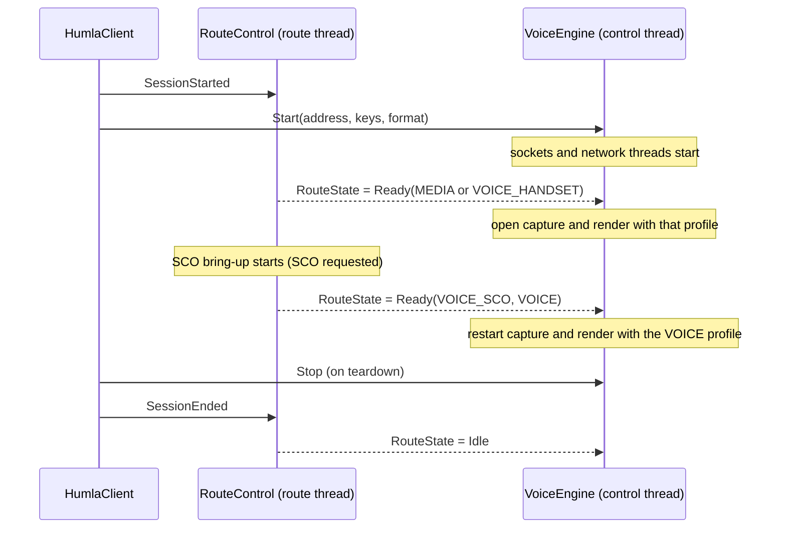

# Route

Part of the [target architecture](README.md). Specifies `RouteControl`
(audio routing, Bluetooth SCO, mode hold) and the session start sequence
between the client, routing, and voice.

## Starting point

Routing is the hardest real-world part of the app and the most churned:
[`BluetoothScoManager`](../../libraries/humla/src/main/java/se/lublin/humla/audio/BluetoothScoManager.kt)
and
[`AudioRouteController`](../../libraries/humla/src/main/java/se/lublin/humla/audio/AudioRouteController.kt)
have 27 commits between them since September. The controller is already
close to the target: one event funnel (`RouteEvent`), main-thread
confinement, ports for the platform (`AudioPlatform`) and SCO (`ScoLink`),
a pure decision (`AppliedRoute`), and 71 virtual-time tests. The
target keeps its logic and tests, and changes three things:

1. It runs on its own thread instead of main.
2. It publishes state instead of calling a `Host` that recreates the audio
   pipeline.
3. It never calls into voice; voice follows its state.

## Thread

`RouteControl` owns a `HandlerThread` named `route`. Its coroutine
dispatcher is that thread's looper (`Handler(looper).asCoroutineDispatcher()`),
so the controller's existing single-thread confinement holds unchanged,
just on a different thread.

- `AudioPlatform.registerDeviceCallback` receives the route handler instead
  of the main handler.
- `BluetoothScoManager` uses the route thread's executor where it uses
  `context.mainExecutor` today.
- Blocking platform calls (`setCommunicationDevice`, `setMode`, SCO
  bring-up) therefore run on the route thread, never on main.
- `AudioRouteController.isMainThread` becomes `isRouteThread`. Off-thread
  re-posting stays, aimed at the route thread.
- **The controller keeps its own session identity.** Device and Bluetooth
  callbacks are application-scoped and can arrive between one session's
  `SessionEnded` and the next `SessionStarted`, or be posted during one and
  run during the next. Today's `shouldDropStaleEvent` compares against
  `Host.sessionToken`; in the target the controller increments a private
  route-session counter on each `SessionStarted`, captures it when posting,
  and drops events whose captured value no longer matches, exactly as
  today. Only the source of the counter changes.
- Everything else the controller owns today stays inside it unchanged:
  the `MODE_IN_COMMUNICATION` claim and restore (`ModeHold`), yielding to a
  cellular call (`MODE_IN_CALL`), clearing an unrequested system SCO link,
  media-sink queries, debounce, and the settle budget.

## API

```kotlin
class RouteControl(platform: AudioPlatform, sco: ScoLink?, prefs: Flow<RoutePreferences>) {
    fun submit(command: RouteCommand)         // non-blocking; posts to the route thread
    val state: StateFlow<RouteState>
    val events: SharedFlow<RouteEvent>
}

sealed interface RouteCommand {
    data object SessionStarted : RouteCommand
    data object SessionEnded : RouteCommand
    data object RetrySco : RouteCommand       // today's retryBluetoothSco; state stays Fallback until the link comes up or fails again
}

data class RoutePreferences(
    val bluetoothSco: Boolean,                // today's ConfigDelta.bluetoothSco
    val handsetStream: Int,                   // today's ConfigDelta.audioStream
)
```

`RouteControl` implements the client's `RouteLifecycle` interface
(`SessionStarted`, `SessionEnded`), so the client depends only on that.

`prefs` comes from the settings flow (`Settings.isBluetoothHeadset` and
`isHandsetMode`, today's `ConfigDelta.bluetoothSco` and `audioStream`).
Preference changes are collected on the route thread and become the
controller's existing `SettingsChanged` event. Device changes, SCO link
changes, and settle rechecks stay internal events, as today.

## `RouteState`

```kotlin
sealed interface RouteState {
    data object Idle : RouteState                                 // no session
    data class Settling(val target: AppliedRoute) : RouteState
    data class Ready(val route: AppliedRoute, val profile: StreamProfile) : RouteState
    data class Fallback(val route: AppliedRoute, val profile: StreamProfile,
        val reason: String) : RouteState
}

enum class StreamProfile {
    VOICE,   // capture VOICE_COMMUNICATION; playback USAGE_VOICE_COMMUNICATION; echo cancellation on; mode IN_COMMUNICATION held
    MEDIA,   // capture MIC; playback USAGE_MEDIA (STREAM_MUSIC); mode untouched
}
```

`AppliedRoute` is today's enum (`VOICE_SCO`, `VOICE_HANDSET`, `MEDIA`).
`VOICE_SCO` and `VOICE_HANDSET` both use the `VOICE` profile; `MEDIA` uses
`MEDIA`. For `VOICE_HANDSET`, the handset stream and speakerphone routing
travel with the profile as they do today (see
[echo cancellation](../echo-cancellation/README.md)).

**What each state means.** These semantics describe the behavior the
pre-migration controller already had; they were settled on 2026-11-12
(see the [step 5a retrospective](issues/09-route-settling-unobservable.md))
in preference to holding voice until SCO is confirmed, which would add a
short silence at every Bluetooth connect.

- `Settling(target)` is written at `SessionStarted` and replaced by the
  first decision in the same route-thread step. Collectors may never
  observe it, and nothing may depend on seeing it; voice treats it as
  "keep whatever streams are open".
- `Ready(route, profile)` means a route has been **decided**, not that it
  is confirmed: `VOICE_SCO` when the SCO link is active; otherwise
  `VOICE_HANDSET` when no media output device is present ("voice by
  absence"); otherwise `MEDIA`. While an SCO bring-up is in progress the
  decision is the non-SCO route, and it changes to `VOICE_SCO` when the
  link comes up.
- `Fallback(route, profile, reason)` means SCO is requested in preferences
  and not active, **and** a bring-up has failed (or the link dropped) in
  this route session. `route` is whatever was decided (`VOICE_HANDSET` or
  `MEDIA`). It is defined by intent, not by route, so it is reachable with
  a media sink present.

| Transition | When |
|---|---|
| `Idle` → `Settling` → first decision | `SessionStarted` (one step; see above) |
| `Ready` ↔ `Ready` (different route) | A device change (after today's 300 ms debounce), a preference change (applied at once, as today), the SCO link coming up or going down, or a media-sink settle recheck changes the decision |
| `Ready` → `Fallback` | SCO bring-up fails (the SCO manager's per-attempt connect timeout plus one retry), or an active SCO link drops while SCO is still requested |
| `Fallback` → `Ready(VOICE_SCO)` | The SCO link comes up (after `RetrySco` or a device change) |
| `Fallback` → `Ready` (non-SCO) | SCO is no longer requested |
| `Fallback`, `RetrySco` | When SCO is requested, a session is live, and the SCO link exists and is idle: start the link; the state stays `Fallback` until the link comes up or fails again. Otherwise the command does nothing |
| any → `Idle` | `SessionEnded` (SCO released, mode restored) |

**Two timers, two owners.** The SCO bring-up budget (per-attempt connect
timeout plus one retry) belongs to the SCO manager and is what leads to
`Fallback`. The **media-sink settle recheck** (3 s, at most 2 rechecks)
belongs to `RouteControl`: while the decision is `VOICE_HANDSET` by
absence, it re-checks whether a media sink has appeared (late A2DP
enumeration). It never produces `Fallback` by itself.

**Inputs are sampled at decision time.** Every decision re-reads both of
its inputs — the media-sink query and `ScoLink.isActive()` — instead of
holding a copy across recomputes. Link and device callbacks only *trigger*
a decision; they carry no route of their own. This is not a performance
detail: `ScoLink.stop()` reports nothing back by contract, so the stops the
controller performs itself (preference off, `SessionEnded`) are silent, and
a callback-fed copy of the link state goes stale on exactly the paths that
leave SCO — the decision then keeps publishing `VOICE_SCO`, holding the
`VOICE` profile and `MODE_IN_COMMUNICATION` for the rest of the session.
For the same reason a preference change applies to the link **before** the
decision is taken (see
[issue 32](issues/32-route-decision-cached-sco-state.md)). Detector:
`RouteControlTest.routeDecisionFollowsLinkStateNotEvents` holds a decision
to the link's own state with no callback delivered.

**Events:** `ScoFailed(reason)` whenever an SCO bring-up fails (which,
under the definition above, always coincides with entering or staying in
`Fallback`), and `RouteChanged` whenever the published state changes,
including changes made by a settle recheck. A feature shows the SCO
failure message (today's `scoFailureMessage` bucketing in `MumlaService`);
screens and features read the current route from `state`.

## Session start



Rules:

- **The client sequences lifetimes only.** Start: `SessionStarted` to route,
  then `Start` to voice. Teardown: `Stop` to voice, then `SessionEnded` to
  route.
- **Voice follows route state.** The `VoiceEngine` control thread collects
  `RouteState`. It opens capture and render in `Ready` or `Fallback`, using
  that state's profile. While `Settling` (never observed in practice), it
  keeps whatever streams are open. On a new `Ready`/`Fallback` with a
  different route or profile, it restarts the streams; a change between
  `Ready` and `Fallback` with the same route and profile does not restart
  them. On `Idle`, it stops them.
- **Route never waits for voice, and voice never calls route.** The
  dependency is one-way, so they cannot deadlock or loop.
- **Network voice starts immediately.** Sockets, crypt, and the network
  threads start on `Start`, so inbound voice is buffered (and pings flow)
  from the first moment.

The cost is one extra stream restart when SCO comes up after the first
decision (a short audible route switch at Bluetooth connect). This is
today's behavior and was kept deliberately over connect-time silence.

## Migration notes

- Step 4 moves the controller to the route thread and replaces `Host` with
  published state. The `VoiceEngine` does not exist yet, so in step 4 the
  Kotlin audio control (today's `AudioHandler` lifecycle, moved to the voice
  control thread) collects `RouteState` and recreates the Kotlin pipeline
  where `Host.recreatePipeline` did.
- The controller's existing tests keep running against the same virtual
  scheduler; only the dispatcher they replace changes.
- This is the step most likely to show problems only on a device (see
  [testing](testing.md#on-device-testing)).
