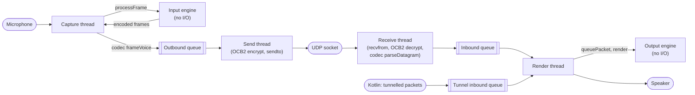

# Voice

Part of the [target architecture](README.md). Specifies the native voice
path: the keep-alive shields it must preserve, the refactored no-I/O
engine, the packet codec, the voice I/O layer, the realtime rules,
`VoicePolicy`, and the Kotlin facade.

## Invariant

**I/O and no-I/O stay separate.** The engine, the packet codec, and OCB2
take bytes and PCM in and give bytes and PCM out. They own no threads,
sockets, or audio devices, which is what makes them exhaustively testable
on the host. Everything that touches a thread, socket, or device lives in
the voice I/O layer. The engine may be refactored; the separation may not
be traded away. A [native tripwire](enforcement.md#native-tripwire)
enforces it.

## Keep-alive shields

While connected, the process must look active to the OS. On battery with
the screen off, Android and OEM power managers otherwise suspend or kill
it, and Murmur drops a client that sends no TCP data for 30 s. Each
shield below defends against a different mechanism. Every past attempt to
save power by removing one caused a regression, and none of those
regressions showed up in tests.

**Uncertainty keeps a shield.** These are heisenbugs: they take minutes to
hours to appear, often on one OEM, and never on the bench. Several causes
here were never isolated. For example, 0.21.9 shipped the standby pause
and the mic gating together, so which one drew the SIGKILLs was never
tested on its own. An unproven cause is a reason to keep every suspect,
not to test by removing one. Removing or weakening a shield needs at
least the kind of field evidence that established it.

| Shield | Defends against | Evidence |
|---|---|---|
| **Output stream started for the whole connection**, never paused or stopped for silence. In 5a, `AudioTrack` in `PLAYSTATE_PLAYING`, underrunning during silence. In 5b, a started AAudio stream whose callback writes zeros during silence | OEM watchdogs (Samsung, Xiaomi, Vivo) that SIGKILL a process holding a wake lock while its output is paused | The 0.21.9 standby pause (`09f6a8a0`) drew SIGKILLs; reverted in `681a8735` (0.21.11). 0.21.7, which wrote zeros continuously, had no disconnects or kills; a starved track is not counted as active playback (no `+audio` in `batterystats`) |
| **Microphone open for the whole connection**, muted and push-to-talk idle included. Muting gates frames in the input engine; it never closes the stream | Vivo force-suspend beneath a held wake lock. Recording-active is the signal it honors; a started but starved output stream does not count as active playback (no `+audio` in `batterystats`) | Closing the mic on mute (`23ca0ad4`, 0.21.9) led to Murmur timeouts every ~5 min on battery; the mic was reopened by the A/B merged in `6548f787` |
| **Partial wake lock and high-performance Wi-Fi lock**, held by the [connection service](app.md#connectionservice) | Kernel suspend and Wi-Fi radio sleep stalling the keepalive | Releasing the wake lock during silence (0.21.10) left 37–104 s gaps and Murmur timeouts; the Wi-Fi lock came from the same A/B |
| **TCP keepalive inside Murmur's 30 s**, sent from an in-process timer and flushed on write with `TCP_NODELAY` (see [transport](transport.md#keepalive-and-udp-health)) | Murmur dropping a client after 30 s without TCP data; UDP traffic does not count | The 0.21.10 investigation |

Brief stream restarts (route change, RNNoise model load) are today's
behavior and accepted. Power is saved only in ways that leave every
shield intact. On silence with no registered voices, the render loop
waits without a timeout (`b1a1118e`) instead of polling at 50 Hz. It is
the least proven piece here. The A/B never tested the polling on its own:
it showed that the mic and Wi-Fi lock together were enough with the wait
in place, on one device. If disconnects return, restoring the polling is
the first thing to try, and any change to the mic shield reopens the
question. Its power saving is small today. Since the mic shield, the
capture thread reads the microphone every 10 ms for the whole connection,
so the CPU wakes regardless, and the Doze investigation's worry about a
fully quiescent process does not apply while capture runs. That changes
neither rule above.

These failures appear only on an untethered device, on battery, with the
screen off, after minutes to hours, and sometimes on one OEM only. USB
charging disables Doze and an active screen holds its own wake lock, so
both hide them. Green host tests say nothing here.

Step 5b keeps every shield. The AAudio input stream stays open for the
whole connection, as the microphone does today. The output stream stays
started, and its callback writes zeros through silence instead of
underrunning, so the render wait above goes away. This output behavior
has the best field record: 0.21.7 wrote silence continuously, its render
loop waking every 20 ms, and had no disconnects or watchdog kills. It also
restores two signals the Doze investigation found absent, and that are
still absent today: playback the OS counts as active, and a render path
that is never fully idle. The cost is one callback per AAudio burst,
small beside a capture path that already wakes every 10 ms. Daily use on
battery is the check, as for every shield.

The investigations:
[zero-audio standby](../power-draw-optimizations/zero-audio-standby-regression-investigation.md)
(0.21.9 and 0.21.10) and
[battery Doze disconnects](../power-draw-optimizations/battery-doze-disconnects.md)
(the mic and Wi-Fi lock A/B). Their commit hash for the mic change,
`1a971285`, does not exist; the commit is `23ca0ad4`.

## Source layout

| Directory | Layer | Contents |
|---|---|---|
| `jni/audio_engine/` | No-I/O | Input and output engines, DSP, VAD, pre-speech buffer, Opus wrappers, jitter buffer (refactored in step 5a) |
| `jni/voice_codec/` | No-I/O | Packet codec (new) |
| `jni/crypto/` | No-I/O | OCB2 (unchanged) |
| `jni/voice_io/` | I/O | Threads, queues, UDP socket, AAudio streams and callbacks (5b), JNI for `VoiceEngine` (new) |

Paths are relative to
[`libraries/humla/src/main/jni`](../../libraries/humla/src/main/jni/).
The existing JNI bridges for the engines
(`NativeAudioInputEngineJni.cpp`, `NativeAudioOutputEngineJni.cpp`) and
crypt (`NativeCryptStateJni.cpp`) are deleted when their Kotlin callers are
(output engine in 5a.3a, crypt in 5a.3b, input engine in 5a.4); `voice_io`
owns the voice JNI surface once it lands in 5a.3a. Until 5a.4 the one
exception is 5a.2's interim codec bridge,
`voice_codec/NativeVoiceCodecJni.cpp`, which exists only because Kotlin
still frames voice; it holds that directory's single `<jni.h>` allowlist
entry and leaves with the file.
`NativeCrashTestJni.cpp` (the crash reporter's native crash test, not part
of voice) moves to `jni/diagnostics/` in step 5a, outside the native
tripwire's scope.

## Engine refactor

The engine's current shape suits several ordinary Java threads calling it,
not realtime threads. Step 5a changes its shape, not its algorithms.

### Goals

1. **Single-threaded by contract.** One thread drives each engine
   instance. No `std::mutex`, no `std::atomic`, no callbacks.
2. **Outputs as return values.** Results go into caller-provided structs.
3. **No allocation once started.** Every buffer, voice, decoder, and jitter
   slot is allocated when the engine is constructed, and no call on the
   realtime path allocates. The input engine's control-plane calls are the
   one exception: RNNoise cannot reset its recurrent state in place, so
   enabling it, swapping its model, or resetting the engine reallocates that
   state (see [input engine](#input-engine)).
4. **Configuration per call.** The input engine receives its configuration
   with every frame and handles transitions itself.

### Input engine

```cpp
struct InputConfig {
    InputMode mode;              // VOICE_ACTIVITY, PUSH_TO_TALK, CONTINUOUS
    bool transmitAllowed;        // from VoicePolicy
    bool pttPressed;             // from VoicePolicy
    int bitrate;
    int framesPerPacket;
    float amplitudeBoost;
    bool adaptiveLevelerEnabled;
    float vadMax, vadMin;
    uint32_t vadHoldFrames;
    float vadSquelchFloorDb;
};

struct EncodedPacket {           // today's DispatchedPacket
    uint8_t data[kMaxOpusBufferBytes];
    size_t size;
    int frames;
    bool isTerminator;
    uint64_t frameNumber;
};

struct InputFrameResult {
    size_t packetCount;
    EncodedPacket packets[kMaxPacketsPerFrame];
    bool talkingChanged;
    bool talking;
    float peakEnergy;
};

class AudioInputEngine {
public:
    explicit AudioInputEngine(std::unique_ptr<IVoiceEncoder>, std::unique_ptr<IDenoiser>);
    // Realtime: one 10 ms frame (480 samples at 48 kHz).
    void processFrame(const int16_t* pcm, size_t samples,
                      const InputConfig& config, InputFrameResult* out);
    // Control plane only (may allocate, never called from the capture thread):
    void setRnnoiseEnabled(bool enabled);
    void setRnnoiseModel(const uint8_t* data, size_t size);
    void reset();
};
```

- `processFrame` compares `config` with the previous frame's and applies
  transitions first. When `transmitAllowed` goes false mid-utterance, it
  flushes the accumulator as an end-of-transmission packet into `out`,
  exactly as `setMuted(true)` does today.
- `InputConfig` is the engine's own view, assembled by the capture thread
  each frame from `VoicePolicy` and `VoiceSettings`; the engine never sees
  either type.
- The denoiser switch is deliberately **not** part of `InputConfig`: it is
  applied on the control plane by `setRnnoiseEnabled`, and the capture
  thread only reads the resulting flag. RNNoise's API has no
  allocation-free reset, so enabling it again recreates its recurrent state
  (five allocations), which neither a frame nor a settings push may do. The
  switch therefore follows the model, which allocates the same way: both
  are set together when the model is loaded, at engine creation or after a
  capture restart (see
  [start, stop, reconfigure](#start-stop-reconfigure)), and neither is in
  `VoiceSettings` (see
  [policy and settings handoff](#policy-and-settings-handoff)). Restoring a
  snapshot of the freshly created state would make a live toggle
  allocation-free; that is deliberately not pursued, because the switch
  changes only with the model.
- Outbound packets hold up to `kMaxOpusBufferBytes` (1024) of Opus data, as
  today. Inbound packets may be larger (up to `MAX_PACKET_BYTES`, 2048), as
  today's output engine accepts.
- `kMaxPacketsPerFrame` covers the pre-speech flush: the pre-speech buffer
  holds 8 frames (`PreSpeechRingBuffer::DEFAULT_CAPACITY_FRAMES`), so at one
  frame per packet a talk start can release 8 packets plus the current one.
  The constant is derived from those two values, not hard-coded.
- Talking-state changes are returned in `out` instead of through
  `TalkingStateCallback`.
- Configuration is sampled once per frame: the capture thread hands over
  the current view and the engine compares it with the previous frame's, so
  every transition lands on a frame boundary. Both consequences are bounded
  by that one 10 ms frame:
  - A mute takes effect on the next frame. Transition handling runs before
    that frame's PCM is touched, so no muted audio is transmitted; only the
    terminator's emission point moves. The capture loop keeps feeding frames
    while muted (the microphone stays open for the whole connection as a
    [keep-alive shield](#keep-alive-shields)), so the deferred flush is
    never stranded.
  - A push-to-talk press and release that both arrive inside one frame
    interval is not observable and transmits nothing. That is the intended
    behavior, not an accident: a press shorter than the 10 ms frame it would
    have to fill is not a transmission attempt, and answering it with a
    150 ms hangover and an empty burst (as the pre-refactor engine did) is
    the thing that was wrong. Only the direct UI path
    (`HumlaService.setTalkingState`) can produce it at all; the
    `VoicePolicy` path already samples per frame. A press that any single
    frame observes arms the full hangover, however brief.

### Output engine

```cpp
struct InboundPacket {
    int32_t session;
    uint32_t sequence;
    int flags;                   // talk context
    bool isTerminator;
    float volumeAdjustment;      // server factor, 1.0 when unset or invalid
    uint16_t length;
    uint8_t data[AudioOutputEngine::MAX_PACKET_BYTES];
};

struct TalkEvent { int32_t session; OutputTalkState state; };

struct RenderResult {
    size_t samples;              // 0 when silent, as today
    size_t talkEventCount;
    TalkEvent talkEvents[AudioOutputEngine::MAX_VOICES * 2];
    uint32_t droppedPackets;     // jitter slot pool exhausted
};

class AudioOutputEngine {
public:
    explicit AudioOutputEngine(DecoderFactory factory, int jitterMarginFrames);
    void queuePacket(const InboundPacket& packet);           // render thread
    void render(int16_t* out, size_t samples, RenderResult* result);   // render thread
    void removeUser(int32_t session);                        // render thread
    void clear();                                            // render thread
    void setJitterMarginFrames(int frames);                  // render thread
};
```

- **Voice pool.** `MAX_VOICES` (32, as today) voice slots are created at
  construction, each with its decoder (from the factory) and jitter buffer.
  A new session takes a free slot; when none is free, today's eviction rule
  picks the victim, and its slot is reset and reused
  (`opus_decoder_ctl(OPUS_RESET_STATE)`, jitter reset).
- **Session lookup.** A fixed array of 32 (session, slot) pairs searched
  linearly, replacing the `std::map`. The array is kept sorted by session
  id, so the mix visits voices in the same ascending order the map
  supplied and the recorded goldens stay bit-exact.
- **Jitter packet storage.** `jitter.c` allocates every packet's bytes with
  `calloc` today. It is changed to take packet storage from a fixed pool
  shared by all voices: 1024 slots of `MAX_PACKET_BYTES` (2 MiB), owned by
  the output engine. When the pool is exhausted, the incoming packet is
  dropped and counted in `RenderResult.droppedPackets`; a dropped packet
  also does not credit the startup gate, since that audio never arrived.
  The pool size is confirmed by a stress test with 32 voices at full jitter
  adaptation (see [testing](testing.md#native-host-suite)): loss,
  reordering and compression bursts for 60 simulated seconds at the
  production margin peak at 140 of 1024 slots with zero drops.
- **Volume adjustment.** `InboundPacket.volumeAdjustment` rides the packet
  into the jitter buffer and is applied when that packet's decoded samples
  are written into the voice scratch, before the mix. Concealment chunks
  stand in for a lost packet and use the voice's last seen factor, so a
  loss never snaps a listener's adjustment back to unity.
- **Loss handling.** A missing frame is concealed at once with Opus PLC,
  as upstream does, and no in-band FEC decode is attempted (upstream
  clients never send FEC, and neither does Mumla OLED). Chunks join
  without blending: Opus keeps its output continuous across concealment
  and the next real decode itself.
- **Render quantum.** The I/O layer never calls `render` with more than
  `MAX_QUANTUM_SAMPLES` (60 ms), so the scratch buffers' slow-path resize
  never runs. The engine asserts this in debug builds.
- **Talk events.** Transitions recorded during `queuePacket` (eviction),
  `removeUser`, `clear`, and `render` go into a fixed internal array and are
  returned by the next `RenderResult`, queue-time events before that
  quantum's own. A render with no samples, or one where nothing is audible,
  still delivers them, so nothing depends on a listener running. The arrays
  are sized from the contract, not guessed: one result carries at most one
  queue-time transition plus one mix-time transition per voice, so
  `2 * MAX_VOICES` entries is exactly enough and the pending array holds the
  same again as headroom (no transition spills into the next render, and a
  full array would leave the transition retryable rather than lost).

### Allocation sites removed

| Today | Replacement |
|---|---|
| `std::make_unique<Voice>` and `m_voices.emplace` on a new session | Preallocated voice pool |
| Decoder factory call on a new session | Decoders created at construction |
| `jitter_buffer_init` on a new session | Jitter buffers created at construction, reset on reuse |
| `calloc` per packet in `jitter.c` | Shared fixed slot pool |
| `std::map` node allocation | Fixed lookup array |
| `m_mix` / `m_voiceScratch` resize for large quanta | Quantum capped by the I/O layer |
| `pendingEvents` vectors, `m_packetsToDispatch` growth | Fixed arrays in result structs |

### Behavior pinning

Before any refactor commit, step 5a records **golden outputs** from today's
engines on the host: fixed input PCM sequences (speech, silence, PTT
toggles, mid-utterance mute) through the input engine, and fixed packet
sequences (in-order, reordered, lost, terminators, 33 concurrent senders)
through the output engine. The refactored engines must reproduce the
captured packets and mixed PCM exactly. Goldens are recorded and compared
by the existing host native suite (which already builds and runs these
engines, with the RNNoise model from the repository), always on the host
with the same toolchain, so Opus's determinism for identical input and
settings makes exact comparison possible. Any intended difference is a
separate, reviewed change.

## Packet codec

A no-I/O component in `jni/voice_codec/`. All functions are pure and
allocation-free, writing into caller buffers.

```cpp
enum class UdpFormat { LEGACY, PROTOBUF };

// Outbound voice: one EncodedPacket -> one datagram payload (unencrypted).
size_t frameVoice(UdpFormat, const EncodedPacket&, uint32_t voiceTarget,
                  uint8_t* out, size_t capacity);

// Outbound ping.
size_t framePing(UdpFormat, uint64_t timestampMicros, uint8_t* out, size_t capacity);

// Inbound: one decrypted datagram -> voice frames, a ping, or nothing.
struct ParsedDatagram {
    enum Kind { VOICE, PING, UNKNOWN } kind;
    int32_t session;
    size_t frameCount;
    InboundPacket frames[kMaxFramesPerDatagram];     // voice
    uint64_t pingTimestamp;                          // ping
    uint64_t serverVersionV2;                        // protobuf ping, 0 if absent
    uint32_t maxBandwidthPerUser;                    // protobuf ping, 0 if absent
};
bool parseDatagram(UdpFormat, const uint8_t* data, size_t length,
                   ParsedDatagram* out);
```

`kMaxFramesPerDatagram` is 12, the output engine's largest bundle
(`MAX_DECODE_SAMPLES` is 12 × 10 ms). Today's legacy parser chains frames
until the packet ends; real servers send one frame per datagram, so frames
beyond the twelfth are dropped and counted, a bound today's code lacks.

Formats, ported byte-for-byte from today's Kotlin:

- **Legacy voice** (`AudioHandler.onAudioPacketEncoded`,
  `AudioOutput` legacy parsing): header byte
  `(UDPVoiceOpus << 5) | (target & 0x1F)`; then, in Mumble's
  variable-length integer encoding (today's `PacketBuffer.writeLong` /
  `readLong`), the frame number and a size header (`length & 0x1FFF`, bit
  13 = end of transmission); then the Opus payload. Inbound packets carry
  the sender session after the header byte and may chain several
  size/payload pairs; a trailing 12-byte positional block after at least
  one frame ends parsing, as today.
- **Protobuf voice**: a `0x00` type byte, then a `MumbleUDP.Audio` message
  with `target` (only when non-zero), `frame_number`, `opus_data`, and
  `is_terminator` (only when set). Inbound messages use `context`,
  `sender_session`, `frame_number`, `opus_data`, `volume_adjustment`, and
  `is_terminator`. Positional data is parsed and ignored, as today. An
  empty `opus_data` yields no frame whether or not `is_terminator` is set:
  upstream rejects audio packets without data, and no conforming sender
  emits one (our encoder zero-fills a full silence packet for a
  terminator). Outbound protobuf framing refuses an empty payload too, so
  the codec never emits a packet its own parser drops; the legacy format
  still allows an empty terminator.
- **Pings**: legacy (`UDPPing` type byte, then the timestamp) and protobuf
  (`0x01` type byte, then `MumbleUDP.Ping`).

**Volume adjustment.** `MumbleUDP.Audio.volume_adjustment` is a per-packet
factor the server computes for this listener (channel listening volumes on
a protobuf server); the field's own contract makes `0` mean unset. The
parser carries it in `InboundPacket.volumeAdjustment`, `1.0` when unset or
when a peer sends a non-positive or non-finite value; the jitter buffer
keeps it with the packet; render multiplies that packet's decoded samples
by it as they are written into the voice scratch. Concealment chunks
stand in for a lost packet and use the voice's last seen factor.
Legacy packets carry no factor.

Two deliberate divergences from upstream's client, both recorded in [open
items](open-items.md): upstream applies the last dequeued packet's factor
to the whole mixed quantum, after its own fades, while here each packet
carries its own factor and is scaled before the fades (a mid-quantum
change therefore steps at a packet boundary); and upstream multiplies
whatever factor arrives, while here anything that is not positive and
finite falls back to unity. With a constant, valid factor the two agree.
Applying the listener's local per-channel volume against pre-1.5 servers
is a separate upstream branch and remains absent (see the historical
[feature gap audit](../upstream-feature-gap-audit/01-protocol-transport.md)).

There is no 1.2.2 codec workaround. The former `applyLegacyCodecWorkaround`
swapped the CELT Alpha/Beta ordinals for servers reporting `0x10202`; the
legacy format only ever yields `VoiceOpus` here, so both CELT variants were
dropped either way, and upstream 1.5 drops non-Opus legacy voice instead of
swapping it.

### Protobuf through nanopb

The protobuf side uses [nanopb](https://github.com/nanopb/nanopb), a C
protobuf implementation built for embedded use: generated code, no
allocation, fixed-size fields. It fits the no-I/O, no-allocation rules
without a full protobuf runtime in the native build.

- **Runtime:** nanopb as a submodule at `jni/nanopb`, registered in the root
  `.gitmodules` like `opus` and `rnnoise`, pinned to the tag that matches
  the generator. Compiled without `PB_ENABLE_MALLOC`, so it cannot
  allocate. `scripts/worktree.py` already initializes every submodule, so
  it needs no change.
- **Generator:** `pkgs.nanopb` in the dev shell (0.4.9.1 in the flake's
  nixpkgs on 2026-11-10). A script, `scripts/gen_nanopb.sh`, generates
  `jni/voice_codec/generated/MumbleUDP.pb.{c,h}` from the same vendored
  [`MumbleUDP.proto`](../../libraries/humla/src/MumbleUDP.proto) the Java
  classes come from, and fails if the generator and submodule versions
  differ.
- **Generated code is committed**, like the generated Java protobuf
  classes, in commits separate from manual edits.
- **Options file** (`MumbleUDP.options`) sets fixed sizes:
  `Audio.opus_data` at `MAX_PACKET_BYTES` (2048), `Audio.positional_data`
  at 3 floats, so decoded messages live in plain structs.
- The codec functions above wrap nanopb's encode and decode with
  caller-provided buffers. Host tests still check output byte-for-byte
  against the Java-generated classes.

The legacy format is not protobuf: it is Mumble's own variable-length
integer encoding, already hand-written in Kotlin (`PacketBuffer`), and is
ported as is.

## Voice I/O layer



### Threads

| Thread | Realtime | Loop |
|---|---|---|
| Capture | Yes | Read 10 ms of PCM (in 5b, take whatever burst the callback delivers and feed it in 10 ms frames); read config and policy; `processFrame`; frame each packet; push to the outbound queue; post the send semaphore; store the self-talking flag |
| Render | Yes | Drain both inbound queues into `queuePacket`; `render` one quantum (at most 60 ms; in 5b, one 10 ms frame per call through the carry buffer); fold the result's talk events into the level table and publish the talk snapshot; write PCM to the device (zeros when silent in 5b); in 5a, after a quantum with no audio, wait on the render wake (see [render idle](#render-idle-and-wake)) |
| Send | No | Wait on the send semaphore; pop packets; UDP: OCB2 encrypt and `sendto`; tunnel: hand the framed packet to Kotlin |
| Receive | No | Blocking `recvfrom`; OCB2 decrypt; `parseDatagram`; voice: drop locally muted and unknown senders (see [sender filter](#sender-filter)), push to the inbound queue; ping: report to Kotlin; decrypt failure: request a crypt resync when due (see [transport](transport.md#crypt-setup)) |
| Notifier | No | Every 20 ms while running, read the latest talk snapshot and the self-talking flag and deliver them to Kotlin in one call. From 5b it also reads the stream-disconnect atomic on every tick and, when it changed, calls `onStreamDisconnect(generation)`, a separate Kotlin call |

- In **step 5a**, the capture and render loops are entry points called by
  today's Kotlin `AudioRecord` and `AudioTrack` threads
  (`nativeCaptureFrame(pcm)`, `nativeRender(out)`). In **step 5b**, the
  AAudio data callbacks call the C++ functions behind them directly
  (`VoiceSend::captureFrame`, and `VoiceIo::render` one 10 ms frame at a
  time through a carry buffer), the JNI entry points stay for host tests only,
  and the render wake is deleted (see [render idle](#render-idle-and-wake)).
  Apart from the stream code and the disconnect flag, nothing else changes
  between 5a and 5b. The callbacks run on AAudio's threads, never attach
  to the JVM, and follow the [realtime rules](#realtime-rules).
- **Half duplex** (today's `AudioOutput.setHalfDuplexMuted`): the capture
  thread publishes "self is talking" in one atomic flag owned by the I/O
  layer; while the effective half-duplex flag (raw `VoiceSettings.halfDuplex`
  gated to push-to-talk at the native push) is set and the flag is set, the
  render thread writes silence instead of the mix. As today, half duplex
  only applies in push-to-talk mode. The engines are unaware of it.
- The capture entry point accepts any block size (AAudio bursts vary by
  device) and feeds the input engine in exact 10 ms frames, carrying the
  remainder to the next call. The render entry point splits requests larger
  than 60 ms into several `render` calls.
- Non-realtime native threads attach to the JVM once at thread start and
  detach at exit.

### Queues

All queues are fixed-capacity, single-producer single-consumer, lock-free
rings, allocated at start. Nothing blocks. A completely full ring drops the
new item and increments a counter reported in `VoiceStatus` (the producer
cannot safely remove old items from a single-producer ring).

**The outbound queue keeps today's drop-oldest behavior** (today's
`HumlaUDP` send channel uses `DROP_OLDEST` with a bound of about 200 ms):
the send thread, when it wakes, skips every queued packet older than
200 ms of audio before sending, and counts them as dropped. The ring holds
twice that, so in practice the drop-newest path never runs.

| Queue | Producer → consumer | Item | Capacity |
|---|---|---|---|
| Outbound | Capture → send | Framed packet (≤ 1100 bytes) | 400 ms of packets at the current frames per packet (at most 40) |
| Inbound | Receive → render | `InboundPacket` | 256 |
| Tunnel inbound | Kotlin tunnel caller → render | `InboundPacket` or remove-user control (session id) | 256 |

Talk state does not travel through a queue, because a full queue would
drop a transition and a lost "stopped talking" sticks an indicator (the
step-2 regression's class; see
[state](state.md#compatibility-handles-migration-only)). It travels as
levels, latest value only:

- **Talk snapshot (render → notifier).** The output engine still reports
  transitions in `RenderResult.talkEvents`. The render thread folds them
  into a level table, one entry per voice (at most `MAX_VOICES`), and
  publishes the table plus cumulative dropped-packet counts through a
  sequence lock with render as the single writer. Each snapshot is the
  complete state and replaces the previous one, so a slow notifier sees a
  newer snapshot, never a contradiction or a gap. Destroying or resetting
  the output engine publishes an empty table.
- **Self-talking flag (capture → notifier, from 5a.4).** One atomic flag
  the capture thread stores on every talk transition.
- A talking spell shorter than one notifier interval (about 20 ms) can go
  unseen. Real transmissions last far longer: senders hold after speech
  (250 ms after voice activity and 150 ms after push-to-talk in this
  client), and a voice stays talking until it misses more than 10 frames.
  Missing such a spell leaves no stale state.

The tunnel queue's producer is the session's message coroutine. Its
`queueTunnelled` call parses the packet and applies the same
[sender filter](#sender-filter) as the receive thread before pushing. It is one
coroutine, so it is a single logical producer even though it may resume on
different dispatcher threads; the ring's acquire/release ordering covers
that.

Output-engine calls that originate off the render thread reach it as
control items on the **tunnel ring**, drained with the inbound rings
before `render`. The only one is `removeUser` when another user leaves:
the session applies `UserRemove` on its message coroutine, the tunnel
ring's producer, so the removal needs no second producer and no new ring.
It also stays ordered after any tunnelled voice from that user already
queued.

- **Full ring.** A removal that finds the ring full is dropped and
  counted like any full-ring drop; no slots are reserved for it. The ring
  is only full when the render thread has stalled, so tunnelled voice is
  being dropped too. The cost is small: the server has stopped forwarding
  the user's voice, so the engine's dead-voice rule (more than
  `DEAD_MISS_FRAMES`, 10 frames, without a packet) releases the voice and
  reports it passive about 100 ms after its buffered audio runs out.
- **UDP race.** A UDP frame from the leaving user that was filtered before
  the removal can still reach the render thread after it, from the inbound
  ring, and briefly reopen a voice slot. Today's code has the same window:
  `AudioOutput` checks `getUser` on the UDP coroutine, the session
  coroutine's `removeUser` runs, then the late `queuePacket` lands. The
  dead-voice rule releases the slot the same way.

### Render idle and wake

This is the 5a mechanism; step 5b deletes it (see the last bullet).

When a render returns no audio, the render thread waits instead of
spinning at 50 Hz (`b1a1118e`), with the same rule as before 5a.3b: no
timeout when the output engine reports no active voices, 20 ms when it
does (voices filling their startup gate or waiting out the miss expiry).
The output stream stays started and underruns; in 5a nothing writes zeros
(see [keep-alive shields](#keep-alive-shields)). The pacer is unchanged
in 5a.

The wait is a POSIX semaphore owned by `voice_io`, entered through
`awaitWork(timeoutMs)` between render calls, never inside one. Timeouts
use `sem_clockwait` on `CLOCK_MONOTONIC` (API 30, the minimum SDK).

- **No lost wakeups.** Before waiting, render stores an `idle` flag and
  then checks both rings; if either is non-empty it clears the flag and
  skips the wait. Every producer pushes first, then posts only if
  `idle.exchange(false)` returns true. Both sides use sequentially
  consistent ordering, so a push either lands before render's check or
  sees the flag. At most one post per idle period; a spurious wake costs
  one empty quantum.
- **Producers.** The post lives inside the `voice_io` push functions
  (inbound, tunnel, and the remove-user control item), so the receive
  thread, the tunnel caller, and the interim Kotlin pushes share one wake
  path and the receive thread never calls into Kotlin for it.
- **Stop.** Clear the running flag, then post. The semaphore remembers
  the post, so a stop racing the wait's entry cannot strand the render
  thread, and no thread interrupt is needed.
- **Step 5b.** Callback mode has no idle state: AAudio calls render once
  per burst, and the callback writes zeros through silence (see
  [keep-alive shields](#keep-alive-shields)). The semaphore, the `idle`
  flag, `awaitWork`, and the producer posts are deleted, along with the
  pacer.

Rejected: a Kotlin wake called from native (a JNI call on the receive
path that needs the same idle protocol, and dies in 5b); in 5a, writing
silence continuously from the Kotlin render thread (a behavior change 5a
does not allow, and it brings back the 50 Hz spin). In 5b the AAudio
callback writes zeros instead, which needs no wake at all.

### Policy and settings handoff

Kotlin publishes two values into native code:
- `VoicePolicy` (changes with session state and the server's bandwidth
  cap; see [below](#voicepolicy)),
- `VoiceSettings` (changes with user settings):

```kotlin
data class VoiceSettings(
    val inputMode: InputMode,                 // Settings.inputMethod, via today's InputModes.resolveInputMode
    val vadMax: Float,                        // Settings.detectionThreshold, via today's
    val vadMin: Float,                        //   ActivityInputMode.setThreshold mapping
    val amplitudeBoost: Float,                // Settings.amplitudeBoostMultiplier
    val targetBitrate: Int,                   // Settings.inputQuality (today's ConfigDelta.inputQuality)
    val targetFramesPerPacket: Int,           // Settings.framesPerPacket
    val halfDuplex: Boolean,                  // Raw Settings.isHalfDuplex preference; the effective value sent to native is raw && inputMode == PUSH_TO_TALK, derived at the push
    val adaptiveLeveler: Boolean,             // Settings.isAdaptiveLevelerEnabled
)
```

A `VoiceSettings` mapper in `:libraries:humla` builds this from the
settings flow, reusing today's conversion code from `InputModes` and
`ActivityInputMode`. The mapper stores the raw half-duplex preference so a
transmit-mode round trip preserves it (`PUSH_TO_TALK` with half duplex on,
away to another mode, and back stays on); storing the effective value would
collapse the middle step to false and lose the preference. Today
`VoiceControl` gates the raw flag to push-to-talk when building the pipeline;
from 5a.4 `VoiceEngine` derives the effective value at each native push
(`setSettings` / `pushSettings`), so Kotlin keeps intent while native render
reads one gated flag. Everything today's engine sets at creation and never
changes (RNNoise enabled when its model loads, VAD hold frames, squelch
floor, jitter margin of 4 frames) stays a constant of the I/O layer.

Each is stored in a **sequence lock**: one writer (the JNI call), any
number of readers (capture, receive, render, and the tunnel caller). The
writer increments the sequence to odd, writes, and increments to even; a
reader copies the value and retries if the sequence was odd or changed. Readers never block, and
the copy is a few dozen bytes plus the locally-muted and known session
lists (capacity 256 sessions each; see [sender filter](#sender-filter) for
what happens when a list is longer).

The capture thread builds `InputConfig` from both values at every frame.
The receive thread and the tunnel caller read the locally-muted and known
session lists. The
render thread reads `halfDuplex`; the jitter margin is a constant (above)
and goes through no lock.

### Sender filter

Both inbound paths, UDP and tunnel, drop voice from a sender that is
locally muted or not a known session, as today's `AudioOutput` does for
both formats (`user == null || user.isLocalMuted`). Dropping unknown
senders is retained, not listed as a behavior change. Until 5a.3b, which
brings the first native reader, Kotlin applies the filter before pushing
frames into the rings (5a.3a).

- **Source.** The known sessions travel in `VoicePolicy.knownSessions`,
  beside `locallyMuted`, through the same policy sequence lock. The byte
  layout of the native snapshot is part of 5a.3b's design, together with
  the fields 5a.4 adds.
- **Capacity and overflow.** Both lists hold 256 sessions, since readers
  copy the whole snapshot for every datagram. They fail in opposite
  directions. A longer muted list keeps the first 256 and logs: some
  muted users are heard. A longer known list sets an overflow flag, and
  while it is set the unknown-sender check is skipped and only the muted
  check applies, because a truncated allowlist would silence real users.
- **Collector lag, accepted.** Native code learns of a new user one
  collector hop (microseconds to about a millisecond) after
  `Session.getUser` does today. This does not matter in practice. A
  joining user's `UserState` is sent when they authenticate, and their
  first voice comes at least their own sync round trip later. At our own
  connect, both paths drop everything until state is published at
  `ServerSync`, so the hop adds at most a packet in the middle of
  speech. The same hop already delays the muted list. If first syllables
  are ever lost in practice, the fallback is for `Session` to write the
  list itself as it applies `UserState` and `UserRemove`, ahead of
  publishing, through its own single-writer sequence lock.

### Realtime rules

1. **The capture and render paths never wait on a lock, allocate, or
   call into Kotlin.** In 5a these are the Kotlin-driven threads; in 5b,
   the AAudio data callbacks. Their only system calls are `sem_post` to
   wake the send thread and, in 5a, the audio read or write (in 5b AAudio
   hands the callback its buffer). `sem_post` never blocks and never
   allocates, and is the one deliberate exception. In 5a the render
   thread's [idle wait](#render-idle-and-wake) is not a lock: it blocks
   only between render calls, after a quantum with no audio. 5b has no
   idle wait.
2. **Each engine instance is driven by exactly one thread**: the input
   engine by capture, the output engine by render. In 5b that is the
   thread AAudio runs each callback on, for one stream's lifetime; after a
   reopen a different thread may take over, ordered by the control thread
   closing the old streams first (see [engine
   lifecycle](#start-stop-reconfigure)). Every other thread reaches them
   through the queues or the sequence locks.
3. **Only non-realtime native threads call into Kotlin.**

OCB2's encrypt and decrypt locks stay: they are taken only by the send and
receive threads (and briefly by Kotlin for key changes), never on a
realtime thread.

### Start, stop, reconfigure

Performed by the Kotlin **voice control thread**, in command order:

- **Start:** reset both engines; set crypt keys; create and connect the
  UDP socket; start the send, receive, and notifier threads; start capture
  and render (Kotlin threads in 5a, AAudio callback streams in 5b) once
  `RouteState` is `Ready` or `Fallback` (see
  [route](route.md#session-start)).
- **Stop:** stop capture and render (5a: clear the render running flag and
  post the render wake before the join; 5b: request stop on both AAudio
  streams, wait up to 500 ms for `AAUDIO_STREAM_STATE_STOPPED` or
  `AAUDIO_STREAM_STATE_DISCONNECTED`, release the capture effects, and
  close both streams); set the stop flag; shut the socket down to abort
  the blocked `recvfrom` (`close` alone does not wake it); post the send
  semaphore; join the three threads; close the socket (only after the
  join, so its fd number cannot be recycled under the exiting receiver);
  zero the crypt keys; clear the queues. (In 5a.3b the send thread does
  not exist yet and capture/render are pipeline-owned Kotlin threads, so
  the native engine and rings reset at the next Start instead, when no
  render is live; the socket shutdown/close, receive/notifier join, and
  key zeroing still happen at Stop.)
- **Reconfigure:** settings go through the sequence lock and need no
  restart. The one exception is loading a new RNNoise model, which
  allocates, so it stops capture, loads the model on the control thread,
  and restarts capture.
- **Route change:** restart capture and render streams on the new route;
  the engines keep their state (voices and jitter buffers survive). In 5b
  both streams are stopped and closed as at Stop, then reopened with the
  route's [stream parameters](route.md#stream-parameters), and the capture
  echo canceller is attached to the new input session before the streams
  start (no platform noise suppressor or gain control: native capture runs
  RNNoise and the adaptive leveler).

The control thread is the only caller of start and stop, so they never race
each other, and it is never the main thread.

**Engine lifecycle.** While capture runs, the capture thread is the only
caller of the input engine; while render runs, the render thread is the
only caller of the output engine. The control thread constructs, resets,
and destroys an engine only while its thread is stopped. Starting and
stopping that thread orders the handoff: `Thread.start` and `join` in 5a,
and in 5b `AAudioStream_close`, after which no callback runs (stop alone
may never report stopped on a disconnected stream). Lifecycle calls assert
in debug builds that the thread is stopped. Until `VoiceEngine` keeps the
engines across sessions (5a.3b), each start constructs a fresh output
engine, as `AudioOutput.startPlaying` does today, so 5a.3a needs no reset.

### Failures

Voice failures never end the session: text, the channel tree, and every
other feature keep working without audio, and the connection notification
and chat log show the error.

| Failure | Handling |
|---|---|
| Capture or playback stream cannot open (including a missing microphone permission; the activity requests permissions before connecting, as today) | `VoiceEvent.PipelineError`, `VoiceStatus.lastError`; the control thread clears its record of the built pipeline and retries on the next route or route-preference change |
| A stream fails while running (AAudio disconnect, `AudioRecord` error) | Reopen once on the control thread; if that fails, as above. In 5b, AAudio's error callback stores its stream's generation and error code in atomics; AAudio's documentation says not to stop, close, or reopen a stream from that callback. The notifier delivers the generation on its next tick, and the control thread logs the error at teardown. Kotlin posts one reopen of both streams to the control thread, which skips it if voice is not running, no streams are open, or the generation does not exactly match the live pair's. One attempt per disconnect; only a second disconnect of the exact generation built by that reopen counts as a failed reopen within 5 s |
| UDP socket cannot be created or connected | `VoiceEvent.UdpUnavailable`; the transport switches to tunnel mode at once, as it would after its 20 s rule |
| Crypt key setup rejected (`setKeys` returns false) | Treated as a protocol violation: the transport fails the session, as today's invalid-key path does |

The chat log feature formats `PipelineError` as a warning, as today's
`Host.onPipelineError` and `onLogWarning` do.

## `VoicePolicy`

```kotlin
data class VoicePolicy(
    val transmitAllowed: Boolean,
    val pttPressed: Boolean,
    val voiceTarget: Int,                     // 0 normal, 1-30 whisper, 31 server loopback
    val bitrate: Int,                         // after the server's bandwidth cap
    val framesPerPacket: Int,                 // after the server's bandwidth cap
    val locallyMuted: PersistentSet<Int>,     // sessions whose voice is dropped
    val knownSessions: PersistentSet<Int>,    // senders the filter accepts
)

fun voicePolicy(s: SessionState, v: VoiceSettings): VoicePolicy {
    val self = s.server.self
    val transmit = s.server.phase == SyncPhase.SYNCED && self != null &&
        !effectiveSelfMute(s) && !self.muted && !self.deafened && !self.suppressed
    val encoder = computeEffectiveConfig(v.targetBitrate, v.targetFramesPerPacket,
        s.server.info.maxBandwidth)        // today's AudioHandler function, moved as is
    return VoicePolicy(
        transmitAllowed = transmit,
        pttPressed = s.local.pttPressed,
        voiceTarget = s.local.voiceTargetId,
        bitrate = encoder.bitrate,
        framesPerPacket = encoder.framesPerPacket,
        locallyMuted = s.server.users.values.filter { it.localMuted }
            .map { it.session }.toPersistentSet(),
        knownSessions = s.server.users.keys.toPersistentSet(),
    )
}
```

The server's bandwidth cap (from `ServerSync`, `ServerConfig`, or a
protobuf UDP ping) lowers bitrate and frames per packet exactly as today's
`AudioHandler.setMaxBandwidth` does. When the cap changes the effective
values, the policy collector emits `VoiceEvent.EncoderLimited`, which the
chat log feature formats with today's `audio_max_bandwidth` string.

`effectiveSelfMute` is defined in [state](state.md#self-mute-and-deafen):
the user's desired self-mute wins over the server echo, and a server echo
of self-deafen always closes the gate.

Deafen does not silence playback on the client: murmur stops sending voice
to deafened users, as it does today.

A single collector (`PolicyCollector` in `se.lublin.humla.voice`) runs on
its own single-thread dispatcher (never the voice control thread, which
can block on stream changes). It combines the current session's state with
`VoiceSettings`, maps each pair to a `VoicePolicy`, skips unchanged values, and calls
`VoiceEngine.setPolicy`. A mute therefore reaches the gate within one
collector dispatch plus at most one 10 ms frame.

## Kotlin facade

```kotlin
class VoiceEngine(context: Context, settings: StateFlow<VoiceSettings>,
        route: StateFlow<RouteState>) : VoiceLifecycle, VoiceLink {
    fun submit(command: VoiceCommand)         // non-blocking; executed on the voice control thread
    fun setPolicy(policy: VoicePolicy)        // policy collector only
    fun queueTunnelled(packet: ByteArray)     // session message coroutine only
    fun removeUser(session: Int)              // session message coroutine only
    fun encryptIv(): ByteString               // for CryptSetup replies
    fun setKeys(keys: CryptKeys)              // CryptSetup with full keys
    fun setDecryptIv(iv: ByteString)          // CryptSetup resync

    val status: StateFlow<VoiceStatus>
    val talkActivity: StateFlow<TalkActivity>
    val events: SharedFlow<VoiceEvent>
}

sealed interface VoiceCommand {
    data class Start(val host: InetAddress, val port: Int, val keys: CryptKeys,
        val format: UdpFormat,
        val legacyServerVersion: Int,
        val tunnelSink: (ByteArray) -> Unit) : VoiceCommand
    data object Stop : VoiceCommand
    data class SetVoiceRoute(val udp: Boolean) : VoiceCommand
    data class SendPing(val timestampMicros: Long) : VoiceCommand
}
```

`VoiceEngine` implements the client's `VoiceLifecycle` and the
transport's `VoiceLink` interfaces (see [client](client.md#humlaclient) and
[transport](transport.md#responsibilities)), so neither depends on the
Android-backed class.

`setKeys`, `setDecryptIv`, and `encryptIv` call OCB2 directly under its own
locks; they need no ordering against stream lifecycle. `SendPing` is
executed by the send thread (the control thread only enqueues it).

`Start` carries no route. Within a session the route is whatever the
transport last sent with `SetVoiceRoute`; `Stop` resets it to tunnel, so
each session starts tunnelled and no route carries over. The transport
sends its initial route at `ServerSync`, which `Start` also follows, in
either order: before the push, voice is tunnelled and opens no socket, so
a forced-TCP session never touches UDP. A route field in `Start` would be
a second writer: a switch submitted between the client reading the
transport's decision and the client submitting `Start` would be
overwritten. The socket opens once voice is started and the route is
UDP, whichever comes last, and stays open across tunnel switches until
`Stop`. `format` and
`legacyServerVersion` come from the transport, which fixes them at the
server's first `Version` (see [transport](transport.md#udp-packet-format)).
The version is retained in `VoiceFormat` and passed to `nativeSetFormat`,
which discards it; no codec path reads it (see
[issue 35](issues/35-legacy-server-version-unread.md)).

### Outputs

```kotlin
data class VoiceStatus(
    val running: Boolean,
    val bitrate: Int,                         // current encoder settings, from VoicePolicy
    val framesPerPacket: Int,
    val localCrypt: CryptCounts,              // good, late, lost, resync (see client.md)
    val droppedOutbound: Long,
    val droppedInbound: Long,
    val droppedJitter: Long,
    val lastError: String?,
)

data class TalkActivity(
    val selfTalking: Boolean,
    val users: PersistentMap<Int, TalkState>, // TALKING, SHOUTING, WHISPERING; absent = passive
)

sealed interface VoiceEvent {
    data class UdpPing(val timestampMicros: Long, val serverVersionV2: Long?,
        val maxBandwidth: Int?) : VoiceEvent
    data class PipelineError(val message: String) : VoiceEvent
    data object UdpUnavailable : VoiceEvent
    data object CryptResyncRequested : VoiceEvent
    data class EncoderLimited(val maxBandwidth: Int, val bitrate: Int,
        val framesPerPacket: Int) : VoiceEvent
}
```

Talk states come from the output engine's existing mapping of each
packet's talk context (`talkStateForFlags`: normal, shout, whisper,
listener), as today. `talkActivity` is updated by the notifier at most
every 20 ms and feeds
screens, the overlay, and features. It is never part of `SessionState`.

**Writers.** From 5a.4 the notifier is the only writer of `talkActivity`,
including the clear below. In 5a.3a there are three write sites: the
notifier (remote users), `AudioHandler`'s talking callback (`selfTalking`,
on the capture thread, plus the final not-talking from
`AudioHandler.shutdown`), and the clear. `shutdown`'s reset and report
must come after the capture thread is joined. Today they don't:
`shutdown` resets `mTalking` before `mInput.shutdown()` joins capture, so
a last frame in that window can report talking with no not-talking after
it, which would leave `selfTalking` stuck in the service-lifetime
publisher. 5a.3a moves the reset and report after the join. Two of them can run at the same moment, so in 5a.3a every write
uses `MutableStateFlow.update {}`: a plain read-copy-write could let one
writer overwrite the other's change and lose a not-talking.

**Cleared when the output engine goes away.** Whenever the I/O layer stops
render and destroys or resets the output engine, the publisher sets
`users` to empty after the notifier's final read, so no snapshot from the
old engine can light an indicator afterwards. That happens at Stop and,
in 5a.3a, at every `AudioHandler` rebuild that a route or settings change
causes. The engine's destructor emits no passive events by design, and a
reset's events are never rendered, so without this rule a remote user
talking at that moment stays shown as talking. After a reconnect the stale
entry could even light up a different user, because Murmur reuses session
IDs. `selfTalking` is set from `AudioHandler`'s Kotlin talking callback
from 5a.3a (`AudioHandler.shutdown` reports not talking, after the
capture join; see Writers above) and from
the capture thread's self-talking flag from 5a.4.

## Interim mute (step 4, before 5a)

Before the native path exists, the policy collector publishes a
`StateFlow<VoicePolicy>` instead of calling native code. The Kotlin capture
thread reads its value each frame and calls the current engine's
`setMuted` and `setPttTalking` only when `transmitAllowed` or `pttPressed`
changes. It is the same thread that drives the engine, so there is no
cross-thread contention, and native code keeps owning the
end-of-transmission marker. Step 5a replaces the Kotlin reader with
`VoiceEngine.setPolicy`; the collector and `voicePolicy()` stay.
