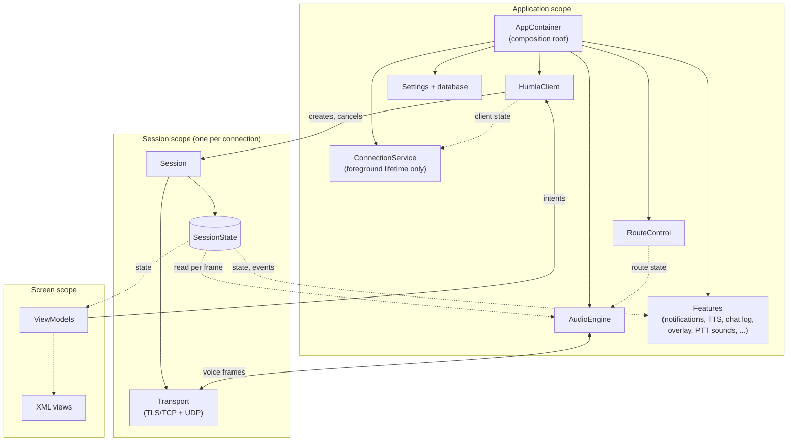
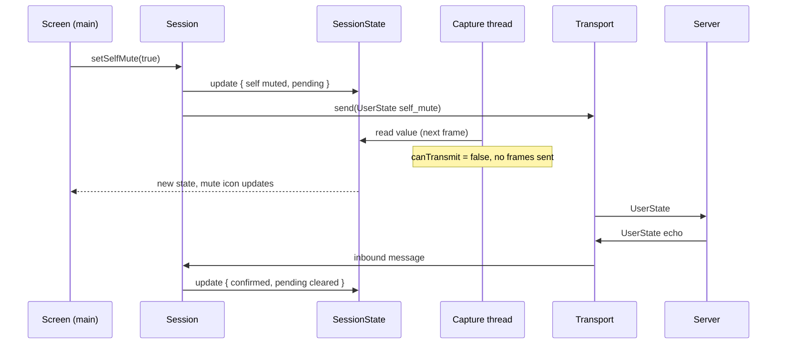

# Target Architecture

Snapshot: `master` at `55a2d70c`, 2026-11-10. Citations name files and
symbols, not line numbers.

Status: proposal. No code exists for any of this. Nothing here authorizes
work; each migration step starts only on explicit request.

## Relationship to the whales list

The [whales list](README.md) is deliberately *satisficing*: the smallest
structural fix for each family of symptoms. This document is the
*optimizing* counterpart: the architecture Mumla OLED would have if it were
designed today, and a path to it. Both share the whales list's admission
bar and its refusal to sweep krill.

## Design goal

Make the correct path the easy path. Today, staying correct in almost any
part of the app means remembering concurrency rules (lock order, which
thread may call what, whether a session or view is still current). In this
architecture those rules are carried by the structure: ownership, lifetimes,
and thread placement are decided once, and ordinary code cannot get them
wrong without visibly breaking the design.

## Overview



Solid arrows are calls or ownership; dotted arrows are state or events
that the receiver collects.

There are three lifetimes: the **application**, a **session** per
connection, and a **screen** per visible UI. Everything belongs to exactly
one of them and is cleaned up when its lifetime ends.

## Components

### `AppContainer` (composition root)

Created in `MumlaApplication`. Constructs every application-scoped object
by hand and passes dependencies through constructors: settings repository,
database, `HumlaClient`, `AudioEngine`, `RouteControl`, and the feature
collectors. Screens obtain what they need from it through a ViewModel
factory. There is no DI framework.

### `HumlaClient`

The single entry point for connecting. Application-scoped.

- Holds the current connection as `StateFlow<ClientState>`:
  `Idle`, `Connecting(server, attempt)`, `Connected(session)`,
  `Reconnecting(server, attempt, lastState)`, `Failed(error)`.
- `connect(server)` cancels any current `Session` and creates a new one.
  `disconnect()` cancels it.
- Owns the reconnect policy. When a session fails, the client waits out the
  backoff and creates a fresh `Session`. During that time
  `Reconnecting.lastState` keeps the last channel tree available so screens
  can keep showing it.
- Holds no protocol state itself.

### `Session`

Everything that exists for one connection, and nothing that outlives it.

- Created with its own `CoroutineScope`, a child of the client's scope.
  Every coroutine, timer, and callback for the connection runs in that
  scope. Cancelling the scope ends the connection.
- All fields are non-null `val`s set at construction: the `Transport`, the
  state flow, the event flow. Nothing is reset or reused.
- Applies server messages to its state in arrival order, in one coroutine
  that drains the transport's inbound channel. The protocol handlers that
  live in [`ModelHandler`](../../libraries/humla/src/main/java/se/lublin/humla/protocol/ModelHandler.kt)
  today become functions from (state, message) to new state.
- Exposes user intents as plain methods: `setSelfMute`, `setSelfDeafen`,
  `setPtt`, `joinChannel`, `sendText`, `setWhisperTarget`, `setLocalMute`,
  and so on. Each updates state atomically and, where the protocol needs
  it, enqueues a message to the server.
- On start, loads the local mute/ignore lists for this server from the
  database. Local mute changes are written back off the main thread.

### `SessionState`

One immutable value per session, held in a `MutableStateFlow`:

```kotlin
data class SessionState(
    val server: ServerState,   // channels, users, permissions, server settings, synced flag
    val local: LocalState,     // PTT pressed, whisper target, pending self-mute/deafen proposals
)
```

`User` and `Channel` become immutable data classes inside `ServerState`.
A `User` carries every fact consumers need about that user (server mute,
self mute, local mute, volume), whoever decided it. Any writer changes
state with `state.update { it.copy(...) }`, an atomic swap. Readers on any
thread read `state.value` and get a complete, consistent value.

During the initial join, the session builds `ServerState` privately and
publishes it once when the server sends `ServerSync` (the protocol's
end-of-initial-state message). After that, each change publishes a new
value.

Things that must never be dropped (text messages, permission denied, user
joined or left, server rejected) are also emitted on a separate
`SharedFlow<SessionEvent>`. State is for "what is true now"; events are for
"this happened".

### `Transport`

The connection's network I/O. Owned by the session.

- A TCP reader thread does blocking reads, parses protobuf frames, and
  sends parsed messages into the session's inbound channel.
- A writer coroutine on the I/O dispatcher drains a bounded outbound
  channel. `send(message)` only enqueues; it never blocks the caller. A full
  queue means the connection is unhealthy and fails the session.
- UDP keeps its existing coroutine
  ([`HumlaUDP`](../../libraries/humla/src/main/java/se/lublin/humla/net/HumlaUDP.kt))
  and lock-free send queue, with the existing fallback to tunnelling voice
  over TCP.
- Keepalive and ping timers are coroutines in the session scope.
- Any fatal I/O error fails the session with a cause. The transport never
  reconnects on its own.

### `AudioEngine`

All audio capture and playback. Application-scoped, so the audio stack is
not torn down and rebuilt by every reconnect.

- **Control thread.** One dedicated thread handles start, stop, and
  reconfigure: creating `AudioRecord`/`AudioTrack`, creating native engines,
  joining old threads. Other code calls `submit(AudioCommand)`, which only
  enqueues. The engine reports `StateFlow<AudioStatus>` and an event flow
  for pipeline errors.
- **Capture thread** (realtime). Reads the microphone, runs native
  DSP/encode, and hands encoded frames to the session's transport. On every
  20 ms frame it reads the current `SessionState` and decides whether to
  transmit with a pure function, `canTransmit(state, inputMode)`, covering
  self mute, server mute or suppress, PTT, and voice activity. Muting
  therefore takes effect on the next frame, without going through the
  control thread.
- **Render thread** (realtime). Pulls mixed audio from the native output
  engine into `AudioTrack`. Inbound voice packets are queued into the
  native engine by the UDP side, which drops packets from users the local
  user has muted (read from `SessionState`).
- **Route changes.** The control thread collects `RouteControl`'s state and
  restarts capture or playback when the device changes.
- The native C++ engines and their JNI facades are unchanged.

### `RouteControl`

Audio routing: communication device, Bluetooth SCO, A2DP, and the settle
and debounce timing. Application-scoped.

- Runs on its own thread (a `HandlerThread`, so platform callbacks can be
  delivered there directly). Blocking platform calls such as
  `setCommunicationDevice` run there, not on main.
- Takes `submit(RouteCommand)`: session started, session ended, preference
  changed.
- Publishes `StateFlow<RouteState>` (applied route, input ready) and events
  (SCO failed).
- Built from today's
  [`AudioRouteController`](../../libraries/humla/src/main/java/se/lublin/humla/audio/AudioRouteController.kt),
  [`BluetoothScoManager`](../../libraries/humla/src/main/java/se/lublin/humla/audio/BluetoothScoManager.kt),
  and `AudioPlatform`/`ScoLink`. Its decision logic and tests carry over.

### App layer

- **`ConnectionService`** is a foreground `Service` that collects
  `HumlaClient.state`. It goes foreground while connecting, connected, or
  reconnecting, holds the wake and Wi-Fi locks, and stops when idle. Nothing
  binds to it, and it contains no connection logic.
- **Features** are small classes, each collecting the state and events it
  cares about: connection notification, message notifications, TTS, chat
  log, PTT sounds, overlay, hot corner, proximity sensor, and the talk
  broadcast receiver. Each one is independent. They replace the
  responsibilities currently piled into
  [`MumlaService`](../../app/src/main/java/se/lublin/mumla/service/MumlaService.kt)
  by inheritance from `HumlaService`.
- **Screens** keep their XML layouts. Each gets a ViewModel that turns
  client and session state into UI state, and calls client or session
  methods for user actions. Fragments and activities collect UI state with
  `repeatOnLifecycle`, so updates arrive on main and only while visible.
  [`MumlaActivity`](../../app/src/main/java/se/lublin/mumla/app/MumlaActivity.kt)'s
  connection, trust-prompt, and reconnect bookkeeping moves into its
  ViewModel.
- **Settings** are a `Flow<Settings>` from the existing DataStore
  repository. `HumlaClient`, `AudioEngine`, and features collect the keys
  they use; storage APIs become `suspend`.

## Threads

| Thread | Runs | May block? |
|---|---|---|
| Main | Views, ViewModels, UI-touching features | Never |
| Default dispatcher | Session message handling, state updates, feature logic | No |
| I/O dispatcher | TCP writer, UDP, database, DataStore | On I/O only |
| TCP reader (one per session) | Blocking socket reads and frame parsing | On the socket |
| Audio control | Audio start, stop, reconfigure, thread joins | Yes, off main |
| Capture, render | Realtime audio | Only on the audio device |
| Route | Platform audio-route calls and callbacks | Yes, off main |

Nothing on main ever waits for another thread. Threads communicate by
enqueuing commands or by publishing state that others read.

## Walkthroughs

### Connecting

1. The server list's ViewModel calls `client.connect(server)`.
2. The client cancels any current session, creates a new `Session`, and
   publishes `Connecting`. `ConnectionService`, collecting client state,
   goes foreground.
3. The session opens its `Transport`. The TLS handshake and authentication
   run on the I/O side.
4. Server messages flow into the session. It builds `ServerState`
   privately and publishes it on `ServerSync`. The client publishes
   `Connected(session)`.
5. The client tells `RouteControl` the session started and tells
   `AudioEngine` to start with this session's state and transport.
6. Screens and features, collecting state, show the channel tree.

### The user mutes



The mute is optimistic, with the server echo as confirmation, preserving
the desktop-parity rules recorded in
[optimistic-self-mute](../optimistic-self-mute/README.md) (deafen implies
mute; the server's version wins).

### Someone else talks

The UDP coroutine receives and decrypts the packet
([`CryptState`](../../libraries/humla/src/main/java/se/lublin/humla/net/CryptState.kt)),
reads the sender's local mute and volume from `SessionState`, and queues
the packet into the native output engine. The render thread mixes it into
`AudioTrack`. Speaking indicators come from the audio engine's talk-activity
flow and are kept out of `SessionState`, which would otherwise change many
times per second.

### A Bluetooth headset connects

The platform callback arrives on the route thread. `RouteControl` applies
the new route and publishes `RouteState`. The audio control thread,
collecting it, restarts capture on the new device. Screens showing the
route update from the same state.

### The network drops

1. The TCP reader hits an I/O error and fails the session.
2. The client cancels the session's scope. The transport, timers, and
   message coroutine stop. Any callback still in flight belongs to that
   cancelled session and does nothing.
3. The client publishes `Reconnecting(lastState)`, waits out the backoff,
   and creates a fresh `Session`. The connecting walkthrough repeats.

### A screen closes or rotates

Its lifecycle stops collection. There is nothing to unregister, and no
update can reach a destroyed view.

## What the structure rules out

| Structure | Rules out |
|---|---|
| Immutable `SessionState`, atomic updates | Half-updated reads, locks on model data, observers holding live objects |
| One `Session` per connection, callbacks capture it | Late events reaching a newer connection; generation counters and stale-event checks |
| Command-only audio and route control | Main waiting on audio or route work; lock-order deadlocks between main and audio |
| `repeatOnLifecycle` collection | Updates on the wrong thread or after a view is destroyed |
| Composition root, features as collectors | Inheritance coupling between app and library; the service-binding layer |

## Enforcement

A check in [`check.sh`](../../scripts/check.sh) fails if `@Volatile`,
`@Synchronized`, `synchronized(`, `Thread(`, `Handler(`, or `runBlocking`
appears in main sources outside an allowlist file.

The allowlist starts as today's 31 files (about 330 sites) so the gate is
green on day one. Each migration step removes files, and the check fails if
a listed file no longer needs to be there, so the list can only shrink. The
expected end state is about nine files at real boundaries: `CryptState`,
the two native engine facades, `AudioInput` and `AudioOutput` (the
realtime threads), `HumlaTCP` and `HumlaUDP` (socket readers),
`HumlaSSLSocketFactory` (TLS callbacks on the socket thread), and
`CrashReporter` (the uncaught-exception handler).

One convention remains outside those files: the lambda passed to
`update {}` must not have side effects, because an atomic swap may retry
it.

## How the whales map

| Whale | Satisficing fix ([README](README.md)) | This architecture |
|---|---|---|
| W1 no session object | Per-connect `Session` owning a scope | `Session` under `HumlaClient`, reconnect owned by the client |
| W2 shared mutable model | Single writer publishing snapshots | Immutable `SessionState`; any writer, atomic updates |
| W3 audio control locks | Single audio-control thread | `AudioEngine` control thread; transmit decided per frame from state |
| W4 half-finished data/DI | Finish *or* revert | Revert: `AppContainer`, suspend storage APIs |
| W5 app god objects | Composition plus ViewModel | Features as collectors, ViewModels, no binding |
| W6 no harness | murmur loopback suite | Same, plus virtual-time tests (below) |

## Testing

- **Virtual-time tests (every `check.sh`).** `Session`, `HumlaClient`,
  `AudioEngine` control, and `RouteControl` are coroutines, so they run
  under `kotlinx-coroutines-test` against fake transports and platforms,
  as [`AudioRouteControllerTest`](../../libraries/humla/src/test/java/se/lublin/humla/audio/AudioRouteControllerTest.kt)
  already does. Cover: disconnect at every step of the sync sequence;
  reconnect racing a user disconnect; mute, deafen, and PTT spam during
  connect and disconnect; route flaps mid-connect. Assert: no voice frame
  while muted; at most one live session; no work runs for a cancelled
  session; every user in exactly one channel.
- **State-transition tests.** Message handling is (state, message) → new
  state, so each protocol handler is tested as a plain function.
- **murmur interop (every `check.sh`).** The whales list's W6 suite: a
  throwaway `murmur` from the dev shell on loopback, with real TLS, UDP
  crypt, and connection code. Required, because fakes only test our idea of
  the server.
- **Trace replay (later).** Recorded server message streams replayed
  through the message handlers as regression fixtures.
- Native audio and crypto keep their existing host suite.

## Migration path

Each step lands as atomic commits in a worktree under the `check.sh` gate,
and each step's "done" includes shrinking the allowlist. Steps 2–4 are each
worth landing on their own.

1. **Harness and gate.** murmur interop, virtual-time scaffolding, and the
   allowlist check seeded with today's files. Done when a known past race
   (e.g. disconnect during sync) is reproduced red.
2. **Immutable state.** Introduce `SessionState`; `User` and `Channel`
   become immutable; `ModelHandler` handlers become state transitions,
   publishing on `ServerSync`. `IHumlaObserver` keeps working, fed from the
   new state, until step 5. Done when `Channel`, `User`, and `ModelHandler`
   leave the allowlist.
3. **`Session` and `HumlaClient`.** Per-connection fields move out of
   `HumlaService` into `Session`; reconnect moves to the client. Done when
   `connectionGeneration` and `shouldDropStaleEvent` are deleted and
   `HumlaConnection` leaves the allowlist. Likely split further: the
   connection code spans about 2,200 lines across `HumlaConnection`,
   `HumlaTCP`, and `HumlaUDP`.
4. **`AudioEngine` and `RouteControl`.** Audio control moves to its own
   thread with transmit decided per frame; route moves to its own thread.
   Done when `mMuteLock` is deleted, no `join` runs on main, and
   `AudioHandler`, `AudioRouteController`, and `BluetoothScoManager` leave
   the allowlist.
5. **Screens on ViewModels.** Replace `IHumlaObserver` in fragments, the
   activity, and the overlay with collected UI state. Done when no screen
   implements an observer.
6. **App cut-over.** `AppContainer`, features as collectors,
   `ConnectionService`, binding layer removed, Hilt and kapt removed,
   storage APIs `suspend`. Done when nothing binds a service and
   `HumlaService`, `MumlaService`, `MumlaActivity`, and the storage files
   leave the allowlist.
7. **Clean up.** Delete `IHumlaObserver`, `HumlaCallbacks`, and any
   compatibility shims. Done when the allowlist is down to the boundary
   files.

## Kill criteria

Fall back to the satisficing whales list if:

- **Step 1** cannot reproduce at least one known past race.
- **Step 2** causes measurable lag on a large server that publishing on
  `ServerSync` does not fix (try a persistent map before giving up).
- **Voice regresses** in glitch rate or latency after step 4 and cannot be
  fixed within this design.

Treat it as a design problem, not an implementation one, if a file cannot
leave the allowlist without new coordination machinery.

## Rejected alternatives

| Alternative | Why rejected |
|---|---|
| **One control loop** owning all non-realtime state | Forces one order on things that have none; a large join sync would queue ahead of mute taps and route events. |
| **Authorities**: state split by who decides it, with joined views for readers | Split `User` by writer even though every reader needs the joined value, then rebuilt the join with extra machinery. |
| **Rules only**: concurrency rules applied across the code | Discipline written down; does not make the wrong path harder. |

## Parked: native voice hot path

Putting the whole voice path in C++ (capture → DSP → Opus → OCB2 →
`sendto`, and the reverse) would remove per-frame JNI crossings and garbage
collection from the realtime path. It is parked because it breaks the
native [fence](../migration/README.md) and the `AudioRecord`/`AudioTrack`
(no Oboe/AAudio) stance. **Revisit trigger:** measured glitches or jitter
attributable to the JNI/Kotlin hop after step 4.

## Non-goals

- Compose or any UI toolkit change. The views and their pixels stay; the
  [killed Compose rewrite](../migration/README.md) stays killed.
- Rewriting the native audio or crypto code.
- Kotlin Multiplatform or an iOS port.
- New features (see the
  [upstream feature gap audit](../upstream-feature-gap-audit/README.md)).

## Open questions

- **Socket readers:** whether `HumlaTCP` and `HumlaUDP` reads can move to
  coroutines on the I/O dispatcher and leave the allowlist.
- **`AudioEngine` scope:** application-scoped (as above, survives
  reconnects) versus per session (simpler teardown, but rebuilds audio on
  every reconnect). Needs a device check of how expensive the rebuild is.
- **Observer compatibility:** whether anything outside the app still needs
  `IHumlaObserver` after step 7.
- **`check.sh` budget:** how much murmur time the gate can absorb (see
  [check-sh-speed](../check-sh-speed/README.md)).
