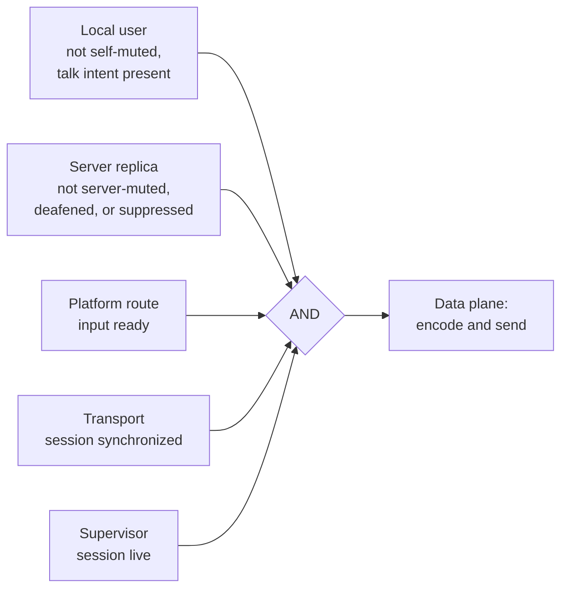
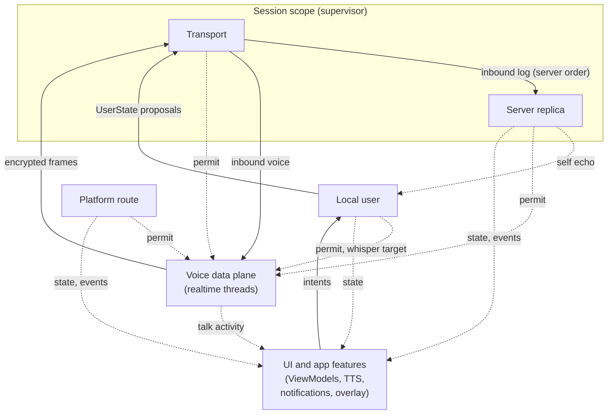

# Target Architecture — Authorities, Not a Loop

Snapshot: `master` at `3bd75bd8`, 2026-11-10. Citations name files and
symbols, not line numbers.

Status: proposal. No code exists for any of this. Nothing here authorizes
work; each step below starts only on explicit request.

## Relationship to the whales list

The [whales list](README.md) is deliberately *satisficing*: for each family
of symptoms it gives the smallest structural fix that removes the family.
This document is the *optimizing* counterpart. It asks what end state makes
W1, W2, and W3 (and most of W4 and W5) impossible to reintroduce, not just
fixed. Both documents share the whales list's admission bar and its refusal
to sweep krill.

## Thesis

W1 (no session object), W2 (shared mutable model), and W3 (audio control
locks shared with the capture thread) share a root cause: **nothing owns
ordering.** The main thread, the TCP read and send threads, the UDP
coroutine, binder callers, and the audio threads all touch shared state, so
every recent concurrency fix took the form "add the right guard here".

The tempting fix is to give ordering one owner: a single control loop. That
is the wrong model (see [rejected alternative](#rejected-alternative-a-single-control-loop)),
because **there is no single ordering to own.** This client has several
independent sources of truth, each with its own order, latency budget, and
lifetime. Forcing them into one total order creates head-of-line blocking,
and every patch for that blocking turns out to be one of those sources of
truth trying to get back out.

Today's code shows the confusion in miniature:
[`User`](../../libraries/humla/src/main/java/se/lublin/humla/model/User.kt)
holds server-decided state (`isMuted`, `isDeafened`, `isSuppressed`),
user-decided state (`isSelfMuted`), and device-local state
(`isLocalMuted`, `isLocalIgnored`) on one mutable object. Three authorities
write it, so it needs locks.

The target partitions state by **authority** (who decides what is true),
gives each authority one confined owner, and makes the composition between
authorities independent of order.

## Authorities

| Authority | Decides | Ordered by | Latency budget |
|---|---|---|---|
| **Server replica** | Channel/user tree, server mute/deafen/suppress, permissions, server settings, inbound text messages | The server's TCP message stream | Tolerant; bursty (join sync) |
| **Local user** | Self-mute/deafen, PTT and VAD talk intent, whisper target, local mute/ignore, per-user volume; pending proposals awaiting server echo | User actions | Critical (privacy) |
| **Platform route** | Communication device, SCO/A2DP state, mode hold, settle and debounce | Android callbacks | Slow, flaky effects |
| **Transport** | TLS socket, TCP framing, UDP channel and crypt lifecycle, keepalive, ping statistics, TCP-tunnel fallback | The network plus timers | Moderate |
| **Voice data plane** | Capture, DSP, encode, render, per-user talk activity | 20 ms audio frames | Realtime |

Two non-authorities complete the picture:

- **Settings** is a published value (the DataStore flow), not an actor.
  Each authority reads the keys it needs as a latest value.
- **The session supervisor** owns lifetimes only (see
  [rule 6](#6-the-supervisor-sequences-lifetimes-never-data)).

Each authority is **one confined actor**: one thread or single-threaded
dispatcher, one inbound queue, one writer for its state. Internally an
actor can be a pure reducer, `step(state, input) → (state, outputs)`, which
keeps it deterministic and testable in isolation.

### Server replica

- **Becomes:** [`ModelHandler`](../../libraries/humla/src/main/java/se/lublin/humla/protocol/ModelHandler.kt),
  moved off main.
- **Inputs:** parsed control messages from transport, in server order.
  Parsing happens on the transport side, not in the replica.
- **Publishes:** `ReplicaState` (persistent maps; one snapshot per drained
  batch, an internal optimization that affects nobody else).
- **Emits events:** text message received, user joined/left/moved,
  permission denied, server rejected.
- **Does not own:** anything the local user decides. Local mute/ignore
  history (today passed into `ModelHandler` as `mLocalMuteHistory` /
  `mLocalIgnoreHistory`) moves to the local-user authority.

A large join sync can only delay the replica's own snapshot. It cannot
delay a mute, a route event, or voice.

### Local user

- **Becomes:** the self-mute/deafen, talk-intent, and whisper logic
  currently spread across `HumlaService`, `AudioHandler`, `InputModes`, and
  the app's PTT, hot-corner, media-key, and talk-broadcast paths.
- **Inputs:** UI and hardware intents; the replica's echo of the
  connected user's server state, for reconciliation.
- **Publishes:** desired self state, talk intent, whisper target, local
  mute/ignore set.
- **Sends:** `UserState` proposals to transport (fire-and-forget).
- **Reconciles:** optimistic self-mute/deafen with server echo as confirm,
  preserving the desktop-parity rules from
  [optimistic-self-mute](../optimistic-self-mute/README.md) (deafen implies
  mute, server coercion wins).

### Platform route

- **Becomes:** [`AudioRouteController`](../../libraries/humla/src/main/java/se/lublin/humla/audio/AudioRouteController.kt)
  plus `AudioPlatform`/`ScoLink`. Its main-confinement and single
  `onEvent` funnel already make it the closest thing to an actor in
  today's code.
- **Publishes:** `RouteState` (applied route, input ready).
- **Emits events:** SCO failed, route changed.
- **Confinement:** see [open questions](#open-questions). Platform calls
  such as `setCommunicationDevice` can block, which argues for a dedicated
  looper instead of main.

### Transport

- **Becomes:** [`HumlaConnection`](../../libraries/humla/src/main/java/se/lublin/humla/net/HumlaConnection.kt),
  [`HumlaTCP`](../../libraries/humla/src/main/java/se/lublin/humla/net/HumlaTCP.kt),
  and [`HumlaUDP`](../../libraries/humla/src/main/java/se/lublin/humla/net/HumlaUDP.kt).
- **Internals:** a blocking reader thread and a writer, coordinated by the
  transport actor. A full outbound queue is a connection fault, not a stall
  for anyone else.
- **Outputs:** the inbound message log to the replica (FIFO, server
  order), `TransportState` (phase, UDP available, RTT), and inbound voice
  packets straight to the data plane.
- **Reports failures** to the supervisor. Transport never reconnects
  itself.

### Voice data plane

- **Becomes:** [`AudioHandler`](../../libraries/humla/src/main/java/se/lublin/humla/protocol/AudioHandler.kt),
  `AudioInput`, `AudioOutput`, and the native engines (C++ unchanged).
- **Not a coroutine actor.** It runs on realtime threads and reads
  configuration only as latest values published by the other authorities
  (one atomic reference per input).
- **Owns the mic gate** (see [rule 3](#3-safety-outputs-are-conjunctions-of-permits)).
- **Publishes:** per-user talk activity as its own high-frequency flow,
  kept out of every other authority's state.
- **Sends:** encoded, encrypted frames to transport through the existing
  lock-free UDP send queue.

## Composition rules

These matter more than the actors themselves. Each has a mechanical check.

### 1. One authority, one owner, one queue

Every piece of state has exactly one writing authority. No queue is shared
between authorities, so one authority's backlog cannot delay another.
A queue may carry one authority's order *to* another (transport → replica
carries server order); it never merges two orders.

**Check:** no type is written from two actors. No actor drains a queue
that another authority's inputs also enter.

### 2. Cross-authority composition is order-insensitive

Combining state from several authorities uses latest values (conflated
flows, atomic snapshots) or operations that are commutative and
idempotent. If correctness depends on how two authorities' updates
interleave, the state is in the wrong place. **Re-partition it; do not add
a coordination mechanism.**

**Check:** the multi-actor simulation (see [testing](#testing)) passes
under every explored interleaving of cross-authority deliveries.

### 3. Safety outputs are conjunctions of permits

The mic gate opens only while **every** relevant authority grants it:

The gate is evaluated where it is used, in the data plane, for each frame.
Any authority closes it immediately by publishing a revoked permit. That
needs no coordination: AND does not depend on order, and closing is always
safe.

The special cases from the single-loop design disappear:
- **Mute close** is the local-user permit being revoked. No bypass is
  needed.
- **PTT press** is the local user granting talk intent. The gate opens
  only if every other permit is already granted, so a stale press can
  never transmit while server-suppressed or disconnected.
- **Server mute** is the replica's permit being revoked. It arrives
  whenever the replica gets to it, and a delay there is fail-closed.

**Check:** simulation invariant — no frame is sent at a scheduler step
where any permit is revoked.

### 4. One-shot events come from their authority

Chat messages come from the replica, SCO failures from route, pipeline
errors from the data plane. Consumers (TTS, notifications, toasts) collect
those event streams. Nobody reconstructs events by diffing snapshots, and
conflated state flows are never relied on for delivery.

**Check:** no consumer compares consecutive snapshots to detect an event.

### 5. Lifetimes are structured

A session scope parents every per-connection actor: transport, replica, and
the local user's pending proposals. Route and the data plane get
session-start and session-end inputs. Teardown is cancelling the scope;
a late input to a cancelled child is dropped by construction. W1 becomes
the scope tree, not an object.

**Check:** no generation counters or stale-session checks exist anywhere.

### 6. The supervisor sequences lifetimes, never data

The supervisor starts and stops children, applies reconnect backoff, and
orders session start and end against route session hooks. It holds only
"current attempt" and backoff state. Connect, reconnect, and teardown are
the only places that coordinate several authorities, and they deal only in
starting and stopping.

**Check:** the supervisor's state type contains no protocol or model data.

### 7. No actor waits on another

Interactions between authorities are fire-and-forget messages or reads of
published values. There are no cross-actor request/response awaits. This is
the general form of the `AudioHandler` ↔ native engine ABBA deadlock in
[mute-tap-deadlock](../mute-tap-deadlock/README.md): two domains each
blocking on the other.

**Check:** no cross-actor `await`/`join`/blocking call. No `Thread.join` on
main.

## Shape

Solid arrows are messages; dotted arrows are published latest values or
event streams.

### Removing the binding layer

`IHumlaService`/`IHumlaSession`, service binding, and
[`HumlaServiceFragment`](../../app/src/main/java/se/lublin/mumla/util/HumlaServiceFragment.kt)
are Jumble-era library heritage: they let third-party apps embed the
protocol service. Mumla OLED is one app in one process, and the app
references `IHumlaService` at 44 sites through a surface that was frozen
only for the duration of the migration.

In the end state, the authorities live at application scope. The `Service`
holds only the foreground lifetime, and screens combine the authorities'
published values through ViewModels. The XML views and their pixels do not
change; the [killed Compose rewrite](../migration/README.md) stays killed.
`MumlaService`'s app features (TTS, PTT sounds, overlay, hot corner,
proximity sensor, notifications, chat log) become collectors of the
relevant state and event streams. They no longer override a library base
class.

### Composition root, no DI framework

Drop Hilt and kapt from both modules and use one hand-written composition
root in `MumlaApplication`. At about 160 Kotlin files the app does not need
a DI framework. Room and DataStore stay, behind suspend/`Flow` APIs
consumed off-main.

## How the whales map

| Whale | Satisficing fix ([README](README.md)) | Authorities model |
|---|---|---|
| W1 no session object | Per-connect `Session` object owning a scope | Dissolved: session scope tree under the supervisor (rules 5, 6) |
| W2 shared mutable model | Single writer publishing snapshots | Dissolved: replica owns server state; self and local state leave `User` (rule 1) |
| W3 audio control locks | Single audio-control thread | Dissolved: mic gate is a conjunction of permits read by the data plane (rules 3, 7) |
| W4 half-finished data/DI | Finish *or* revert | Resolved by reverting: hand-written composition root, suspend storage APIs |
| W5 app god objects | Composition plus ViewModel | Dissolved: binding layer removed; app features collect authority streams |
| W6 no harness | murmur loopback suite in `check.sh` | Expanded: multi-actor deterministic simulation, trace replay, murmur |

## Testing

**Ring 1 — multi-actor simulation (every `check.sh`).** Each actor's
reducer is pure, so a deterministic scheduler can run all of them on a
virtual clock and choose, from a seed, the order in which cross-authority
messages and published values are delivered. That explores interleavings
*between* authorities, which is exactly where today's races live. Faults
are injected from the same seed:
- disconnect at every message boundary of the sync sequence,
- UDP loss, duplication, and reordering,
- crypt desync,
- route flaps mid-connect,
- intent storms (mute, deafen, PTT spam during connect and disconnect),
- reconnect racing a user-initiated disconnect,
- a large-server sync backlog while every other authority stays busy.

Invariants, checked after every scheduler step:
- no voice frame is sent while any permit is revoked;
- a revoked permit closes the gate within one data-plane frame, whatever
  the replica's backlog;
- at most one live session scope; no input reaches a cancelled child;
- every user is in exactly one channel, and every channel's parent exists;
- local-user reconciliation converges to the server echo;
- reconnect backoff stays within its bounds.

**Ring 2 — trace replay (required).** Record inbound control streams from
real servers, scrubbed with the rules in
[`CrashReportScrubber`](../../app/src/main/java/se/lublin/mumla/util/CrashReportScrubber.kt)
where they apply, and replay them through the replica as regression
fixtures.

**Ring 3 — murmur interop (required).** The whales list's W6 suite: a
throwaway `murmur` from the dev shell on loopback, exercising real TLS,
real UDP crypt, and the real Android-free parts of the shell.

Rings 2 and 3 are **required**, not optional. Ring 1 only tests the fake
server it is given; if that model of murmur is wrong, the invariants pass
against a protocol that does not exist.

Native audio and crypto keep their existing host suite unchanged.

## Why this is not the Compose rewrite again

The Compose rewrite was killed because its only acceptance oracle was
pixel parity: subjective, expensive, and blessing whatever the new UI
rendered. This design has **objective oracles**: upstream `murmur`
behavior, recorded traces, machine-checked invariants, and a mechanical
check per composition rule.

It is also less of a rewrite than it looks. Rough versions of the seams
already exist: the route controller is main-confined behind one funnel,
`ModelHandler` is main-confined, and UDP runs in its own coroutine. What
is missing is real confinement (they share threads and locks) and the
composition rules.

## Migration path (strangler, every step green)

Each step lands as atomic commits in a worktree under the usual `check.sh`
gate. Old and new paths coexist until the final step. Steps 2 onward are
each independently valuable.

1. **Harness.** Ring 3 (murmur) plus the multi-actor scheduler scaffolding
   from Ring 1, run against the current code wherever possible. Done when
   a known past race (e.g. disconnect during sync) is reproduced red.
2. **Mic gate as a conjunction of permits.** Introduce the five permit
   inputs to the data plane, published initially by the *existing* code
   (`HumlaService`, `ModelHandler`, `AudioRouteController`,
   `HumlaConnection`). This is the smallest step with the largest privacy
   and ANR payoff. Done when `mMuteLock` and the documented
   `AudioHandler` monitor order are deleted, and mute takes no lock
   reachable from main.
3. **Server replica.** Move `ModelHandler` into a confined actor off main,
   publishing `ReplicaState` and events. TCP frames stop being posted to
   the main looper. Done when `model/` has no locks or volatiles and
   `User` carries only server-decided fields.
4. **Local user.** Extract self state, talk intent, whisper target, local
   mute/ignore, and reconciliation out of `HumlaService`, `AudioHandler`,
   and the app's input paths. Done when no other actor writes those
   fields.
5. **Transport and supervisor.** `HumlaConnection` becomes the transport
   actor; the supervisor owns the session scope and reconnect policy.
   Likely needs splitting further (connection control spans about 2,200
   lines across three files). Done when `connectionGeneration`,
   `shouldDropStaleEvent`, and every connection-state lock are deleted.
6. **Platform route.** Finish confining `AudioRouteController` as an actor
   and, if the open question resolves that way, move platform calls off
   main. Done when no route call can block main.
7. **App cut-over.** Application-scoped authorities, ViewModels for the
   connected screens, `MumlaService` features as collectors, Hilt and kapt
   removed. Done when `HumlaService` is not `open` and no app code binds
   the service.
8. **Delete old paths.** Remove the binding surface, `HumlaCallbacks`
   fan-out (if no collector still needs it), and compatibility
   forwarders. Done when every rule's check passes.

## Kill criteria

Stop and fall back to the satisficing whales list if:

- **Step 1** cannot reproduce at least one known past race. The
  simulation would then not buy the safety this plan depends on.
- **Step 2** cannot delete `mMuteLock`. The permit model would then not fit
  the data plane.
- **Voice regresses.** Measured glitch rate or mouth-to-ear latency
  regresses and cannot be fixed within the data-plane design.

And treat this as a signal that the *model* is wrong, not the
implementation:

- **The epicycle check.** If the same state keeps needing a
  cross-authority coordination mechanism (an exception to rules 2 or 7),
  re-partition the authorities. Adding the mechanism is how the
  single-loop design failed.
- **Supervisor creep.** If the supervisor starts accumulating protocol or
  model data (rule 6), an authority is missing.

## Rejected alternative: a single control loop

The first draft of this document proposed one event loop owning all
non-realtime state, with a pure `step(state, event) → (state, effects)`
core. It was rejected because it imposes one total order where none
exists, which causes head-of-line blocking: a large join sync queues ahead
of mute taps, route events, and timers. (Today's code already has this
problem on the main thread, where `HumlaTCP` posts every frame.)

Each patch needed to make the loop safe was an authority trying to get
out:

| Patch the loop needed | Authority it really was |
|---|---|
| Mic-close gate bypassing the loop | Local user's authority over the mic (rule 3) |
| Priority lane for intents | Local user; intents need no order relative to server frames |
| Route effects on their own threads | Platform route |
| Separate flow for speaking indicators | Voice data plane's talk activity |
| Batching sync to bound the stall | Server replica; its backlog should block nobody else |
| Effect executors that must never block the loop | Rule 7 |

The per-actor pure reducer survives from that draft. The single shared
queue does not.

## Parked: native voice hot path

The biggest optional move is putting the entire voice path in C++:
capture → DSP → Opus → OCB2 → `sendto`, and the reverse. Kotlin would
then only publish permits and configuration. That removes per-frame JNI
crossings and GC from the realtime path.

It is parked because it breaks two deliberate decisions: the native
[fence](../migration/README.md) and the `AudioRecord`/`AudioTrack` (no
Oboe/AAudio) stance. The current native code is also recent and tested.

**Revisit trigger:** measured glitches or jitter attributable to the
JNI/Kotlin hop after step 2. The permit and latest-value inputs are
designed so the data plane can move native without touching any other
authority.

## Non-goals

- **Compose, or any UI toolkit change.** The views and their pixels stay.
- **Rust or other rewrites of the native audio and crypto code.** They stay
  fenced.
- **Kotlin Multiplatform or an iOS port.** There is no second consumer.
- **New features.** The [upstream feature gap audit](../upstream-feature-gap-audit/README.md)
  gets cheaper after this, but it is out of scope.

## Open questions

- **Route confinement:** main (Android delivers many audio callbacks
  there) or a dedicated looper (keeps blocking platform calls off the UI).
- **Actor implementation:** coroutines on single-threaded dispatchers
  (`limitedParallelism(1)`) with a `Channel` each, or dedicated threads.
  Either works as long as reducers never suspend and rule 7 holds.
- **Text messages:** whether the chat log is replica-owned (server
  messages) with the app's `mMessageLog` reduced to a view, or stays an
  app-side collector of replica events.
- **Persistent collections:** `kotlinx-collections-immutable` is still
  pre-1.0; the alternative is a small purpose-built structure for the
  replica.
- **Module split:** a separate Android-free module for the reducers
  (enforces purity at the build level) or packages inside
  `:libraries:humla` (less build churn).
- **Observer compatibility:** whether `IHumlaObserver` survives step 8 at
  all, given that every in-tree consumer can move to streams.
- **`check.sh` budget:** how much simulation volume and murmur time the
  gate can absorb (see [check-sh-speed](../check-sh-speed/README.md)).
