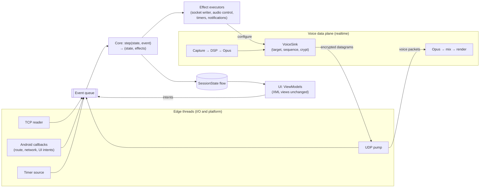

# Target Architecture — Going Big on the Whales

Snapshot: `master` at `e3900444`, 2026-11-10. Citations name files and
symbols, not line numbers.

Status: proposal. No code exists for any of this. Nothing here authorizes
work; each step below starts only on explicit request.

## Relationship to the whales list

The [whales list](README.md) is deliberately *satisficing*: for each family
of symptoms it gives the smallest structural fix that removes the family.
This document is the *optimizing* counterpart. It asks what end state makes
W1, W2, and W3 (and most of W4 and W5) impossible to reintroduce, not just
fixed.

The two documents share a path but not a destination. The whales list ends
at "fewer locks, clearer owners". This document ends at "no shared mutable
state outside the native realtime threads". Both keep the whales list's
admission bar and its refusal to sweep krill.

## Thesis: one missing owner

W1 (no session object), W2 (shared mutable model), and W3 (audio control
locks shared with the capture thread) look like three problems. They are one:
**nothing in the system owns ordering.** The main thread, the TCP read and
send threads, the UDP coroutine, binder callers, and the audio threads all
mutate or read shared state directly. Every concurrency fix in the recent
churn therefore takes the same form: add the right guard at the right
place, then document the lock order in a comment.

The big move is to give ordering a single owner once, so that guards stop
being necessary instead of being placed more carefully.

## End-state invariants

These are the target, stated so a reviewer can check them mechanically:

1. **One control thread.** All non-realtime state (connection, session,
   model, voice targets, audio control, route decisions, config) is owned by
   one event loop. Nothing else reads or writes it.
2. **Pure core.** Protocol logic is a pure function
   `step(state, event) → (state, effects)` in a JVM-only module with no
   `android.*` imports. It does no I/O and reads no clocks.
3. **Immutable state, published.** `state` is an immutable value. Observers
   receive snapshots (`StateFlow`), never live objects.
4. **Threads at the edges only.** Socket readers, the UDP pump, Android
   callbacks, and audio threads only enqueue events or execute effects. The
   one exception is the voice data plane (see below), which bypasses the
   loop through a single lock-free handoff.
5. **No Kotlin locks in the core.** `grep -E 'synchronized|@Synchronized|@Volatile|ReentrantLock'`
   over the core module returns nothing.

## Shape



### Control plane

Everything that is not a 20 ms voice frame goes through the loop:
- protobuf control messages in both directions,
- UDP pings and crypt resync requests,
- timers (keepalive, reconnect backoff, route settle and debounce),
- user intents (connect, mute, deafen, move, whisper),
- route and network events from Android,
- config changes.

[`ConfigDelta`](../../libraries/humla/src/main/java/se/lublin/humla/util/ConfigDelta.kt)
is already shaped like an event, and `AudioRouteController.onEvent` is
already a single funnel; both become event types rather than separate
mechanisms.

A sketch, not an API commitment:

```kotlin
sealed interface Event {
    data class Frame(val type: Int, val payload: ByteArray) : Event
    data class Intent(val intent: UserIntent) : Event
    data class Route(val event: RouteEvent) : Event
    data class Timer(val id: TimerId) : Event
    data class Config(val delta: ConfigDelta) : Event
    data class Transport(val change: TransportChange) : Event
}

sealed interface Effect {
    data class Send(val type: Int, val message: MessageLite) : Effect
    data class ConfigureVoice(val sink: VoiceSinkConfig) : Effect
    data class Audio(val command: AudioCommand) : Effect
    data class Schedule(val id: TimerId, val delayMs: Long) : Effect
    data class Publish(val state: SessionState) : Effect
}

fun step(state: CoreState, event: Event): Pair<CoreState, List<Effect>>
```

### Voice data plane

Routing every voice frame through the loop would couple voice latency to
control-plane load (a large channel-tree sync on join). So voice bypasses
the loop:

- The core emits `ConfigureVoice` (whisper target, codec settings, crypt
  handle, mute gate) whenever any of those change.
- The executor publishes that config to a `VoiceSink` through one atomic
  reference swap. That swap is the only cross-thread handoff the data plane
  has.
- Capture threads read the current config, encode, encrypt, and hand
  datagrams to the UDP pump. Inbound voice goes from the UDP pump straight
  to the native output engine.
- Data-plane anomalies (decrypt failures that need resync, talk-state
  edges) are reported *back* as events. The data plane never mutates core
  state.

[`CryptState`](../../libraries/humla/src/main/java/se/lublin/humla/net/CryptState.kt)
stays native and keeps its existing thread-safety. Only its *lifecycle*
(create, resync, discard) moves under the core.

### Session as a value

There is no `Session` object with a lifetime to get wrong. `CoreState` holds
an optional `SessionState`: connection phase, model, voice targets, and
permissions. Connecting builds a new one, disconnecting drops it, and
reconnecting replaces it.

A late event for a dead session is rejected by checking the session id in
`step`, not by a generation counter spread across threads.

### Android shell

`:libraries:humla` shrinks to the shell around the core:
- the foreground `Service` (lifetime and notification only),
- `AudioRecord`/`AudioTrack` and the native engines,
- `AudioPlatform`/`ScoLink`,
- socket I/O,
- effect executors.

`AudioRouteController`'s decision logic moves into the core as pure state
transitions. Its platform calls become effects.

### Removing the binding layer

`IHumlaService`/`IHumlaSession`, service binding, and
[`HumlaServiceFragment`](../../app/src/main/java/se/lublin/mumla/util/HumlaServiceFragment.kt)
are Jumble-era library heritage: they let third-party apps embed the
protocol service. Mumla OLED is one app in one process, and the app
references `IHumlaService` at 44 sites through a surface that was frozen
only for the duration of the migration.

In the end state, the core and its executors live at application scope.
The `Service` holds the foreground lifetime, and screens collect
`StateFlow<SessionState>` through ViewModels. The XML views and their pixels
do not change. This is a state-layer change, not a UI rewrite, and the
[killed Compose rewrite](../migration/README.md) stays killed.

`MumlaService`'s app features (TTS, PTT sounds, overlay, hot corner,
proximity sensor, notifications, chat log) become independent collectors of
the same flow. They no longer override a library base class.

### Composition root, no DI framework

Drop Hilt and kapt from both modules and use one hand-written composition
root in `MumlaApplication`. At about 160 Kotlin files the app does not need
a DI framework, and the core needs nothing injected beyond its inputs.
Room and DataStore stay, behind suspend/`Flow` APIs consumed off-main.

## How the whales map

| Whale | Satisficing fix ([README](README.md)) | Going big |
|---|---|---|
| W1 no session object | Per-connect `Session` object owning a scope | Dissolved: session is a value inside `CoreState` |
| W2 shared mutable model | Single writer publishing snapshots | Dissolved: state is immutable by construction |
| W3 audio control locks | Single audio-control thread | Dissolved: audio control is effects from the one loop; data plane has one atomic handoff |
| W4 half-finished data/DI | Finish *or* revert | Resolved by reverting: hand-written composition root, suspend storage APIs |
| W5 app god objects | Composition plus ViewModel | Dissolved: binding layer removed, app features are flow collectors |
| W6 no harness | murmur loopback suite in `check.sh` | Expanded: deterministic simulation plus trace replay plus murmur |

## Testing: deterministic simulation

The pure core is what makes going big safe. It allows testing that the
current architecture cannot support.

**Ring 1 — simulation (every `check.sh`).** Run `step` against a scripted
fake server on a virtual clock with seeded fault injection:
- disconnect at every message boundary of the sync sequence,
- UDP loss, duplication, and reordering,
- crypt desync,
- route flaps mid-connect,
- intent storms (mute/deafen spam during connect and disconnect),
- reconnect racing a user-initiated disconnect.

Every failure is reproducible from its seed. Invariants are checked after
every step:
- at most one live session;
- every user is in exactly one channel, and every channel's parent
  exists;
- no `Send` or voice config effect targets a dead session;
- while self-muted, server-muted, or suppressed, the voice config gate is
  closed;
- reconnect backoff stays within its bounds;
- after `Disconnect`, no audio command other than stop is emitted.

**Ring 2 — trace replay.** Record the inbound control stream from real
servers (payloads scrubbed through the existing crash-report scrubbing
rules) and replay it through `step` as regression fixtures. Upstream
behavior gets pinned without hand-writing message sequences.

**Ring 3 — murmur interop.** The whales list's W6 suite: a throwaway
`murmur` from the dev shell on loopback, exercising real TLS, real UDP
crypt, and the real shell. It is slower and coarser, and exists to catch
shell and integration faults the simulation abstracts away.

Native audio and crypto keep their existing host suite unchanged.

## Why this is not the Compose rewrite again

The Compose rewrite was killed because its only acceptance oracle was
pixel parity. That oracle is subjective, expensive, and blesses whatever
the new UI renders. This rewrite has **objective oracles**: upstream
`murmur` behavior, recorded traces, and machine-checked invariants. It also
has a hard mechanical end condition (invariant 5). Each strangler step
either deletes guards or it does not.

## Migration path (strangler, every step green)

Each step lands as atomic commits in a worktree under the usual
`check.sh` gate. The old and new paths coexist until step 6.

1. **Harness first.** Ring 3 (murmur) plus the Ring 1 scaffolding, run
   against the *current* code wherever possible. Done when a known past
   race (e.g. disconnect during sync) is reproduced red under the harness.
2. **Model reducer.** Port
   [`ModelHandler`](../../libraries/humla/src/main/java/se/lublin/humla/protocol/ModelHandler.kt)
   to a pure reducer over immutable model state. Keep `IHumlaObserver`
   delivering snapshot values for compatibility. This is the easiest step
   because the handler is already mostly a message → mutation map. Done
   when `model/` has no locks or volatiles and the topology and self-mute
   tests pass against the reducer.
3. **Connection control.** Fold handshake, sync, keepalive, reconnect
   backoff, and the UDP/TCP fallback decision into `step`. `HumlaConnection`
   becomes socket I/O plus an executor. Done when `connectionGeneration`
   and every connection-state lock are deleted.
4. **Audio control and route.** Move `AudioHandler` control (mute, start,
   stop, bandwidth) and `AudioRouteController` decisions into `step`, and
   introduce `VoiceSink` for the data plane. Done when `mMuteLock` and the
   documented monitor order are deleted, and no `Thread.join` runs on
   main.
5. **Cut over the app.** Application-scoped core and `StateFlow`,
   ViewModels for the connected screens, `MumlaService` features as
   collectors, Hilt and kapt removed. Done when `HumlaService` is not
   `open` and no app code binds the service.
6. **Delete the old path.** Remove the binding surface, `HumlaCallbacks`
   fan-out (if no collector still needs it), and any compatibility
   forwarders. Done when the five end-state invariants hold.

Steps 2–4 are each independently valuable. Stopping after any of them
still leaves the codebase strictly better than the satisficing fix for the
corresponding whale.

## Kill criteria

Stop and fall back to the satisficing whales list if:

- **Step 1** cannot reproduce at least one known past race. If so, the
  simulation is not buying the safety this plan depends on.
- **Step 2** does not delete more guard code than it adds. If so, the
  reducer style does not fit this protocol.
- **Voice regresses.** Measured glitch rate or mouth-to-ear latency
  regresses after step 4 and cannot be fixed within the data-plane design.

## Parked: native voice hot path

The biggest optional move is putting the entire voice path in C++:
capture → DSP → Opus → OCB2 → `sendto`, and the reverse. Kotlin would then
only configure the data plane. That removes per-frame JNI crossings and GC
from the realtime path, and deletes the Kotlin capture and render threads.

It is parked because it breaks two deliberate decisions: the native
[fence](../migration/README.md) and the `AudioRecord`/`AudioTrack` (no
Oboe/AAudio) stance. The current native code is also recent and tested.

**Revisit trigger:** measured audio glitches or jitter attributable to the
JNI/Kotlin hop after step 4. The `VoiceSink` boundary is designed so this
can later move native without touching the core.

## Non-goals

- **Compose, or any UI toolkit change.** The views and their pixels stay.
- **Rust or other rewrites of the native audio and crypto code.** They stay
  fenced.
- **Kotlin Multiplatform or an iOS port.** There is no second consumer;
  the pure core happens to make it possible, but it is not a goal.
- **New features.** The [upstream feature gap audit](../upstream-feature-gap-audit/README.md)
  gets cheaper after this, but it is out of scope.

## Open questions

- **Module split:** a separate `:libraries:humla-core` (enforces "no
  `android.*`" at the build level) or a package inside `:libraries:humla`
  (less build churn).
- **Event loop implementation:** a dedicated thread draining a
  `Channel<Event>`, or a single-threaded coroutine dispatcher. Either works
  as long as `step` itself never suspends.
- **Observer compatibility window:** whether `IHumlaObserver` survives step
  6 at all, given that every in-tree consumer can move to flows.
- **Trace format and scrubbing:** how much of the crash-report scrubber
  ([`CrashReportScrubber`](../../app/src/main/java/se/lublin/mumla/util/CrashReportScrubber.kt))
  can be reused for recorded control streams.
- **`check.sh` budget:** how much simulation volume and murmur time the
  gate can absorb (see [check-sh-speed](../check-sh-speed/README.md)).
