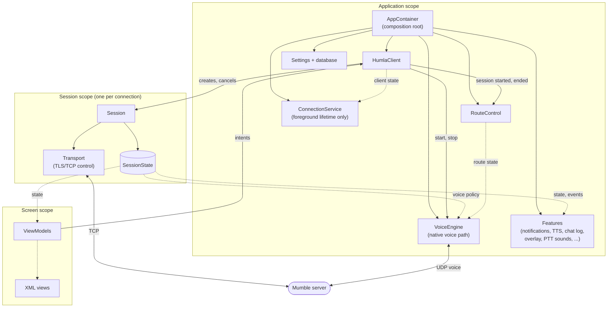
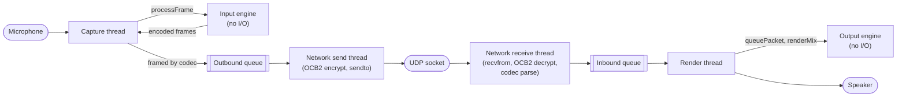
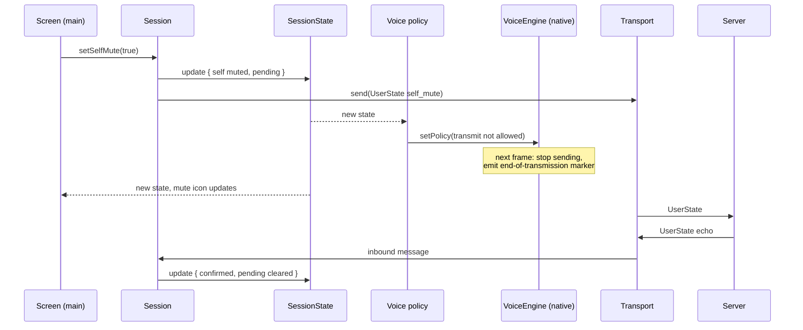

# Target Architecture

Snapshot: `master` at `08651804`, 2026-11-10. Citations name files and
symbols, not line numbers.

Status: proposal. No code exists for any of this. Nothing here authorizes
work; each migration step starts only on explicit request.

## Relationship to the whales list

The [whales list](README.md) is deliberately *satisficing*: the smallest
structural fix for each family of symptoms. This document is the
*optimizing* counterpart: the architecture Mumla OLED would have if it were
designed today, and a path to it. Both share the whales list's admission
bar and its refusal to sweep krill.

## Design goal

Make the correct path the easy path. Today, staying correct in almost any
part of the app means remembering concurrency rules (lock order, which
thread may call what, whether a session or view is still current). In this
architecture those rules are carried by the structure: ownership, lifetimes,
and thread placement are decided once, and ordinary code cannot get them
wrong without visibly breaking the design.

Implementation is not the bottleneck: the `HumlaService` decomposition took
a day and the Java-to-Kotlin migration three. **Verification is.** The plan
below is paced by what can be checked, not by what can be written.

## Overview



Solid arrows are calls or ownership; dotted arrows are state or events
that the receiver collects.

There are three lifetimes: the **application**, a **session** per
connection, and a **screen** per visible UI. Everything belongs to exactly
one of them and is cleaned up when its lifetime ends.

There are two languages with a deliberate line between them. **Kotlin owns
decisions** (who is muted, who we whisper to, which route, whether we are
connected). **Native code owns the voice path** (capture, processing,
encoding, packet framing, encryption, UDP, decoding, mixing, playback).
Kotlin tells native code what it may do; native code never asks Kotlin
anything per frame.

## Components

### `AppContainer` (composition root)

Created in `MumlaApplication`. Constructs every application-scoped object
by hand and passes dependencies through constructors: settings repository,
database, `HumlaClient`, `VoiceEngine`, `RouteControl`, and the feature
collectors. Screens obtain what they need from it through a ViewModel
factory. There is no DI framework.

### `HumlaClient`

The single entry point for connecting. Application-scoped.

- Holds the current connection as `StateFlow<ClientState>`:
  `Idle`, `Connecting(server, attempt)`, `Connected(session)`,
  `Reconnecting(server, attempt, lastState)`, `Failed(error)`.
- `connect(server)` cancels any current `Session` and creates a new one.
  `disconnect()` cancels it.
- Owns the reconnect policy. When a session fails, the client waits out the
  backoff and creates a fresh `Session`. During that time
  `Reconnecting.lastState` keeps the last channel tree available so screens
  can keep showing it.
- Sequences lifetimes across components: it starts and stops the
  `VoiceEngine` and tells `RouteControl` when a session starts and ends (see
  [session start and audio routing](#session-start-and-audio-routing)).
- Holds no protocol state itself.

### `Session`

Everything that exists for one connection, and nothing that outlives it.

- Created with its own `CoroutineScope`, a child of the client's scope.
  Every coroutine and timer for the connection runs in that scope.
- All fields are non-null `val`s set at construction: the `Transport`, the
  state flow, the event flow. Nothing is reset or reused.
- Applies server messages to its state in arrival order, in one coroutine
  that drains the transport's inbound channel. The protocol handlers that
  live in [`ModelHandler`](../../libraries/humla/src/main/java/se/lublin/humla/protocol/ModelHandler.kt)
  today become functions from (state, message) to new state.
- Exposes user intents as plain methods: `setSelfMute`, `setSelfDeafen`,
  `setPtt`, `joinChannel`, `sendText`, `setWhisperTarget`, `setLocalMute`,
  and so on. Each updates state atomically and, where the protocol needs
  it, enqueues a message to the server.
- On start, loads the local mute/ignore lists for this server from the
  database. Local mute changes are written back off the main thread.

**What ending a session stops, and how.** Coroutines in the session scope
and anything sent through its channels stop when the scope is cancelled.
Three things are not covered by cancellation alone and are handled
explicitly:
- The TCP reader thread is blocked in a socket read, which cancellation
  cannot interrupt. The scope's completion handler closes the socket,
  which unblocks the read; the reader's final send into a closed channel
  fails harmlessly.
- The `VoiceEngine` outlives sessions. The client stops it (closing the
  native UDP socket and discarding the session's crypt state) *before* the
  session's transport closes, and starts it again with the new session's
  socket and keys. Native code therefore never holds a reference into a
  dead session.
- Platform callbacks (route, network) go to application-scoped components,
  never to a session.

### `SessionState`

One immutable value per session, held in a `MutableStateFlow`:

```kotlin
data class SessionState(
    val server: ServerState,   // channels, users, permissions, server settings, synced flag
    val local: LocalState,     // PTT pressed, whisper target, pending self-mute/deafen proposals
)
```

`User` and `Channel` become immutable data classes inside `ServerState`.
A `User` carries every fact consumers need about that user (server mute,
self mute, local mute, volume), whoever decided it. Any writer changes
state with `state.update { it.copy(...) }`, an atomic swap. Readers on any
thread read `state.value` and get a complete, consistent value.

During the initial join, the session builds `ServerState` privately and
publishes it once when the server sends `ServerSync` (the protocol's
end-of-initial-state message). After that, each change publishes a new
value.

Things that must never be dropped (text messages, permission denied, user
joined or left, server rejected) are also emitted on a separate
`SharedFlow<SessionEvent>`. State is for "what is true now"; events are for
"this happened".

### `Transport`

The connection's TCP control channel. Owned by the session.

- A TCP reader thread does blocking reads, parses protobuf frames, and
  sends parsed messages into the session's inbound channel.
- A writer coroutine on the I/O dispatcher drains a bounded outbound
  channel. `send(message)` only enqueues; it never blocks the caller. A full
  queue means the connection is unhealthy and fails the session.
- Keepalive timers are coroutines in the session scope.
- Decides whether voice goes over UDP or is tunnelled over TCP, from the
  UDP ping results the `VoiceEngine` reports. In tunnel mode it carries
  voice packets between the server and the `VoiceEngine` (see below).
- Any fatal I/O error fails the session with a cause. The transport never
  reconnects on its own.

### `VoiceEngine` (native voice path)

The whole voice path, in C++, with a thin Kotlin facade. Application-scoped
(see [spikes](#spikes) for the alternative).

**The invariant: I/O and no-I/O stay separate.** Today's native engine does
no I/O:
[`AudioInputEngine`](../../libraries/humla/src/main/jni/audio_engine/AudioInputEngine.h)
takes PCM through `processFrame` and produces encoded packets;
[`AudioOutputEngine`](../../libraries/humla/src/main/jni/audio_engine/AudioOutputEngine.h)
takes packets through `queuePacket` and produces mixed PCM from
`renderMix`; the DSP, VAD, pre-speech buffer, Opus wrappers, jitter
buffers, and OCB2 crypt are all bytes-in, bytes-out. It owns no threads,
sockets, or audio devices, which is why the host suite can test it
exhaustively. This separation is the one property of the native code the
design does not trade away. Everything that touches a thread, socket, or
audio device lives in a separate **voice I/O layer** on top.

**The engine itself may be refactored.** Its current shape suits being
called from several ordinary Java threads, but not realtime audio threads:
- `AudioOutputEngine` guards both `queuePacket` and `renderMix` with one
  mutex, so a network thread queuing packets competes with playback for
  the same lock.
- `AudioInputEngine` invokes its packet callback while holding its locks.
- The first packet from a new user creates a decoder and inserts into a
  map inside `queuePacket`, which allocates memory.

Step 5a refactors the engine, still with no I/O, toward:
- **Single-threaded by contract.** Each engine instance is driven by
  exactly one thread and has no internal locks. Getting data to it from
  other threads is the I/O layer's job.
- **Outputs as return values.** `processFrame` writes packets into a
  caller-provided buffer, and talk-activity edges are returned the same
  way, instead of callbacks invoked under a lock.
- **No allocation in steady state.** Buffers are preallocated. Per-user
  resources (decoder, jitter buffer) are created off the realtime thread by
  the I/O layer and handed to the engine with that user's first packet, or
  drawn from a preallocated pool.
- **Configuration as one value.** Settings and policy are applied with a
  single call at a frame boundary.

Golden-output tests recorded *before* the refactor (fixed input PCM and
packets, captured outputs) check that the refactored engine behaves as
today's does.



Threads and queues are the I/O layer. The engines, the packet codec, and
OCB2 are the no-I/O layer, called by those threads.

**No-I/O layer.**
- **Input and output engines.** Capture DSP (RNNoise, filters, leveler),
  voice activity detection, the pre-speech buffer, and the Opus encoder on
  the way out; jitter buffers, Opus decoders, and the mixer on the way in.
  The input engine owns frame numbers and emits the end-of-transmission
  marker itself when an utterance ends, including when a mute cuts one
  short.
- **Packet codec** (new), written in the same style beside the engines. It
  frames encoded frames into packets (both the protobuf `MumbleUDP.Audio`
  format and the legacy format, as today's
  [`AudioHandler`](../../libraries/humla/src/main/java/se/lublin/humla/protocol/AudioHandler.kt)
  does), adds the whisper target, and parses inbound packets back into
  (sender, frame number, payload, end-of-transmission).
- **OCB2 crypt** from [`crypto`](../../libraries/humla/src/main/jni/crypto/),
  unchanged. It already has separate encrypt and decrypt locks, and it is
  used only by the two network threads, never on a realtime thread.

**Voice I/O layer** (new). Owns every thread, socket, and audio device:
- **Capture thread.** Reads the microphone through AAudio. At each frame
  boundary it applies the latest `VoicePolicy`, calls `processFrame`, frames
  the resulting packets with the codec, and pushes them to the outbound
  queue.
- **Network send thread.** Drains the outbound queue, encrypts, and sends.
  Sends UDP pings when Kotlin asks.
- **Network receive thread.** Receives, decrypts, and parses. Voice goes to
  the inbound queue; for a sender it has not seen before, it first creates
  that user's decoder and jitter buffer, off the realtime path. Pings and
  other non-voice packets go to the notifier.
- **Render thread.** Drains the inbound queue into the output engine, calls
  `renderMix`, and writes to the device.
- **Notifier thread.** The only native thread that calls into Kotlin. It
  carries talk-activity edges, ping results, and errors.
- **Tunnel mode.** When UDP is unavailable, the send thread hands framed
  (unencrypted) packets to the notifier for Kotlin's TCP tunnel, and
  Kotlin pushes tunnelled inbound packets into a second inbound queue. One
  Kotlin crossing per frame, only in the fallback.

### Realtime rules

1. **The capture and render threads never wait on a lock, allocate, make a
   system call other than the audio read or write, or call into Kotlin.**
2. **Each engine instance is driven by one thread.** Every other thread
   reaches it through a single-producer, single-consumer lock-free queue or
   the atomically swapped `VoicePolicy`.
3. **Only the notifier thread calls into Kotlin.**

AAudio offers two ways to run a stream: a data callback on a thread AAudio
owns, or blocking reads and writes on threads we own. Both satisfy these
rules once the engine is refactored; the blocking mode is easier to debug.
The choice is a [spike](#spikes).

**Kotlin facade.** Non-blocking control only:
- `submit(VoiceCommand)` for start (socket address, crypt keys, codec
  settings), stop, and reconfigure. A Kotlin control thread performs these,
  because opening and closing audio streams can block.
- `setPolicy(VoicePolicy)`: see [transmit and mute](#transmit-and-mute).
- Outputs: `StateFlow<VoiceStatus>` (streams up, UDP reachable, crypt
  statistics), talk-activity edges as their own flow, and an event flow for
  pipeline errors and resync requests.

**Kept:** the I/O/no-I/O separation, the DSP, VAD, pre-speech buffer,
Opus, jitter, and mixer algorithms, OCB2, and the host suite.
**Refactored:** the engines' threading, output, and allocation shape
(step 5a). **New:** the packet codec, and the I/O layer with its threads
and queues.

### Transmit and mute

Deciding whether to send has inputs that belong to the session (self mute,
server mute and suppress, PTT, whisper target) and mechanics that belong to
the voice path (voice activity, the pre-speech buffer, the
end-of-transmission marker). That split exists in any design. What this
design fixes is the other half of today's problem: the mechanics are
currently spread across Kotlin and C++, with three crossings per outgoing
frame (Kotlin capture → native encode → Kotlin framing → native encrypt →
Kotlin send). With the native path, all transmit state lives on the native
side and is touched only on the capture thread: the input engine keeps
voice activity, the pre-speech buffer, frame numbers, and the
end-of-transmission marker; the codec adds the whisper target; the capture
thread applies the policy.

The session side is pushed, never pulled:

- `VoicePolicy` is a small value computed from `SessionState`: transmit
  allowed (self mute, server mute or suppress, deafen), PTT pressed,
  whisper target, and the per-user playback table (local mute, volume).
- **Self-mute and self-deafen use the desired value.** `SessionState` holds
  both what the user asked for (pending) and what the server confirmed.
  `VoicePolicy` takes self-mute and self-deafen from the desired value, so
  a mute closes the gate immediately, not after a server round trip,
  matching today's optimistic behavior. Server mute, deafen, and suppress
  come from confirmed server state, since only the server decides them.
- One collector, on its own single-thread dispatcher (never the voice
  control thread, which can block on stream changes), maps each new
  `SessionState` to a `VoicePolicy`, skips unchanged values, and pushes it
  into native code, which swaps it in atomically.
- The capture thread applies the policy at the next frame boundary through
  the engine's configuration call, so a mute takes effect within one
  collector dispatch plus at most one frame. On a transition mid-utterance
  the engine emits the end-of-transmission marker itself.

`VoicePolicy` is the only path from session state into the voice path, so
there is no second copy of mute state to keep in sync by hand.

**Before the native path lands** (migration step 4, below), the Kotlin
capture thread reads `SessionState` each frame and calls the native
engine's existing `setMuted` only when the answer changes. It is the same
thread that drives the engine, so there is no cross-thread contention, and
native code keeps owning the stateful mechanics.

### `RouteControl`

Audio routing: communication device, Bluetooth SCO, A2DP, and the settle
and debounce timing. Application-scoped.

- Runs on its own thread (a `HandlerThread`, so platform callbacks can be
  delivered there directly). Blocking platform calls such as
  `setCommunicationDevice` run there, not on main.
- Takes `submit(RouteCommand)`: session started, session ended, preference
  changed.
- Publishes `StateFlow<RouteState>` and events (SCO failed).
- Built from today's
  [`AudioRouteController`](../../libraries/humla/src/main/java/se/lublin/humla/audio/AudioRouteController.kt),
  [`BluetoothScoManager`](../../libraries/humla/src/main/java/se/lublin/humla/audio/BluetoothScoManager.kt),
  and `AudioPlatform`/`ScoLink`. Its decision logic and its tests (the
  settle budget, lagging-sink catch-up, debounce, mode claim and restore)
  carry over.

### Session start and audio routing

The hardest real-world part of the app, and the most churned:
`BluetoothScoManager` and `AudioRouteController` have 27 commits between
them since September, and slice 7 of the `HumlaService` decomposition
existed to fix the order of session start against the route funnel. The
design keeps the dependencies one-directional:

- **`HumlaClient` sequences lifetimes only.** On connect it sends
  `SessionStarted` to `RouteControl` and `start` to the `VoiceEngine`. On
  teardown it stops the `VoiceEngine` first, then sends `SessionEnded`, so
  nothing captures from a route that is being torn down.
- **`RouteControl` decides and publishes readiness.** `RouteState` is one
  of `Idle`, `Settling(target)`, `Ready(route)`, or
  `Fallback(route, reason)`. `Settling` lasts at most the existing settle
  budget; if SCO does not come up in time, or fails, the state becomes
  `Fallback` with the reason, and a `ScoFailed` event lets a feature show
  the message.
- **`VoiceEngine` follows readiness.** It opens its streams only on `Ready`
  or `Fallback`, never on an unsettled route. When the route changes during
  a session, it keeps the current streams until the new route is `Ready`,
  then reopens them. It also reopens when AAudio reports a disconnected
  stream.

Route never waits for voice and voice never calls into route, so the two
cannot deadlock or loop. The cost is a short silence at connect while SCO
settles, which matches the existing settle budget rather than adding to it.
This sequence needs on-device verification (see
[verification budget](#verification-budget)).

### App layer

- **`ConnectionService`** is a foreground `Service` of type `microphone`.
  Android 14 and later generally refuse to start a microphone foreground
  service while the app is in the background, so:
  - The UI path that calls `client.connect` starts `ConnectionService`
    first, while the app is in the foreground.
  - The service stays in the foreground for the client's whole active
    period, including every reconnect cycle, and stops only when the client
    returns to `Idle`.
  - Connects started from the background (the talk broadcast receiver,
    notification actions) are accepted only while the service is already
    in the foreground.

  The service holds the wake and Wi-Fi locks, nothing binds to it, and it
  contains no connection logic.
- **Features** are small classes, each collecting the state and events it
  cares about: connection notification, message notifications, TTS, chat
  log, PTT sounds, overlay, hot corner, proximity sensor, and the talk
  broadcast receiver. They replace the responsibilities currently piled into
  [`MumlaService`](../../app/src/main/java/se/lublin/mumla/service/MumlaService.kt)
  by inheritance from `HumlaService`.
- **Screens** keep their XML layouts. Each gets a ViewModel that turns
  client and session state into UI state, and calls client or session
  methods for user actions. Fragments and activities collect UI state with
  `repeatOnLifecycle`, so updates arrive on main and only while visible.
  [`MumlaActivity`](../../app/src/main/java/se/lublin/mumla/app/MumlaActivity.kt)'s
  connection, trust-prompt, and reconnect bookkeeping moves into its
  ViewModel.
- **Settings** are a `Flow<Settings>` from the existing DataStore
  repository. `HumlaClient`, `VoiceEngine`, and features collect the keys
  they use; storage APIs become `suspend`.

## Threads

| Thread | Runs | May block? |
|---|---|---|
| Main | Views, ViewModels, UI-touching features | Never |
| Default dispatcher | Session message handling, state updates, feature logic | No |
| Voice policy | Mapping `SessionState` to `VoicePolicy` and pushing it native | No |
| I/O dispatcher | TCP writer, database, DataStore | On I/O only |
| TCP reader (one per session) | Blocking socket reads and frame parsing | On the socket |
| Voice control | Opening, closing, reconfiguring audio streams | Yes, off main |
| Native capture | Microphone read, policy, encode, framing | On the audio device only |
| Native render | Inbound queue, mix, playback | On the audio device only |
| Native network send | Encrypt and send voice and pings | On the socket |
| Native network receive | Receive, decrypt, parse; create decoders for new senders | On the socket |
| Native notifier | Talk activity, ping results, errors to Kotlin | No |
| Route | Platform audio-route calls and callbacks | Yes, off main |

Nothing on main ever waits for another thread. Threads communicate by
enqueuing commands or by publishing state that others read.

## Walkthroughs

### Connecting

1. The server list's ViewModel starts `ConnectionService` and calls
   `client.connect(server)`.
2. The client cancels any current session, creates a new `Session`, and
   publishes `Connecting`.
3. The session opens its `Transport`. The TLS handshake and authentication
   run on the I/O side.
4. Server messages flow into the session. It builds `ServerState`
   privately and publishes it on `ServerSync`. The client publishes
   `Connected(session)`.
5. The client sends `SessionStarted` to `RouteControl` and starts the
   `VoiceEngine` with the session's UDP address and crypt keys. Route
   settles; voice opens its streams on `Ready` or `Fallback`.
6. Screens and features, collecting state, show the channel tree.

### The user mutes



The mute is optimistic, with the server echo as confirmation, preserving
the desktop-parity rules recorded in
[optimistic-self-mute](../optimistic-self-mute/README.md) (deafen implies
mute; the server's version wins). The server also enforces it: murmur
drops voice from any user who is muted, suppressed, or self-muted, so the
client-side gate is about privacy (audio never leaves the device) rather
than about what other users hear.

### Someone else talks

The native receive thread receives, decrypts, and parses the packet. If
the sender is new, it first creates that user's decoder and jitter buffer.
It then pushes the packet onto the inbound queue. The render thread drains
the queue into the output engine, which applies the per-user playback table
from the current `VoicePolicy` (local mute, volume), and mixes the result
into the output. Talk-activity edges go to Kotlin through the notifier as
their own flow, kept out of `SessionState`, which would otherwise change
many times per second.

### A Bluetooth headset connects

The platform callback arrives on the route thread. `RouteControl` moves to
`Settling`, then `Ready` with the headset. The `VoiceEngine`, following
`RouteState`, keeps its streams until `Ready`, then reopens them on the new
device. Screens showing the route update from the same state.

### The network drops

1. The TCP reader hits an I/O error and fails the session.
2. The client stops the `VoiceEngine` (closing its UDP socket and
   discarding the crypt keys), sends `SessionEnded` to `RouteControl`, and
   cancels the session's scope. The scope's completion handler closes the
   TCP socket.
3. The client publishes `Reconnecting(lastState)`, waits out the backoff,
   and creates a fresh `Session`. `ConnectionService` stays in the
   foreground throughout. The connecting walkthrough repeats from step 2.

### A screen closes or rotates

Its lifecycle stops collection. There is nothing to unregister, and no
update can reach a destroyed view.

## What the structure rules out

| Structure | Rules out |
|---|---|
| Immutable `SessionState`, atomic updates | Half-updated reads, locks on model data, observers holding live objects |
| One `Session` per connection | Late events reaching a newer connection; generation counters and stale-event checks |
| Native voice path with pushed `VoicePolicy` | Transmit state split across two languages; per-frame Kotlin work on the realtime path |
| No-I/O engine under a separate I/O layer | I/O creeping into the engine; engine behavior that only a device can test |
| Single-threaded engine fed through lock-free queues | Locks, allocation, and Kotlin calls on realtime audio threads |
| Command-only voice and route control | Main waiting on audio or route work; lock-order deadlocks between main and audio |
| One-directional route → voice dependency | Route and voice waiting on each other |
| `repeatOnLifecycle` collection | Updates on the wrong thread or after a view is destroyed |
| Composition root, features as collectors | Inheritance coupling between app and library; the service-binding layer |

## Remaining conventions

Two rules remain, both narrow:

1. **No side effects inside `update {}`.** An atomic swap may run the
   lambda more than once.
2. **Decide inside `update {}`, not after reading.** Code that reads
   `state.value` and then acts on what it read (for example, "if muted,
   unmute") can act on a stale value. Decisions that depend on current
   state are made inside the `update` lambda, and the effect follows from
   its result. The same applies to holding a snapshot across time: keep IDs,
   not `User` or `Channel` values.

## Enforcement

A **tripwire** in [`check.sh`](../../scripts/check.sh) fails if
`@Volatile`, `@Synchronized`, `synchronized(`, `Thread(`, `Handler(`,
`runBlocking`, `ReentrantLock`, or `Executors.` appears in main sources
outside an allowlist file.

The allowlist starts as today's 31 files (about 330 sites) so the gate is
green on day one. Each migration step removes files, and the check fails if
a listed file no longer needs to be there, so the list can only shrink. The
expected end state is about six files at real boundaries: the native
facades (`VoiceEngine`, `CryptState`), `HumlaTCP` (the socket reader),
`HumlaSSLSocketFactory` (TLS callbacks on the socket thread), and
`CrashReporter` (the uncaught-exception handler). The Kotlin realtime
threads (`AudioInput`, `AudioOutput`) and `HumlaUDP` disappear with the
native path.

It is a tripwire, not a proof. Text search misses atomics and other
`java.util.concurrent` tools, and it cannot see mutability hidden inside
state. Two additions cover the most likely gaps:
- A unit test that walks the state classes (`SessionState` and everything
  reachable from it, `VoicePolicy`, `ClientState`) by reflection and fails
  on any `var` property or any field whose runtime type is a mutable
  collection.
- Review attention on any new `java.util.concurrent` import outside the
  allowlist.

**Native tripwire.** The no-I/O separation gets the same treatment. The
voice I/O layer lives in its own source directory, and the check fails if
engine or codec sources include socket, audio-device, or thread headers
(`<sys/socket.h>`, `<netinet/in.h>`, `<aaudio/AAudio.h>`, Oboe headers,
`<thread>`, `<pthread.h>`, `<fcntl.h>`, `<unistd.h>`). After step 5a's
refactor, the engines are single-threaded, so `<mutex>`,
`<condition_variable>`, and `<atomic>` are forbidden in `audio_engine` as
well. OCB2 keeps its two locks, since two network threads share it. Two
existing exceptions are allowlisted: OCB2 key generation in
`CryptStateOCB2.cpp` reads `/dev/urandom`, and `AudioOutputEngine.cpp`
logs through `<android/log.h>`.

## How the whales map

| Whale | Satisficing fix ([README](README.md)) | This architecture |
|---|---|---|
| W1 no session object | Per-connect `Session` owning a scope | `Session` under `HumlaClient`, reconnect owned by the client |
| W2 shared mutable model | Single writer publishing snapshots | Immutable `SessionState`; any writer, atomic updates |
| W3 audio control locks | Single audio-control thread | Native voice path with pushed policy; command-only control |
| W4 half-finished data/DI | Finish *or* revert | Revert: `AppContainer`, suspend storage APIs |
| W5 app god objects | Composition plus ViewModel | Features as collectors, ViewModels, no binding |
| W6 no harness | murmur loopback suite | Same, plus virtual-time tests and a larger native suite |

## Testing

- **Virtual-time tests (every `check.sh`).** `Session`, `HumlaClient`,
  voice control, the policy collector, and `RouteControl` are coroutines,
  so they run under `kotlinx-coroutines-test` against fakes, as
  [`AudioRouteControllerTest`](../../libraries/humla/src/test/java/se/lublin/humla/audio/AudioRouteControllerTest.kt)
  already does. Cover: disconnect at every step of the sync sequence;
  reconnect racing a user disconnect; mute, deafen, and PTT spam during
  connect and disconnect; route flaps mid-connect; SCO failure during
  `Settling`. Assert: no policy allows transmit while muted; at most one
  live session; voice stops before `SessionEnded`; every user in exactly
  one channel.
- **State-transition tests.** Message handling is (state, message) → new
  state, so each protocol handler is tested as a plain function.
- **Native host suite (every `check.sh`).** The no-I/O layer stays fully
  host-testable:
  - **Golden outputs**, recorded from today's engine before the step 5a
    refactor, pin its behavior: fixed input PCM and packets, compared
    against captured encoded packets and mixed PCM.
  - **No allocation in steady state:** a test build counts allocations
    while `processFrame` and `renderMix` run on warmed-up engines and fails
    on any.
  - **Codec:** framing and parsing in both formats, checked byte-for-byte
    against the Java-generated protobuf classes.
  - **Loopback:** PCM in → input engine → codec → OCB2 → OCB2 → codec →
    output engine → PCM out, with no socket or audio device.
  - **Policy application:** the real engine driven frame by frame,
    including the end-of-transmission marker on a mid-utterance mute.
  - **Queues:** the lock-free queues under a stress test with real threads
    (the one place native tests use threads).
- **murmur interop (every `check.sh`).** The whales list's W6 suite: a
  throwaway `murmur` from the dev shell on loopback, with real TLS, UDP
  crypt, and connection code. Required, because fakes only test our idea of
  the server.
- **Trace replay (later).** Recorded server message streams replayed
  through the message handlers as regression fixtures.

## Verification budget

The real limit on pace is what cannot be automated: real audio devices,
Bluetooth, and Android's foreground-service rules. Each step lists its
on-device checks up front, drawn from the existing torture list (SCO flap,
A2DP stagger, overlay drag and rotate, notification paths) plus:

| Step | On-device checks |
|---|---|
| 2 Immutable state | Large server join; channel list stays live while users move |
| 3 Session and client | Network drop and reconnect in background; Wi-Fi to mobile handover |
| 4 Voice control and route | SCO connect, flap, and failure at connect; A2DP stagger; mute during SCO settle |
| 5a Engine refactor, codec, crypt, UDP | Voice both directions on UDP and in tunnel mode; crypt resync after network change; glitch rate against today's baseline |
| 5b AAudio streams | Latency and glitch rate against the step 5a baseline; echo cancellation on speaker; SCO and wired headset routing on the oldest and newest supported Android versions |
| 7 App cut-over | Background connect rules on Android 14+; notification actions; talk broadcast |

**Recording results.** On-device checks are the step most likely to be
skipped when implementation is fast, so each one leaves a record. A
`PROGRESS.md` beside this document, created in step 1, tracks each step's
status, commits, allowlist count, and on-device results (device, Android
version, pass or fail per check). A step is not done until its row is
filled in, and the final commit of the step cites it.

### Spikes

Open design questions are answered by throwaway worktree spikes before the
step that depends on them, not by discussion:

- **Live handles for step 2:** does the compatibility approach below keep
  every screen updating?
- **AAudio or Oboe:** AAudio directly (minSdk 30 makes it always available)
  or the Oboe wrapper (handles stream reopening and device quirks, at the
  cost of another native dependency).
- **AAudio callback or blocking mode:** data callbacks on AAudio's threads,
  or blocking reads and writes on our own high-priority threads. Measure
  glitch rate and latency for both.
- **Echo cancellation with AAudio:** today `AudioInput` attaches the
  platform `AcousticEchoCanceler` to the `AudioRecord` session ID. AAudio
  can allocate a session ID for the same purpose; confirm the effect
  attaches and works on a voice route.
- **AAudio routing on Android 11–12:** whether an AAudio voice stream
  follows the legacy SCO path that the minSdk 30 floor reintroduced.
- **`VoiceEngine` scope:** application-scoped (survives reconnects) or per
  session (simpler teardown, rebuilds streams on every reconnect). Measure
  the rebuild cost on a device.
- **Framing codec:** a hand-written encoder and parser for the small
  `MumbleUDP.Audio` message, or a generated one. Either way it is checked
  byte-for-byte against the Java classes.

## Migration path

Each step lands as atomic commits in a worktree under the `check.sh` gate,
and each step's "done" includes shrinking the allowlist and passing its
on-device checks. Steps 2–5 are each worth landing on their own.

1. **Harness and gate.** murmur interop, virtual-time scaffolding, and the
   allowlist tripwire seeded with today's files. Done when a known past
   race (e.g. disconnect during sync) is reproduced red.
2. **Immutable state.** Introduce `SessionState` and new immutable types
   for users and channels. App code currently relies on `IUser` and
   `IChannel` being *live* (adapters keep references and expect them to
   change), so swapping snapshots in behind those interfaces would compile
   and silently freeze screens. Instead, `IUser` and `IChannel` become
   **live handles**: an ID plus the state flow, where every property read
   looks up the current value. When the user or channel has left the
   state, the handle returns the last value it saw, as a departed `User`
   object does today. Existing code keeps today's semantics; new
   code uses the snapshot types; the handles are deleted in step 8, and the
   compiler finds any remaining caller. Done when `Channel`, `User`, and
   `ModelHandler` leave the allowlist.
3. **`Session` and `HumlaClient`.** Per-connection fields move out of
   `HumlaService` into `Session`; reconnect moves to the client. Done when
   `connectionGeneration` and `shouldDropStaleEvent` are deleted and
   `HumlaConnection` leaves the allowlist. Likely split further: the
   connection code spans about 2,200 lines across `HumlaConnection`,
   `HumlaTCP`, and `HumlaUDP`.
4. **Voice control and route.** Audio start, stop, and reconfigure move to
   a control thread; the interim per-frame mute check replaces the mute
   locks; `RouteControl` moves to its own thread with the readiness states
   above. Done when `mMuteLock` is deleted, no `join` runs on main, and
   `AudioHandler`, `AudioRouteController`, and `BluetoothScoManager` leave
   the allowlist.
5. **Native voice path**, in two parts:
   - **5a. Engine refactor, codec, and network threads.** Record the
     golden outputs first, then refactor the engines (single-threaded,
     outputs as return values, no steady-state allocation). Add the packet
     codec and the I/O layer's queues, network threads, and notifier. The
     I/O layer exposes capture and render entry points (apply policy and
     encode one frame; drain the inbound queue and mix one buffer). In 5a,
     the Kotlin `AudioRecord` and `AudioTrack` threads call those entry
     points. This alone puts all transmit state on the native side and
     replaces the interim mute check with `VoicePolicy`. Done when the
     golden-output and allocation tests pass, `HumlaUDP` and the Kotlin
     framing in `AudioHandler` are deleted, and the native tripwire is
     green.
   - **5b. AAudio capture and playback.** Native capture and render threads
     (or AAudio callbacks) call the same entry points, so 5b changes only
     who calls them. Done when `AudioInput` and `AudioOutput` are deleted
     and the step 5b on-device checks match or beat the 5a baseline.
6. **Screens on ViewModels.** Replace `IHumlaObserver` in fragments, the
   activity, and the overlay with collected UI state. Done when no screen
   implements an observer.
7. **App cut-over.** `AppContainer`, features as collectors,
   `ConnectionService` with the foreground rules above, binding layer
   removed, Hilt and kapt removed, storage APIs `suspend`. Done when nothing
   binds a service and `HumlaService`, `MumlaService`, `MumlaActivity`, and
   the storage files leave the allowlist.
8. **Clean up.** Delete `IHumlaObserver`, `HumlaCallbacks`, the live
   handles, and any other compatibility shims. Done when the allowlist is
   down to the boundary files.

## Kill criteria

Each criterion is about verification, not effort:

- **Step 1** cannot reproduce at least one known past race. Without that,
  the harness cannot vouch for later steps; fall back to the satisficing
  whales list.
- **Step 2's live-handle spike** shows screen behavior changes that the
  tests did not catch. Fix the harness before continuing.
- **Step 4's route sequence** fails the on-device SCO checks and cannot be
  fixed within the readiness model. Re-think the sequence before step 5.
- **Step 5b** regresses latency, glitch rate, echo cancellation, or routing
  on device and cannot be fixed. Stop at 5a: keep `AudioRecord` and
  `AudioTrack`, which still leaves all transmit state on the native side.

Treat it as a design problem, not an implementation one, if a file cannot
leave the allowlist without new coordination machinery.

## Decisions this reverses

When the relevant steps land, these records must be updated in the same
branch:

- The native **fence** in the [migration](../migration/README.md)
  decisions ("C++ frozen, no behavior touch"). It is replaced by a
  narrower, permanent rule: **the engine stays free of I/O.** Step 5a
  refactors the engine for realtime use, pinned by golden outputs recorded
  beforehand; native code grows by adding a no-I/O codec beside the engine
  and an I/O layer on top. The native suite remains the gate, and the
  native tripwire enforces the separation.
- The "no Oboe/AAudio" description of the audio pipeline in
  [`AGENTS.md`](../../AGENTS.md) (step 5b).
- The frozen binder surface (`IMumlaService`/`IHumlaService`/
  `IHumlaSession`), which was frozen only for the migration and is removed
  in step 7.

## Rejected alternatives

| Alternative | Why rejected |
|---|---|
| **One control loop** owning all non-realtime state | Forces one order on things that have none; a large join sync would queue ahead of mute taps and route events. |
| **Authorities**: state split by who decides it, with joined views for readers | Split `User` by writer even though every reader needs the joined value, then rebuilt the join with extra machinery. |
| **Rules only**: concurrency rules applied across the code | Discipline written down; does not make the wrong path harder. |
| **Per-frame Kotlin transmit decision** (`canTransmit(state)` on the capture thread, as the final design) | Duplicates or fights the stateful native mechanics (voice activity, pre-speech buffer, end-of-transmission marker). Kept only as the interim before step 5a. |

## Non-goals

- Compose or any UI toolkit change. The views and their pixels stay; the
  [killed Compose rewrite](../migration/README.md) stays killed.
- Giving the native engine any I/O. Refactoring it is in scope (step 5a);
  merging the I/O and no-I/O layers is not.
- Rewriting the native audio or crypt code in Rust or another language.
- Kotlin Multiplatform or an iOS port.
- New features (see the
  [upstream feature gap audit](../upstream-feature-gap-audit/README.md)).

## Open questions

The design questions are listed under [spikes](#spikes). Remaining
non-design questions:

- **Socket reader:** whether the `HumlaTCP` read loop can move to a
  coroutine on the I/O dispatcher and leave the allowlist.
- **Observer compatibility:** whether anything outside the app still needs
  `IHumlaObserver` after step 8.
- **`check.sh` budget:** how much murmur time the gate can absorb (see
  [check-sh-speed](../check-sh-speed/README.md)).
