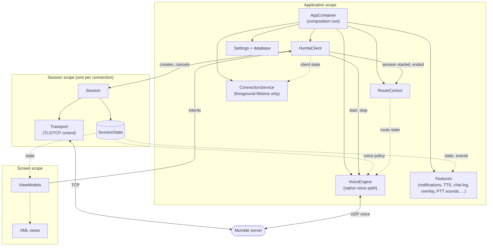
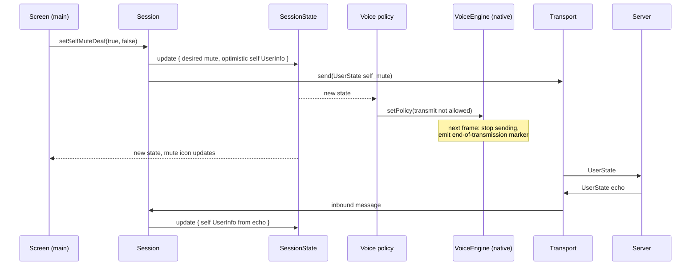

# Target Architecture

Snapshot: `master` at `04a9cf8d`, 2026-11-10. Citations name files and
symbols, not line numbers.

Status: specification in progress. No code exists for any of this.
Nothing here authorizes work; each migration step starts only on explicit
request, once the [open items](open-items.md) that gate it are resolved.

## Relationship to the whales list

The [whales list](../README.md) is deliberately *satisficing*: the smallest
structural fix for each family of symptoms. This specification is the
*optimizing* counterpart: the architecture Mumla OLED would have if it were
designed today, and a path to it. Both share the whales list's admission
bar and its refusal to sweep krill.

## Design goal

Make the correct path the easy path. Today, staying correct in almost any
part of the app means remembering concurrency rules (lock order, which
thread may call what, whether a session or view is still current). In this
architecture those rules are carried by the structure: ownership, lifetimes,
and thread placement are decided once, and ordinary code cannot get them
wrong without visibly breaking the design.

Implementation is not the bottleneck: the `HumlaService` decomposition took
a day and the Java-to-Kotlin migration three. What makes fast changes safe
is **automated verification**: architecture checks, state and virtual-time
tests, the native suite, and the murmur harness (see
[testing](testing.md)). On-device testing is at the developer's discretion,
with snapshot releases as the field test.

## Specification

| File | Specifies |
|---|---|
| [state.md](state.md) | `SessionState` schema, message and intent transitions, self-mute semantics, events, compatibility handles |
| [client.md](client.md) | `HumlaClient` states and reconnect policy; `Session` lifecycle, intents, teardown |
| [transport.md](transport.md) | TCP control channel, TLS, keepalive and UDP health, crypt setup, tunnel mode |
| [voice.md](voice.md) | Native voice path: engine refactor, packet codec, I/O layer, realtime rules, `VoicePolicy`, Kotlin facade |
| [route.md](route.md) | `RouteControl` states, route thread, session start sequence |
| [app.md](app.md) | `AppContainer`, `ConnectionService`, features, screens and ViewModels, settings |
| [enforcement.md](enforcement.md) | Architecture checks in `check.sh`, immutability test, remaining conventions |
| [testing.md](testing.md) | Test layers, murmur interop harness, native suite additions, on-device testing, `PROGRESS.md` |
| [migration.md](migration.md) | Steps and commits, done-when lists, spikes, kill criteria, decisions reversed |
| [open-items.md](open-items.md) | Underspecification tracker: open, gating, and resolved items |

## Overview

Solid arrows are calls or ownership; dotted arrows are state or events
that the receiver collects.

There are three lifetimes: the **application**, a **session** per
connection, and a **screen** per visible UI. Everything belongs to exactly
one of them and is cleaned up when its lifetime ends.

There are two languages with a deliberate line between them. **Kotlin owns
decisions** (who is muted, who we whisper to, which route, whether we are
connected). **Native code owns the voice path** (capture, processing,
encoding, packet framing, encryption, UDP, decoding, mixing, playback).
Kotlin tells native code what it may do; native code never asks Kotlin
anything per frame. Inside the native code, a second line separates the
**no-I/O engine** (bytes and PCM in, bytes and PCM out) from the **I/O
layer** (threads, sockets, devices).

## Components in brief

- **`AppContainer`** builds every application-scoped object by hand; no DI
  framework. ([app](app.md#appcontainer))
- **`HumlaClient`** is the single entry point for connecting. It holds
  `ClientState` (`Idle`, `Connecting`, `Connected`, `Reconnecting`,
  `Failed`), owns today's reconnect policy, and sequences session, route,
  and voice lifetimes. ([client](client.md#humlaclient))
- **`Session`** is one connection: a coroutine scope, a transport, an
  immutable `SessionState`, an event stream, statistics, and the user's
  intents. Ending it cancels its scope. ([client](client.md#session))
- **`SessionState`** is one immutable value (persistent collections),
  changed only by pure transitions inside `update {}`. `UserInfo` carries
  every fact about a user, whoever decided it. ([state](state.md))
- **`Transport`** is the TCP control channel: a reader thread, a writer
  coroutine, keepalive, and the UDP-or-tunnel decision.
  ([transport](transport.md))
- **`VoiceEngine`** is the native voice path: a refactored, single-threaded
  no-I/O engine and packet codec, driven by an I/O layer of capture,
  render, send, receive, and notifier threads joined by lock-free queues.
  Kotlin pushes `VoicePolicy` and settings in through sequence locks.
  ([voice](voice.md))
- **`RouteControl`** is today's route controller on its own thread,
  publishing `RouteState`; voice follows it. ([route](route.md))
- **`ConnectionService`** holds the foreground lifetime and nothing else;
  **features** replace each `MumlaService` responsibility; **screens** get
  ViewModels and collect state. ([app](app.md))

## Threads

| Thread | Runs | May block? |
|---|---|---|
| Main | Views, ViewModels, UI-touching features | Never |
| Client dispatcher | Connection lifecycle transitions | No |
| Default dispatcher | Session message handling, state updates, feature logic | No |
| Voice policy | Mapping `SessionState` to `VoicePolicy` and pushing it native | No |
| I/O dispatcher | TCP writer, database, DataStore | On I/O only |
| TCP reader (one per session) | Blocking socket reads and frame parsing | On the socket |
| Voice control | Starting, stopping, and reconfiguring the voice path | Yes, off main |
| Route | Platform audio-route calls and callbacks | Yes, off main |
| Native capture | Microphone read, policy, encode, framing | On the audio device only |
| Native render | Inbound queues, mix, playback | On the audio device only |
| Native send | Encrypt and send voice and pings | On the socket |
| Native receive | Receive, decrypt, parse, drop locally muted senders | On the socket |
| Native notifier | Talk activity and errors to Kotlin, every 20 ms | No |

Nothing on main ever waits for another thread. Threads communicate by
enqueuing commands or by publishing state that others read.

## Walkthroughs

### Connecting

1. The server list's ViewModel starts `ConnectionService` and calls
   `client.connect(target)`.
2. The client cancels any current session, creates a new `Session`, and
   publishes `Connecting`.
3. The session's `Transport` opens the TLS connection; the session sends
   `Version` and `Authenticate`.
4. Server messages flow into the session. It builds `ServerState`
   privately and publishes it on `ServerSync`. The client publishes
   `Connected(session)`.
5. The client sends `SessionStarted` to `RouteControl` and starts the
   `VoiceEngine` with the session's UDP address and crypt keys. Network
   voice starts at once; capture and playback open when the route is
   `Ready` or `Fallback`.
6. Screens and features, collecting state, show the channel tree.

### The user mutes

The mute is optimistic, preserving the desktop-parity rules recorded in
[optimistic-self-mute](../../optimistic-self-mute/README.md): deafen
implies mute, the echo updates the model, and an echoed self-deafen always
closes the mic (see [state](state.md#self-mute-and-deafen)). The server
also enforces mutes: murmur drops voice from any user who is muted,
suppressed, or self-muted, so the client-side gate is about privacy (audio
never leaves the device) rather than about what other users hear.

### Someone else talks

The native receive thread receives, decrypts, and parses the packet, drops
it if the sender is locally muted, and pushes it onto the inbound queue.
The render thread drains the queue into the output engine, which gives a
new sender a slot from its preallocated voice pool, and mixes the result
into the output. Talk-activity changes reach Kotlin through the notifier
as their own flow, kept out of `SessionState`, which would otherwise change
many times per second.

### A Bluetooth headset connects

The platform callback arrives on the route thread. `RouteControl` moves to
`Settling`, then `Ready` with the headset. The voice control thread,
following `RouteState`, keeps the current streams until `Ready`, then
reopens them on the new device. The engines keep their state. Screens
showing the route update from the same state.

### The network drops

1. The TCP reader hits an I/O error and fails the session.
2. The client stops the `VoiceEngine` (closing its UDP socket and
   discarding the crypt keys), sends `SessionEnded` to `RouteControl`, and
   cancels the session's scope. The scope's completion handler closes the
   TCP socket.
3. The client publishes `Reconnecting(lastState)`, waits out the backoff,
   and creates a fresh `Session`. `ConnectionService` stays in the
   foreground throughout. The connecting walkthrough repeats from step 2.

### A screen closes or rotates

Its lifecycle stops collection. There is nothing to unregister, and no
update can reach a destroyed view.

## What the structure rules out

| Structure | Rules out |
|---|---|
| Immutable `SessionState`, atomic updates | Half-updated reads, locks on model data, observers holding live objects |
| One `Session` per connection | Late events reaching a newer connection; generation counters and stale-event checks |
| Native voice path with pushed `VoicePolicy` | Transmit state split across two languages; per-frame Kotlin work on the realtime path |
| No-I/O engine under a separate I/O layer | I/O creeping into the engine; engine behavior that only a device can test |
| Single-threaded engine fed through lock-free queues | Locks, allocation, and Kotlin calls on realtime audio threads |
| Command-only voice and route control | Main waiting on audio or route work; lock-order deadlocks between main and audio |
| One-directional route → voice dependency | Route and voice waiting on each other |
| `repeatOnLifecycle` collection | Updates on the wrong thread or after a view is destroyed |
| Composition root, features as collectors | Inheritance coupling between app and library; the service-binding layer |
| Architecture checks with a shrinking allowlist ([enforcement](enforcement.md)) | The old patterns quietly creeping back |

## Rejected alternatives

| Alternative | Why rejected |
|---|---|
| **One control loop** owning all non-realtime state | Forces one order on things that have none; a large join sync would queue ahead of mute taps and route events. |
| **Authorities**: state split by who decides it, with joined views for readers | Split `User` by writer even though every reader needs the joined value, then rebuilt the join with extra machinery. |
| **Rules only**: concurrency rules applied across the code | Discipline written down; does not make the wrong path harder. |
| **Per-frame Kotlin transmit decision** (`canTransmit(state)` on the capture thread, as the final design) | Duplicates or fights the stateful native mechanics (voice activity, pre-speech buffer, end-of-transmission marker). Kept only as the interim before step 5a. |
| **Hand-written protobuf encoding** in the native codec | Error-prone to write and maintain; nanopb generates allocation-free code from the same `.proto` file instead. |
| **Leaving the native engine untouched** under the I/O layer | Its locks, callbacks under locks, and per-packet allocation are unsafe on realtime threads; refactoring it while keeping the no-I/O separation is the better trade. |

## Non-goals

- Compose or any UI toolkit change. The views and their pixels stay; the
  [killed Compose rewrite](../../migration/README.md) stays killed.
- Giving the native engine any I/O, or merging the I/O and no-I/O layers.
  Refactoring the engine is in scope.
- Rewriting the native audio or crypt code in Rust or another language.
- Kotlin Multiplatform or an iOS port.
- New features (see the
  [upstream feature gap audit](../../upstream-feature-gap-audit/README.md)).
