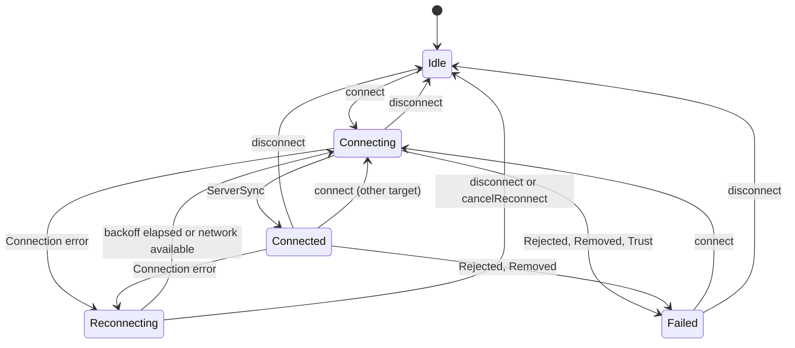

# Client and session

Part of the [target architecture](README.md). Specifies `HumlaClient` (the
connection lifecycle and reconnect policy) and `Session` (one connection,
its scope, its intents, and its teardown).

## `HumlaClient`

Application-scoped. Lives in `se.lublin.humla.client`, which imports no
`android.*`: everything platform-backed reaches it through small
interfaces, so the client runs in plain JVM tests with fakes:
[`NetworkMonitor`](#networkmonitor), `VoiceLifecycle` (implemented by the
`VoiceEngine`: `submit(Start)` and `submit(Stop)`), and `RouteLifecycle`
(implemented by `RouteControl`: `SessionStarted` and `SessionEnded`).

```kotlin
class HumlaClient(
    scope: CoroutineScope,                    // application scope, SupervisorJob
    private val transports: TransportFactory,
    private val voice: VoiceLifecycle,
    private val route: RouteLifecycle,
    private val network: NetworkMonitor,
    private val localFacts: LocalFactsStore,  // local mute/ignore, self mute/deaf (database, settings)
    private val clock: Clock,
) {
    val state: StateFlow<ClientState>

    fun connect(target: ConnectTarget)        // non-blocking
    fun disconnect()                          // non-blocking
    fun cancelReconnect()                     // non-blocking
}
```

All lifecycle logic runs on one **client dispatcher**
(`Dispatchers.Default.limitedParallelism(1)`). The public methods only
launch onto it and return, whatever thread calls them (main, a feature,
a broadcast receiver); there are no binder threads in the target, since
nothing binds a service. This dispatcher handles lifecycle transitions
only (a handful per connection), never server messages or voice, so it
cannot become a bottleneck.

### `ConnectTarget`

Everything a connection needs, frozen when `connect` is called, as today's
`ConnectionParams` snapshot is:

```kotlin
data class ConnectTarget(
    val server: ServerEndpoint,
    val certificate: ClientCertificate?,
    val trustStore: TrustStoreRef?,           // today's ConfigDelta.TrustStoreRef (strings only)
    val forceTcp: Boolean,
    val clientName: String,
    val accessTokens: PersistentList<String>,
)

data class ClientCertificate(                 // replaces ConfigDelta.CertRef, whose ByteArray is mutable
    val pkcs12: ByteString,
    val password: String?,
) { override fun toString() = "ClientCertificate(<${pkcs12.size()} bytes>, password=<redacted>)" }

data class ServerEndpoint(                    // immutable copy of the Room Server row
    val serverId: Long,                       // Server.id: keys local mute/ignore lists and tokens
    val name: String?,
    val host: String,
    val port: Int,
    val username: String?,
    val password: String?,
)
```

The Room `Server` entity has mutable fields (and SRV resolution writes
`resolvedHost`/`resolvedPort` into it today), so the target copies the
fields it needs into `ServerEndpoint` when `connect` is called. SRV
results stay inside the transport.

Local mute/ignore history and the persisted self-mute state are not in the
target; the session loads them from `LocalFactsStore` when it starts, so a
reconnect always uses current values:

```kotlin
data class LocalFacts(
    val mutedUserIds: PersistentSet<Int>,     // registered user IDs, per server
    val ignoredUserIds: PersistentSet<Int>,
    val selfMuted: Boolean,                   // persisted settings, as today
    val selfDeafened: Boolean,
)

interface LocalFactsStore {
    suspend fun load(serverId: Long): LocalFacts
    suspend fun setLocalMute(serverId: Long, userId: Int, muted: Boolean)
    suspend fun setLocalIgnore(serverId: Long, userId: Int, ignored: Boolean)
    suspend fun setSelfMuteDeaf(muted: Boolean, deafened: Boolean)
}
```

The lists are keyed by registered user ID, as in today's database. When a
`UserState` arrives for a registered user, the transition sets
`localMuted`/`localIgnored` on that user's `UserInfo` from these sets, so
session IDs never need to be stored. Unregistered users can be locally
muted for the current session only, as today. Writes run on the I/O
dispatcher in the session scope; the state update does not wait for them.

### `ClientState`

```kotlin
sealed interface ClientState {
    data object Idle : ClientState
    data class Connecting(val target: ConnectTarget, val attempt: Int) : ClientState
    data class Connected(val target: ConnectTarget, val session: Session) : ClientState
    data class Reconnecting(val target: ConnectTarget, val attempt: Int,
        val retryAtMillis: Long, val lastError: ClientError,
        val lastState: ServerState?) : ClientState
    data class Failed(val target: ConnectTarget, val error: ClientError) : ClientState
}

sealed interface ClientError {
    data class Connection(val message: String, val cause: Throwable?) : ClientError  // reconnects
    data class Rejected(val type: Int, val reason: String?) : ClientError           // Reject
    data class Removed(val actor: Int?, val reason: String?, val ban: Boolean) : ClientError
    data class Trust(val chain: PersistentList<X509Certificate>, val failure: HandshakeFailure,
        val verifiedHost: String?) : ClientError                                    // TLS verification
}
```

The client also exposes `currentSession: StateFlow<Session?>`, set as soon
as a session is created and cleared when it ends. While `Connecting`, that
session's state is the `HANDSHAKING` value (no channels or users); the
full tree is published at `ServerSync`, just before `Connected`. Screens
that want the tree simply wait for `SYNCED`.



### Reconnect policy

Unchanged from today's `HumlaService`, now in a pure `ReconnectPolicy`
object tested by the existing `ReconnectBackoffTest` truth table:

- **Which errors reconnect:** only `ClientError.Connection` (today's
  `CONNECTION_ERROR`). `Rejected`, `Removed`, and `Trust` go to `Failed`,
  because the user has to act (a trust prompt, a changed password, a ban).
- **Delays** by attempt number: 1 s, 3 s, 6 s, 12 s, then 25 s for every
  later attempt.
- **Attempt counter:** incremented by each automatic attempt; reset when a
  session reaches `Connected` and when the user disconnects. A manual
  `connect` does *not* reset it: if a manual retry fails, the server is
  still down, so the next automatic attempt keeps the grown delay.
- **Network available:** while `Reconnecting`, a `NetworkMonitor`
  availability event cancels the timer and starts the next attempt
  immediately (incrementing the counter), as today's network callback does.
  Repeated events while `Connecting` are ignored.

### `NetworkMonitor`

```kotlin
interface NetworkMonitor {
    val available: Flow<Unit>                 // emits on each default-network availability
}
```

The app implements it over `ConnectivityManager.registerDefaultNetworkCallback`.
The client collects it only while `Reconnecting`.

## `Session`

One connection. Created by the client for each attempt and never reused.

```kotlin
class Session internal constructor(
    val id: Long,                             // unique per process, for logs and tests
    val target: ConnectTarget,
    parentScope: CoroutineScope,
    transport: Transport,
    localFacts: LocalFacts,                   // loaded before construction
) {
    val state: StateFlow<SessionState>
    val events: SharedFlow<SessionEvent>
    val stats: StateFlow<SessionStats>
    val failure: Deferred<ClientError>        // completes once, when the session fails

    // intents: see below
}
```

- **Scope:** `parentScope` plus a fresh `SupervisorJob`. The message
  coroutine, keepalive timers, and transport writer all run in it.
- **Fields:** all non-null and set at construction.
- **Failure:** any fatal condition (transport I/O error, `Reject`, removal
  of self, protocol violation) completes `failure` exactly once. The client
  awaits `failure` and ends the session.

### Start sequence

1. The client loads `LocalFacts` (local mute/ignore lists for this server,
   persisted self-mute/deafen) from `LocalFactsStore` on the I/O
   dispatcher. If loading fails, the session starts with empty lists and
   the stored self-mute values treated as unset, and the error is logged;
   a database problem never blocks connecting.
2. The client creates the `Transport`, which resolves the host (SRV first,
   with today's lookup and fallback to the plain host name), opens the TLS
   socket, and verifies the certificate. All of this runs on the I/O
   dispatcher inside the attempt's scope, so `disconnect` or a new
   `connect` cancels it; cancellation closes any socket already opened. A
   verification failure completes `failure` with `ClientError.Trust`; any
   other error before the session exists (DNS, connect, TLS I/O) is
   `ClientError.Connection` and reconnects.
3. The client creates the `Session` with phase `HANDSHAKING` and publishes
   `Connecting`.
4. The session sends `Version` and `Authenticate` (username, password,
   access tokens, Opus support) exactly as today's connection-established
   path does.
5. Server messages flow through the session's message coroutine (see
   [state](state.md#sync-phases-and-publication)). `CryptSetup` arrives
   during sync; the transport keeps the keys for the voice start.
6. On `ServerSync`: phase `SYNCED`, state published, the transport starts
   its ping loop, and the session sends the restored self-mute `UserState`
   if one is set.
7. The client publishes `Connected(session)`, sends `SessionStarted` to
   `RouteControl`, and submits `VoiceCommand.Start` with the server's UDP
   address, the crypt keys, the UDP packet format, whether voice starts
   tunnelled, the server's legacy version (for the 1.2.2 codec workaround),
   and the tunnel sink, which is the transport's `sendTunnelled`
   (see [voice](voice.md#kotlin-facade)).
   Codec and input settings reach the `VoiceEngine` from the settings flow,
   not through the client.

### Intents

`Session` exposes the user actions that `IHumlaSession` exposes today. Each
is non-blocking: one atomic state update and/or one enqueued TCP message
(see [state](state.md#user-intents) for the state side).

| Today (`IHumlaSession`) | Target |
|---|---|
| `getSessionId`, `getSessionUser`, `getSessionChannel`, `getUser`, `getChannel`, `getRootChannel`, `getPermissions`, `getServerSettings`, `getServerVersion*`, `getServerRelease`, `getServerOS*` | Read `state.value` (`server.self`, `users`, `channels`, `rootPermissions`, `info`) |
| `getTCPLatency`, `getUDPLatency`, `getMaxBandwidth`, `getCurrentBandwidth` | Read `stats.value` |
| `getTransmitMode`, `getCodec` | Settings (transmit mode) and `state.value.server.info.opus` |
| `isTalking`, `setTalkingState` | `VoiceEngine` talk activity; `setPtt(pressed)` |
| `joinChannel`, `moveUserToChannel` | `joinChannel(id)`, `moveUser(session, channel)` |
| `sendAccessTokens` | `sendAccessTokens(tokens)` |
| `requestPermissions`, `requestComment`, `requestAvatar`, `requestChannelDescription` | `requestPermissions(channel)`, `requestComment(session)`, `requestTexture(session)`, `requestDescription(channel)` |
| `registerUser`, `kickBanUser`, `setPrioritySpeaker`, `setMuteDeafState` | Same names |
| `sendUserTextMessage`, `sendChannelTextMessage` | `sendText(channels, trees, users, message)`; returns nothing: the sent message is emitted as an event so the chat log has one input |
| `setUserComment` | `setComment(session, comment)` |
| `setSelfMuteDeafState` | `setSelfMuteDeaf(mute, deaf)` (see [state](state.md#self-mute-and-deafen)) |
| `linkChannels`, `unlinkChannels`, `unlinkAllChannels` | Same names, taking channel IDs |
| `registerWhisperTarget`, `unregisterWhisperTarget`, `setVoiceTargetId`, `getVoiceTargetId`, `getVoiceTargetMode`, `getWhisperTarget` | `registerWhisperTarget`, `unregisterWhisperTarget`, `setVoiceTarget`; reads from `state.value.local` |
| `setListeningChannel`, `setListeningVolume`, `isListeningToChannel` | `setListening`, `setListeningVolume`; reads from state |

`sendText` emits `TextMessageSent` (see [state](state.md#events)), so the
chat log feature
records both directions from the event stream.

| Today (`IHumlaService`) | Target |
|---|---|
| `registerObserver`, `unregisterObserver` | Collect `client.state`, `session.state`, `session.events` |
| `isConnected`, `getConnectionState`, `getConnectionError`, `getTargetServer` | `client.state` |
| `isReconnecting`, `getReconnectAttempts`, `getReconnectDelay`, `cancelReconnect` | `ClientState.Reconnecting`; `client.cancelReconnect()` |
| `disconnect` | `client.disconnect()` |
| `isBluetoothScoActive`, `isMediaRouteActive`, `retryBluetoothSco` | `route.state`; `route.submit(RouteCommand.RetrySco)` |
| `HumlaSession()` | `(client.state.value as? Connected)?.session`. Today this throws `HumlaDisconnectedException` when disconnected and callers catch it; in the target, a null session is the normal "not connected" case, and ViewModels render it from state |

### Ending a session

The client ends a session on failure, on `disconnect`, and before
connecting to another target. The order is fixed:

1. `voice.submit(VoiceCommand.Stop)`. The voice control thread processes
   commands in order, so the next session's `Start` can only run after this
   stop has closed the UDP socket and discarded the crypt keys.
2. `route.submit(RouteCommand.SessionEnded)`, so nothing captures from a
   route being torn down.
3. Cancel the session's scope. Its completion handler closes the TCP
   socket, which unblocks the transport's reader thread; the reader's last
   send into the closed inbound channel fails harmlessly.
4. Publish the next `ClientState`.

After step 3, nothing can reach the old session's state: its coroutines are
cancelled, its channels are closed, and native code and platform callbacks
never held a reference to it.

### Statistics

```kotlin
data class SessionStats(
    val tcpLatencyMicros: Long?,
    val udpLatencyMicros: Long?,
    val usingUdp: Boolean,                    // from TransportStats
    val currentBandwidth: Int?,               // calculateAudioBandwidth(VoiceStatus.bitrate, framesPerPacket)
    val localCrypt: CryptCounts,              // from VoiceStatus
    val remoteCrypt: CryptCounts,             // from TransportStats (TCP Ping replies)
)

data class CryptCounts(val good: Int, val late: Int, val lost: Int, val resync: Int)
```

The session combines `transport.stats` and `voice.status` into `stats` with
one `combine` collector in its scope. Before voice starts, `localCrypt` is
all zeros. `usingUdp` comes only from the transport, which owns that
decision (see [transport](transport.md#keepalive-and-udp-health)).
`currentBandwidth` uses today's `calculateAudioBandwidth`, moved as is.
The server's bandwidth cap is not a statistic: it lives in
`ServerState.info.maxBandwidth` (see [state](state.md#types)), the single
source for both screens and the encoder. Kept out of `SessionState` because latency
changes every ping.
