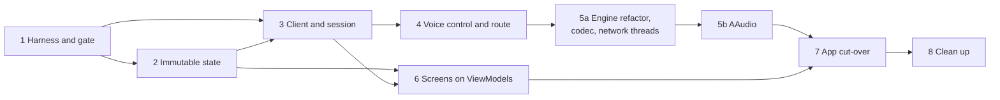

# Migration

Part of the [target architecture](README.md). Specifies the step order,
the commits inside each step, what "done" means, the spikes that gate
steps, the kill criteria, and the decisions this work reverses.

## Ground rules

- Each step runs in its own worktree (`./scripts/worktree.py add …`) and
  lands as atomic commits, each passing `./scripts/check.sh`.
- A step is **done** when its done-when list holds, the allowlist has
  shrunk as stated, and its row in `PROGRESS.md` is updated. On-device
  testing is at the developer's discretion (see
  [testing](testing.md#on-device-testing)). Merging is a separate,
  user-requested action, as always.
- Steps 2–5 are each worth landing alone. Step 6 needs steps 2 and 3.
  Step 7 needs all earlier steps.
- Spikes run in throwaway worktrees before the step that depends on them,
  and their findings are written into the relevant spec file before the
  step starts.

## Step 1 — Harness and gate

1. `scripts/check_architecture.py` with its tests: concurrency tripwire,
   native tripwire, Android-free package check (packages that do not exist
   yet pass trivially). `scripts/architecture-allowlist.txt` seeded with
   today's files and counts. Wired into `check.sh`.
2. Dev shell: `pkgs.murmur`. Test resources: the loopback test certificate
   and key. `:libraries:humla` test dependencies: Robolectric (version
   from the catalog). The `murmurInteropTest` Gradle task and its
   `check.sh` step.
3. Interop scenarios against today's `HumlaConnection` (see
   [testing](testing.md#murmur-interop)).
4. `StateImmutabilityTest` scaffold (walks nothing until step 2) and
   `PROGRESS.md`.

**Done when:** the harness reproduces the stale-callback race fixed in
`2e2a067d` with that fix reverted in a throwaway worktree, and passes on
`master`.

## Step 2 — Immutable state

**Spike first:** live handles (see [state](state.md#compatibility-handles-migration-only))
behind `ChannelListAdapter` on a large-server interop scenario. Confirms
screens keep updating.

1. `kotlinx-collections-immutable` in the version catalog. The state types,
   `ChannelTree`, and their tests.
2. Transitions ported from `ModelHandler`, one message family per commit
   (`ChannelState`/`ChannelRemove`/links; `UserState`; `UserRemove`;
   `PermissionQuery`; `ServerSync`, `ServerConfig`, `Version`,
   `CodecVersion`), each with its existing tests ported.
3. `SessionEvent` emission. A temporary adapter in `:libraries:humla`
   turns events into today's `HumlaLogger` strings, so the chat log keeps
   working; it moves to the app in step 7.
4. `HumlaService` holds a `MutableStateFlow<SessionState>` and applies the
   transitions; `ModelHandler` is deleted.
5. Live handles replace `User` and `Channel` behind `IUser` and
   `IChannel`; `IHumlaObserver` callbacks pass handles.
6. `AudioHandler`'s reads of self and local-mute state come from the state
   flow.

**Done when:** `Channel`, `User`, and `ModelHandler` are off the
allowlist (deleted); `StateImmutabilityTest` walks `SessionState`.

## Step 3 — Client and session

1. `Transport` extracted from `HumlaConnection` and `HumlaTCP`: framing,
   reader thread, writer coroutine, TLS, keepalive, UDP health. It still
   drives today's Kotlin `HumlaUDP` until step 5a.
2. `Session`: scope, message coroutine, intents, statistics.
   `HumlaService` delegates `IHumlaSession` to the current session.
3. `HumlaClient`, `ClientState`, `ReconnectPolicy` (with
   `ReconnectBackoffTest` ported), `NetworkMonitor`. `HumlaService`
   delegates `IHumlaService` to the client.
4. Delete `connectionGeneration`, the connect, reconnect, apply, and
   whisper locks, and `ConnectionParams` (replaced by `ConnectTarget`).

**Done when:** `HumlaConnection` is off the allowlist (deleted), and the
interop harness drives `HumlaClient` directly.

## Step 4 — Voice control and route

1. `RouteControl`: the controller moves to the route `HandlerThread`,
   publishes `RouteState` and events, and `Host` is removed. `ScoLink`
   callbacks use the route executor.
2. Voice control thread: today's `AudioHandler` lifecycle (create, destroy,
   recreate) runs there and follows `RouteState` (see
   [route](route.md#migration-notes)).
3. The policy collector publishes `StateFlow<VoicePolicy>`. Interim
   consumer: the Kotlin capture thread reads it each frame and calls the
   engine's `setMuted`/`setPttTalking` on change (see
   [voice](voice.md#interim-mute-step-4-before-5a)).
4. Delete `mMuteLock` and the documented `AudioHandler` monitor order, and
   `AudioRouteController.shouldDropStaleEvent` (session identity now comes
   from the client's start/stop ordering).

**Done when:** no `join` runs on main; `AudioHandler`,
`AudioRouteController`, and `BluetoothScoManager` are off the allowlist.

## Step 5a — Engine refactor, codec, network threads

1. **Golden fixtures**, recorded from today's engines, committed before any
   engine change.
2. Engine refactor, one concern per commit, each reproducing the golden
   fixtures: input engine (per-frame config, result struct, no locks);
   output engine (voice pool, lookup array, result struct, no locks);
   `jitter.c` slot pool; allocation-count test.
3. Packet codec, in separate commits: the nanopb submodule and
   `pkgs.nanopb` in the dev shell; `scripts/gen_nanopb.sh` with the options
   file; the generated `MumbleUDP.pb.{c,h}` (generated code only); the
   codec itself, with fixtures generated by a JVM test from the Java
   protobuf classes and `PacketBuffer`.
4. `voice_io`: queues, sequence locks, send, receive, and notifier threads,
   capture and render entry points, half-duplex flag; its JNI and the
   Kotlin `VoiceEngine` facade.
5. Switch over: the Kotlin `AudioRecord` and `AudioTrack` threads call the
   entry points; `Transport` sends pings and keys through `VoiceEngine`;
   `VoicePolicy` goes to native code. Delete `HumlaUDP`, the Kotlin framing
   in `AudioHandler`, the Kotlin `CryptState`, and the old JNI bridges.

**Done when:** golden, allocation, codec, loopback, queue, and
sequence-lock tests pass; the native tripwire's step-5a rules are on;
`HumlaUDP` and `CryptState` are off the allowlist.

## Step 5b — AAudio

**Spikes first:** AAudio or Oboe; callback or blocking mode; echo
cancellation through an AAudio session ID (see [open items](open-items.md)).
Spikes run on the developer's device; Android 11–12 is not tested.

1. Native capture and render threads (or AAudio callbacks), opening
   streams with the profile from `RouteState` and reopening on disconnect.
2. Echo cancellation attached to the AAudio session.
3. Delete `AudioInput` and `AudioOutput`; update the audio pipeline
   description in `AGENTS.md`.

**Done when:** `AudioInput` and `AudioOutput` are deleted and the AAudio
path is in daily use without regressions the developer notices against
5a.

## Step 6 — Screens on ViewModels

One screen per commit, in this order: `ServerInfoFragment`,
`AccessTokenFragment`, comment fragments, `ChannelChatFragment`,
`ChannelFragment`, `ChannelListFragment` (with the menus),
`MumlaActivity`. Each commit removes that screen's `IHumlaObserver` and
`HumlaServiceFragment` use (see [app](app.md#screens)).

**Done when:** no screen implements an observer or extends
`HumlaServiceFragment`.

## Step 7 — App cut-over

1. `AppContainer` and the ViewModel factory; storage APIs become `suspend`
   and the `runBlocking` bridges are deleted.
2. Features, one per commit (see [app](app.md#features)); the
   `chat_notify_*` and `deny_reason_*` strings (with their translations)
   move from `:libraries:humla` resources to `:app`, and the step-2
   logging adapter is deleted.
3. `ConnectionService` with the foreground rules; the UI starts it before
   connecting.
4. Delete `MumlaService`, `IMumlaService`, `HumlaService`,
   `HumlaServiceProvider`, `HumlaServiceFragment`, `ConfigDelta`, and the
   service-binding code.
5. Remove Hilt and kapt from both modules.
6. Update the migration README's native fence and binder-surface decisions
   (see [below](#decisions-this-reverses)).

**Done when:** nothing binds a service; the allowlist no longer lists
`HumlaService`, `MumlaService`, `MumlaActivity`, or the storage files.

## Step 8 — Clean up

Delete `IHumlaObserver`, `HumlaCallbacks`, the live handles, `IUser`,
`IChannel`, and any remaining compatibility shims.

**Done when:** the allowlist holds only the boundary files listed in
[enforcement](enforcement.md#concurrency-tripwire).

## Kill criteria

- **Step 1** cannot reproduce a known past race. The harness cannot vouch
  for later steps; fall back to the satisficing
  [whales list](../README.md).
- **Step 2's live-handle spike** shows screen behavior changes the tests
  did not catch. Fix the harness before continuing.
- **Step 4's route sequence** misbehaves with the Bluetooth headset in
  daily use and cannot be fixed within the readiness model. Rethink the
  sequence before step 5.
- **Step 5b** regresses latency, glitches, echo cancellation, or routing in
  daily use and cannot be fixed. Stop at 5a: keep `AudioRecord` and
  `AudioTrack`, which still leaves all transmit state on the native side.
- **Any step:** if a file cannot leave the allowlist without new
  coordination machinery, treat it as a design problem and revisit the
  spec, not the code.

## Decisions this reverses

Updated in the branch of the step that reverses them:

| Decision (where recorded) | Replaced by | Step |
|---|---|---|
| Native fence: "C++ frozen, no behavior touch" ([migration README](../../migration/README.md)) | The engine stays free of I/O; it may be refactored, pinned by golden outputs | 5a (recorded), 7 (README updated) |
| "No Oboe/AAudio" in the audio pipeline description ([`AGENTS.md`](../../../AGENTS.md)) | AAudio (or Oboe, per spike) for capture and playback | 5b |
| Frozen binder surface `IMumlaService`/`IHumlaService`/`IHumlaSession` ([migration README](../../migration/README.md)) | Removed; screens and features collect flows | 7 |
| Hilt as the DI framework ([migration slices](../../migration/slices.md)) | Hand-written `AppContainer` | 7 |
