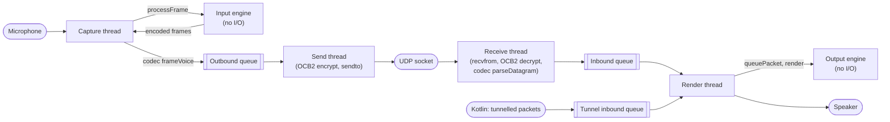

# Voice

Part of the [target architecture](README.md). Specifies the native voice
path: the refactored no-I/O engine, the packet codec, the voice I/O layer,
the realtime rules, `VoicePolicy`, and the Kotlin facade.

## Invariant

**I/O and no-I/O stay separate.** The engine, the packet codec, and OCB2
take bytes and PCM in and give bytes and PCM out. They own no threads,
sockets, or audio devices, which is what makes them exhaustively testable
on the host. Everything that touches a thread, socket, or device lives in
the voice I/O layer. The engine may be refactored; the separation may not
be traded away. A [native tripwire](enforcement.md#native-tripwire)
enforces it.

## Source layout

| Directory | Layer | Contents |
|---|---|---|
| `jni/audio_engine/` | No-I/O | Input and output engines, DSP, VAD, pre-speech buffer, Opus wrappers, jitter buffer (refactored in step 5a) |
| `jni/voice_codec/` | No-I/O | Packet codec (new) |
| `jni/crypto/` | No-I/O | OCB2 (unchanged) |
| `jni/voice_io/` | I/O | Threads, queues, UDP socket, AAudio streams (5b), JNI for `VoiceEngine` (new) |

Paths are relative to
[`libraries/humla/src/main/jni`](../../../libraries/humla/src/main/jni/).
The existing JNI bridges for the engines
(`NativeAudioInputEngineJni.cpp`, `NativeAudioOutputEngineJni.cpp`) and
crypt (`NativeCryptStateJni.cpp`) are deleted when their Kotlin callers are
(steps 5a and 5b); `voice_io` has the only JNI surface for voice.

## Engine refactor

The engine's current shape suits several ordinary Java threads calling it,
not realtime threads. Step 5a changes its shape, not its algorithms.

### Goals

1. **Single-threaded by contract.** One thread drives each engine
   instance. No `std::mutex`, no `std::atomic`, no callbacks.
2. **Outputs as return values.** Results go into caller-provided structs.
3. **No allocation once started.** Every buffer, voice, decoder, and jitter
   slot is allocated when the engine is constructed.
4. **Configuration per call.** The input engine receives its configuration
   with every frame and handles transitions itself.

### Input engine

```cpp
struct InputConfig {
    InputMode mode;              // VOICE_ACTIVITY, PUSH_TO_TALK, CONTINUOUS
    bool transmitAllowed;        // from VoicePolicy
    bool pttPressed;             // from VoicePolicy
    int bitrate;
    int framesPerPacket;
    float amplitudeBoost;
    bool rnnoiseEnabled;
    bool adaptiveLevelerEnabled;
    float vadMax, vadMin;
    uint32_t vadHoldFrames;
    float vadSquelchFloorDb;
};

struct EncodedPacket {           // today's DispatchedPacket
    uint8_t data[kMaxOpusBufferBytes];
    size_t size;
    int frames;
    bool isTerminator;
    uint64_t frameNumber;
};

struct InputFrameResult {
    size_t packetCount;
    EncodedPacket packets[kMaxPacketsPerFrame];
    bool talkingChanged;
    bool talking;
    float peakEnergy;
};

class AudioInputEngine {
public:
    explicit AudioInputEngine(std::unique_ptr<IVoiceEncoder>, std::unique_ptr<IDenoiser>);
    // Realtime: one 10 ms frame (480 samples at 48 kHz).
    void processFrame(const int16_t* pcm, size_t samples,
                      const InputConfig& config, InputFrameResult* out);
    // Control thread only, while stopped:
    void setRnnoiseModel(const uint8_t* data, size_t size);
    void reset();
};
```

- `processFrame` compares `config` with the previous frame's and applies
  transitions first. When `transmitAllowed` goes false mid-utterance, it
  flushes the accumulator as an end-of-transmission packet into `out`,
  exactly as `setMuted(true)` does today.
- `kMaxPacketsPerFrame` covers the pre-speech flush: the pre-speech buffer
  holds 8 frames (`PreSpeechRingBuffer::DEFAULT_CAPACITY_FRAMES`), so at one
  frame per packet a talk start can release 8 packets plus the current one.
  The constant is derived from those two values, not hard-coded.
- Talking-state changes are returned in `out` instead of through
  `TalkingStateCallback`.

### Output engine

```cpp
struct InboundPacket {
    int32_t session;
    uint32_t sequence;
    int flags;                   // talk context
    bool isTerminator;
    uint16_t length;
    uint8_t data[AudioOutputEngine::MAX_PACKET_BYTES];
};

struct TalkEvent { int32_t session; OutputTalkState state; };

struct RenderResult {
    size_t samples;              // 0 when silent, as today
    size_t talkEventCount;
    TalkEvent talkEvents[AudioOutputEngine::MAX_VOICES * 2];
    uint32_t droppedPackets;     // jitter slot pool exhausted
};

class AudioOutputEngine {
public:
    explicit AudioOutputEngine(DecoderFactory factory, int jitterMarginFrames);
    void queuePacket(const InboundPacket& packet);           // render thread
    void render(int16_t* out, size_t samples, RenderResult* result);   // render thread
    void removeUser(int32_t session);                        // render thread
    void clear();                                            // render thread
    void setJitterMarginFrames(int frames);                  // render thread
};
```

- **Voice pool.** `MAX_VOICES` (32, as today) voice slots are created at
  construction, each with its decoder (from the factory) and jitter buffer.
  A new session takes a free slot; when none is free, today's eviction rule
  picks the victim, and its slot is reset and reused
  (`opus_decoder_ctl(OPUS_RESET_STATE)`, jitter reset).
- **Session lookup.** A fixed array of 32 (session, slot) pairs searched
  linearly, replacing the `std::map`.
- **Jitter packet storage.** `jitter.c` allocates every packet's bytes with
  `calloc` today. It is changed to take packet storage from a fixed pool
  shared by all voices: 1024 slots of `MAX_PACKET_BYTES` (2 MiB), owned by
  the output engine. When the pool is exhausted, the incoming packet is
  dropped and counted in `RenderResult.droppedPackets`. The pool size is
  confirmed by a stress test with 32 voices at full jitter adaptation (see
  [testing](testing.md#native-host-suite)).
- **Render quantum.** The I/O layer never calls `render` with more than
  `MAX_QUANTUM_SAMPLES` (60 ms), so the scratch buffers' slow-path resize
  never runs. The engine asserts this in debug builds.
- **Talk events.** Transitions recorded during `queuePacket` (eviction) and
  `render` go into a fixed internal array, returned with the next
  `RenderResult`.

### Allocation sites removed

| Today | Replacement |
|---|---|
| `std::make_unique<Voice>` and `m_voices.emplace` on a new session | Preallocated voice pool |
| Decoder factory call on a new session | Decoders created at construction |
| `jitter_buffer_init` on a new session | Jitter buffers created at construction, reset on reuse |
| `calloc` per packet in `jitter.c` | Shared fixed slot pool |
| `std::map` node allocation | Fixed lookup array |
| `m_mix` / `m_voiceScratch` resize for large quanta | Quantum capped by the I/O layer |
| `pendingEvents` vectors, `m_packetsToDispatch` growth | Fixed arrays in result structs |

### Behavior pinning

Before any refactor commit, step 5a records **golden outputs** from today's
engines on the host: fixed input PCM sequences (speech, silence, PTT
toggles, mid-utterance mute) through the input engine, and fixed packet
sequences (in-order, reordered, lost, terminators, 33 concurrent senders)
through the output engine. The refactored engines must reproduce the
captured packets and mixed PCM exactly. Opus encoding and decoding are
deterministic for identical input and settings, so exact comparison is
possible; any intended difference is a separate, reviewed change.

## Packet codec

A no-I/O component in `jni/voice_codec/`. All functions are pure and
allocation-free, writing into caller buffers.

```cpp
enum class UdpFormat { LEGACY, PROTOBUF };

// Outbound voice: one EncodedPacket -> one datagram payload (unencrypted).
size_t frameVoice(UdpFormat, const EncodedPacket&, uint32_t voiceTarget,
                  uint8_t* out, size_t capacity);

// Outbound ping.
size_t framePing(UdpFormat, uint64_t timestampMicros, uint8_t* out, size_t capacity);

// Inbound: one decrypted datagram -> voice frames, a ping, or nothing.
struct ParsedDatagram {
    enum Kind { VOICE, PING, UNKNOWN } kind;
    int32_t session;
    size_t frameCount;
    InboundPacket frames[kMaxFramesPerDatagram];     // voice
    uint64_t pingTimestamp;                          // ping
    uint64_t serverVersionV2;                        // protobuf ping, 0 if absent
    uint32_t maxBandwidthPerUser;                    // protobuf ping, 0 if absent
};
bool parseDatagram(UdpFormat, const uint8_t* data, size_t length,
                   uint32_t legacyCodecWorkaroundVersion, ParsedDatagram* out);
```

Formats, ported byte-for-byte from today's Kotlin:

- **Legacy voice** (`AudioHandler.onAudioPacketEncoded`,
  `AudioOutput` legacy parsing): header byte
  `(UDPVoiceOpus << 5) | (target & 0x1F)`; then, in Mumble's
  variable-length integer encoding (today's `PacketBuffer.writeLong` /
  `readLong`), the frame number and a size header (`length & 0x1FFF`, bit
  13 = end of transmission); then the Opus payload. Inbound packets carry
  the sender session after the header byte and may chain several
  size/payload pairs; a trailing 12-byte positional block after at least
  one frame ends parsing, as today.
- **Protobuf voice**: a `0x00` type byte, then a `MumbleUDP.Audio` message
  with `target` (only when non-zero), `frame_number`, `opus_data`, and
  `is_terminator` (only when set). Inbound messages use `context`,
  `sender_session`, `frame_number`, `opus_data`, and `is_terminator`; an
  empty `opus_data` with `is_terminator` is still delivered, as today.
  Positional data and `volume_adjustment` are parsed and ignored, as today.
- **Pings**: legacy (`UDPPing` type byte, then the timestamp) and protobuf
  (`0x01` type byte, then `MumbleUDP.Ping`).
- **1.2.2 workaround**: today's `applyLegacyCodecWorkaround`, applied when
  the server's legacy version is `0x10202`.

The protobuf encoding and decoding are hand-written for these two small
messages (field numbers and wire types from
[`MumbleUDP.proto`](../../../libraries/humla/src/MumbleUDP.proto)),
because pulling a protobuf runtime into the native build is not worth it
for two messages. Host tests check them byte-for-byte against the
Java-generated classes.

## Voice I/O layer



### Threads

| Thread | Realtime | Loop |
|---|---|---|
| Capture | Yes | Read 10 ms of PCM; read config and policy; `processFrame`; frame each packet; push to the outbound queue; post the send semaphore; push talk edges to the capture event queue |
| Render | Yes | Drain both inbound queues into `queuePacket`; `render` one quantum (at most 60 ms); push talk events to the render event queue; write PCM to the device |
| Send | No | Wait on the send semaphore; pop packets; UDP: OCB2 encrypt and `sendto`; tunnel: hand the framed packet to Kotlin |
| Receive | No | Blocking `recvfrom`; OCB2 decrypt; `parseDatagram`; voice: drop locally muted senders, push to the inbound queue; ping: report to Kotlin |
| Notifier | No | Every 20 ms while running, drain the capture and render event queues and deliver them to Kotlin in one call |

- In **step 5a**, the capture and render loops are entry points called by
  today's Kotlin `AudioRecord` and `AudioTrack` threads
  (`nativeCaptureFrame(pcm)`, `nativeRender(out)`). In **step 5b**, native
  threads (or AAudio callbacks) call the same entry points. Nothing else
  changes between 5a and 5b.
- **Half duplex** (today's `AudioOutput.setHalfDuplexMuted`): the capture
  thread publishes "self is talking" in one atomic flag owned by the I/O
  layer; while half duplex is enabled in `VoiceSettings` and the flag is
  set, the render thread writes silence instead of the mix. The engines are
  unaware of it.
- The capture entry point accepts any block size (AAudio bursts vary by
  device) and feeds the input engine in exact 10 ms frames, carrying the
  remainder to the next call. The render entry point splits requests larger
  than 60 ms into several `render` calls.
- Non-realtime native threads attach to the JVM once at thread start and
  detach at exit.

### Queues

All queues are fixed-capacity, single-producer single-consumer, lock-free
rings, allocated at start. A full queue drops the new item and increments a
counter reported in `VoiceStatus`; nothing blocks.

| Queue | Producer → consumer | Item | Capacity |
|---|---|---|---|
| Outbound | Capture → send | Framed packet (≤ 1100 bytes) | 64 |
| Inbound | Receive → render | `InboundPacket` | 256 |
| Tunnel inbound | Kotlin tunnel caller → render | `InboundPacket` | 256 |
| Capture events | Capture → notifier | Self talk edge | 64 |
| Render events | Render → notifier | `TalkEvent`, dropped-packet counts | 256 |

The tunnel queue's producer is the session's message coroutine. It is one
coroutine, so it is a single logical producer even though it may resume on
different dispatcher threads; the ring's acquire/release ordering covers
that.

### Policy and settings handoff

Kotlin publishes two values into native code:
- `VoicePolicy` (changes with session state; see [below](#voicepolicy)),
- `VoiceSettings` (changes with user settings: input mode, bitrate, frames
  per packet, amplitude boost, RNNoise, leveler, VAD thresholds, jitter
  margin).

Each is stored in a **sequence lock**: one writer (the JNI call), any
number of readers (capture, receive, render). The writer increments the
sequence to odd, writes, and increments to even; a reader copies the value
and retries if the sequence was odd or changed. Readers never block, and
the copy is a few dozen bytes plus the locally-muted session list
(capacity 256 sessions; a longer list keeps the first 256 and logs).

The capture thread builds `InputConfig` from both values at every frame.
The receive thread reads the locally-muted list. The render thread reads
the jitter margin.

### Realtime rules

1. **The capture and render threads never wait on a lock, allocate, or
   call into Kotlin.** Their only system calls are the audio read or write
   and `sem_post` to wake the send thread. `sem_post` never blocks and
   never allocates, and is the one deliberate exception.
2. **Each engine instance is driven by exactly one thread**: the input
   engine by capture, the output engine by render. Every other thread
   reaches them through the queues or the sequence locks.
3. **Only non-realtime native threads call into Kotlin.**

OCB2's encrypt and decrypt locks stay: they are taken only by the send and
receive threads (and briefly by Kotlin for key changes), never on a
realtime thread.

### Start, stop, reconfigure

Performed by the Kotlin **voice control thread**, in command order:

- **Start:** reset both engines; set crypt keys; create and connect the UDP
  socket; start the send, receive, and notifier threads; start capture and
  render (Kotlin threads in 5a, AAudio streams in 5b) once `RouteState` is
  `Ready` or `Fallback` (see [route](route.md#session-start)).
- **Stop:** stop capture and render; set the stop flag; close the socket
  (unblocks `recvfrom`); post the send semaphore; join the three threads;
  zero the crypt keys; clear the queues.
- **Reconfigure:** settings go through the sequence lock and need no
  restart. The one exception is loading a new RNNoise model, which
  allocates, so it stops capture, loads the model on the control thread,
  and restarts capture.
- **Route change:** restart capture and render streams on the new route;
  the engines keep their state (voices and jitter buffers survive).

The control thread is the only caller of start and stop, so they never race
each other, and it is never the main thread.

## `VoicePolicy`

```kotlin
data class VoicePolicy(
    val transmitAllowed: Boolean,
    val pttPressed: Boolean,
    val voiceTarget: Int,                     // 0 = normal talking
    val locallyMuted: PersistentSet<Int>,     // sessions whose voice is dropped
)

fun voicePolicy(s: SessionState): VoicePolicy {
    val self = s.server.self
    val transmit = s.server.phase == SyncPhase.SYNCED && self != null &&
        !effectiveSelfMute(s) && !self.muted && !self.deafened && !self.suppressed
    return VoicePolicy(
        transmitAllowed = transmit,
        pttPressed = s.local.pttPressed,
        voiceTarget = s.local.voiceTargetId,
        locallyMuted = s.server.users.values.filter { it.localMuted }
            .map { it.session }.toPersistentSet(),
    )
}
```

`effectiveSelfMute` is defined in [state](state.md#self-mute-and-deafen):
the user's desired self-mute wins over the server echo, and a server echo
of self-deafen always closes the gate.

Deafen does not silence playback on the client: murmur stops sending voice
to deafened users, as it does today.

A single collector runs on its own single-thread dispatcher (never the
voice control thread, which can block on stream changes). It maps each
`SessionState` to a `VoicePolicy`, skips unchanged values, and calls
`VoiceEngine.setPolicy`. A mute therefore reaches the gate within one
collector dispatch plus at most one 10 ms frame.

## Kotlin facade

```kotlin
class VoiceEngine(context: Context, settings: Flow<VoiceSettings>, route: StateFlow<RouteState>) {
    fun submit(command: VoiceCommand)         // non-blocking; executed on the voice control thread
    fun setPolicy(policy: VoicePolicy)        // policy collector only
    fun queueTunnelled(packet: ByteArray)     // session message coroutine only
    fun encryptIv(): ByteArray                // for CryptSetup replies
    fun setKeys(keys: CryptKeys)              // CryptSetup with full keys
    fun setDecryptIv(iv: ByteArray)           // CryptSetup resync

    val status: StateFlow<VoiceStatus>
    val talkActivity: StateFlow<TalkActivity>
    val events: SharedFlow<VoiceEvent>
}

sealed interface VoiceCommand {
    data class Start(val host: InetAddress, val port: Int, val keys: CryptKeys,
        val format: UdpFormat, val tunnel: Boolean,
        val legacyServerVersion: Int,
        val tunnelSink: (ByteArray) -> Unit) : VoiceCommand
    data object Stop : VoiceCommand
    data class SetVoiceRoute(val udp: Boolean) : VoiceCommand
    data class SendPing(val timestampMicros: Long) : VoiceCommand
}
```

`VoiceEngine` implements the client's `VoiceLifecycle` and the
transport's `VoiceLink` interfaces (see [client](client.md#humlaclient) and
[transport](transport.md#responsibilities)), so neither depends on the
Android-backed class.

`setKeys`, `setDecryptIv`, and `encryptIv` call OCB2 directly under its own
locks; they need no ordering against stream lifecycle. `SendPing` is
executed by the send thread (the control thread only enqueues it).

### Outputs

```kotlin
data class VoiceStatus(
    val running: Boolean,
    val usingUdp: Boolean,
    val localCrypt: CryptCounts,              // good, late, lost, resync
    val droppedOutbound: Long,
    val droppedInbound: Long,
    val droppedJitter: Long,
    val lastError: String?,
)

data class TalkActivity(
    val selfTalking: Boolean,
    val users: PersistentMap<Int, TalkState>, // TALKING, SHOUTING, WHISPERING; absent = passive
)

sealed interface VoiceEvent {
    data class UdpPing(val timestampMicros: Long, val serverVersionV2: Long?,
        val maxBandwidth: Int?) : VoiceEvent
    data class PipelineError(val message: String) : VoiceEvent
}
```

`talkActivity` is updated by the notifier at most every 20 ms and feeds
screens, the overlay, and features. It is never part of `SessionState`.

## Interim mute (step 4, before 5a)

Before the native path exists, the policy collector publishes a
`StateFlow<VoicePolicy>` instead of calling native code. The Kotlin capture
thread reads its value each frame and calls the current engine's
`setMuted` and `setPttTalking` only when `transmitAllowed` or `pttPressed`
changes. It is the same thread that drives the engine, so there is no
cross-thread contention, and native code keeps owning the
end-of-transmission marker. Step 5a replaces the Kotlin reader with
`VoiceEngine.setPolicy`; the collector and `voicePolicy()` stay.
